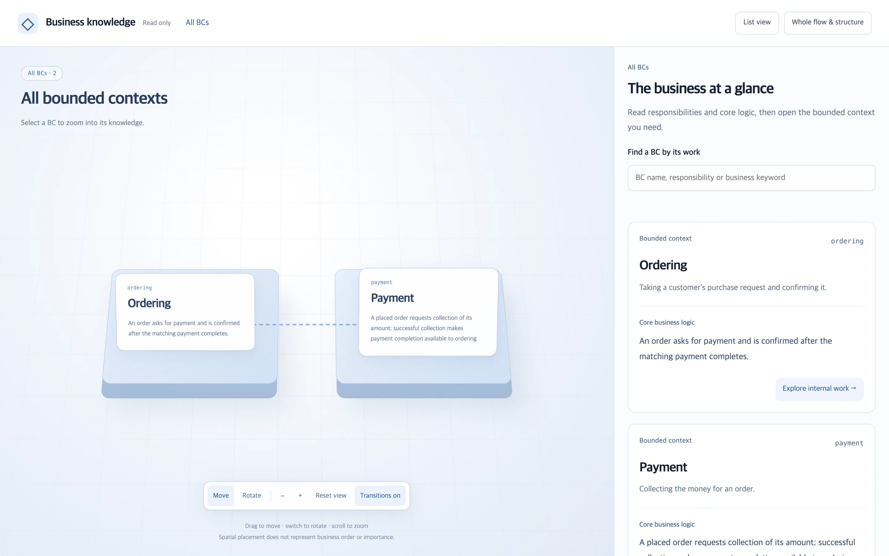
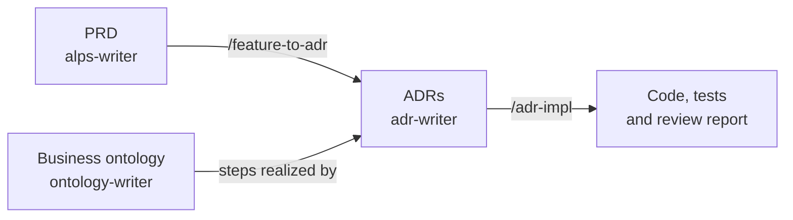
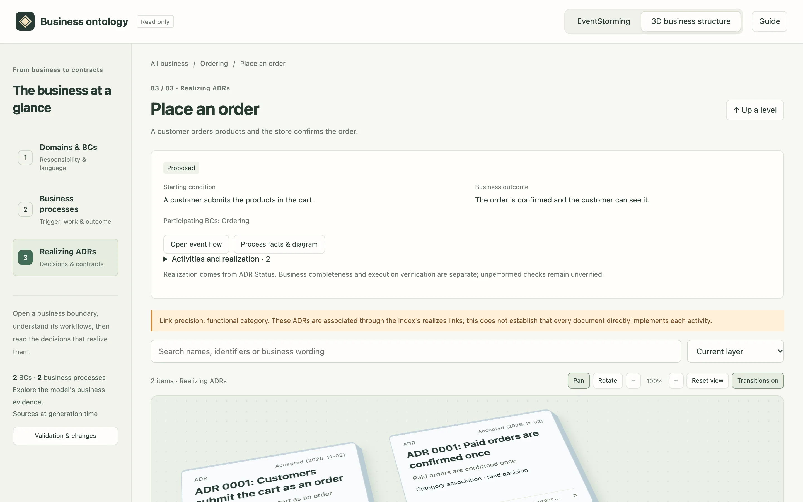
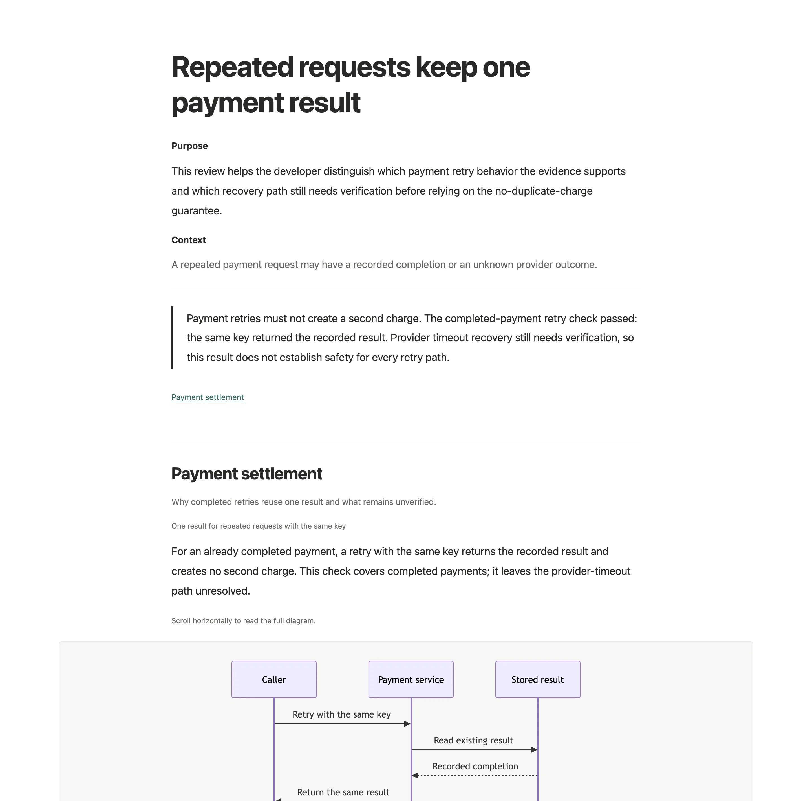

# ALPS Writer Plugins

[](./LICENSE)


Three plugins for Claude Code and Codex that carry intent from a product idea to
working code: write the requirements, keep a model of how the business flows,
record the decisions code must honor, and implement them with evidence.



## The plugins

| Plugin                                                 | What it gives you                                                                                       | Start with                          |
| ------------------------------------------------------ | ------------------------------------------------------------------------------------------------------- | ----------------------------------- |
| [alps-writer](./plugins/alps-writer/README.md)         | A product requirements document (Full or Lite ALPS) written through conversation, section by section    | `/alps-init`, `/lite-alps-init`     |
| [adr-writer](./plugins/adr-writer/README.md)           | Architecture decision records (ADRs), implementation against them, and evidence-backed review reports   | `/adr-new`, `/adr-import`           |
| [ontology-writer](./plugins/ontology-writer/README.md) | An optional model of business flows above the ADRs, with a browsable view and pre-change context checks | `/ontology-build`, `/ontology-view` |

Each plugin installs and works on its own. They connect where their artifacts do:



The Full ALPS → ADR handoff needs alps-writer and adr-writer; an ontology that
reaches ADRs needs ontology-writer and adr-writer.

## Quick start

Requires [Bun](https://bun.sh) 1.4.2 or later. The MCP server, hooks and scripts
run with Bun; nothing else is installed.

**Claude Code**

```text
/plugin marketplace add haandol/alps-writer-plugins
/plugin install alps-writer@alps-writer
/plugin install adr-writer@alps-writer
/plugin install ontology-writer@alps-writer   # only for a business ontology
```

**Codex**

```bash
codex plugin marketplace add haandol/alps-writer-plugins
codex plugin add alps-writer@alps-writer
codex plugin add adr-writer@alps-writer
codex plugin add ontology-writer@alps-writer   # only for a business ontology
```

In Codex, invoke a skill with `$skill-name` (such as `$alps-init`) instead of
`/skill-name`, or ask in plain language. When prompted, review and trust the
plugins' `SessionStart` hooks; they restore short directives on startup, resume,
clear and compaction, and a hook does not run for every user prompt. For Codex on Amazon Bedrock, read the
[ADR Writer troubleshooting](./plugins/adr-writer/README.md#amazon-bedrock-rejects-a-subagent-request)
before running review skills.

## Choose a workflow

| Starting point                               | Commands                                                |
| -------------------------------------------- | ------------------------------------------------------- |
| Define a proof of concept (PoC)              | `/lite-alps-init`                                       |
| Plan a product, then implement it            | `/alps-init` → `/feature-to-adr` → `/adr-impl`          |
| Make an architecture or requirement decision | `/adr-new` → `/adr-impl`                                |
| Document decisions in an existing codebase   | `/adr-import [project-path-or-feature-scope]`           |
| Find the decision that owns a question       | `/adr-search <query>`                                   |
| Model how the business flows across features | `/ontology-build` → `/ontology-edit` → `/ontology-view` |

New ADRs start as `Proposed`. `/adr-impl` implements and tests them and runs
`/adr-impl-review` as its completion gate; a passing review promotes the ADR to
`Accepted`. Changes to requirements or architecture need your confirmation first;
fixes that restore intended behavior and behavior-preserving refactors do not.

## What you see

**Browse the business model** — the business structure view of `/ontology-view`:



**Read a review** — a standalone report from the bundled example:



Reports work offline. Self-check questions are optional, and
the ordinary main-session completion response never prints Q1 or starts grading.
More screenshots are in the [ontology-writer](./plugins/ontology-writer/README.md#the-saved-view)
and [adr-writer](./plugins/adr-writer/README.md#reports-you-can-read) READMEs.

## What belongs in each artifact

The plugins preserve conditions needed to rebuild the system and leave
recoverable facts in code and tests.

| Artifact          | What it owns                                                                                                |
| ----------------- | ----------------------------------------------------------------------------------------------------------- |
| PRD               | User problems, expected outcomes, product requirements, and exclusions                                      |
| Business ontology | How the business flows: events, policies, cross-step rules and terms (optional)                             |
| ADR               | Architecture decisions, exact requirement values and rules, rationale, alternatives, and durable boundaries |
| Code and tests    | Implementation details and executable verification                                                          |
| Issue, PR, commit | Change-specific intent and history                                                                          |

Apply three checks in order:

1. **Requirement gate:** keep any fact whose loss could change required behavior,
   values, permissions, ordering or failure guarantees.
2. **Code-readthrough test:** leave other facts in code when the implementation
   shows them.
3. **ADR admission gate and litmus test:** record durable architectural choices,
   their reasons and trade-offs when code alone cannot explain them.

Rebuilding does not mean recreating the same files or libraries; it means keeping
behavior and constraints. Removing the plugins leaves PRDs, ADRs, models, code and
tests readable on their own: hooks and skills govern artifacts, actions, evidence
and approvals, and leave private reasoning and subagent orchestration to the model.
See the [dependency model](./docs/dependency-model.md) for the reference rules.

## Repository layout

This is a Bun workspace monorepo. Each plugin under `plugins/` ships on its own,
so files two plugins share are kept once under `shared/` and copied into each
plugin by sync scripts; CI fails on a stale copy.

```text
plugins/
├── alps-writer/       # PRD skills and the TypeScript MCP server (committed dist/ bundle)
├── adr-writer/        # ADR skills, hooks, templates, validation scripts, evals
└── ontology-writer/   # ontology skills, hook, Turtle vocabulary, CLI and HTML views
shared/                # canonical files copied into plugins (search, report-writer, reader-profile)
stubs/                 # empty stand-ins for dependencies' unused packages
scripts/               # sync, version, release, test-runner and screenshot scripts
docs/                  # usage guides, ADRs for this repository, README images
```

## Documentation

| Guide                                                                                                                                | Contents                                                                                 |
| ------------------------------------------------------------------------------------------------------------------------------------ | ---------------------------------------------------------------------------------------- |
| [Usage](./docs/usage.md)                                                                                                             | Walkthroughs, all commands, hooks, and the ADR index                                     |
| [ADR process](./docs/adr-process.md)                                                                                                 | Lifecycle, critical command paths, routing, and efficiency review as diagrams (Korean)   |
| [ADR templates](./plugins/adr-writer/templates/adr/)                                                                                 | Authoring rules, directory structure, and index schema                                   |
| [Ontology workflow](./plugins/ontology-writer/docs/workflow.md) · [example](./plugins/ontology-writer/docs/order-payment-example.md) | How business evidence becomes an ontology and reaches ADRs, code and tests (Korean)      |
| [MCP server](./docs/mcp-server.md)                                                                                                   | Use the ALPS server in other Model Context Protocol (MCP) clients; environment variables |

## Development

```bash
bun install
bun run test            # generated-asset checks and every test file
bun run build           # rebuild the committed alps-writer bundle
bun run lint
bun run format:check
bun run docs:screenshots   # regenerate docs/images from the bundled examples
```

The marketplace runs the committed `plugins/alps-writer/dist/` bundle, so include
the rebuilt bundle with any server change, and release with `bun run bump <version>`
so all version sites agree. Skill evaluations are described in the
[evaluation guide](./plugins/adr-writer/evals/skills/README.md); live runs need
`--live` and incur model costs.

## Contributing

Read [CONTRIBUTING.md](./CONTRIBUTING.md) for branch, commit and pull request
conventions, and [AGENTS.md](./AGENTS.md) for architecture and repository rules.
Open an issue before substantial changes.

[Bug reports and feature requests](https://github.com/haandol/alps-writer-plugins/issues) · [MIT License](./LICENSE)
