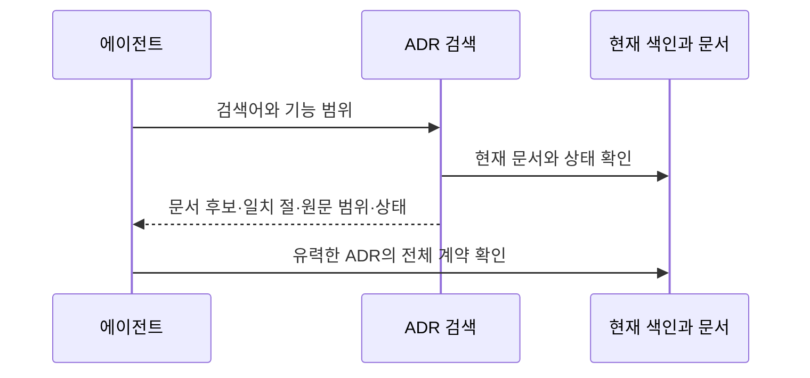

# ADR 0001: 원문과 상태로 이어지는 로컬 ADR 검색

Date: 2026-11-07

## Status

Accepted (2026-11-07)

## Purpose

에이전트는 결정을 바꾸기 전에 그 결정을 소유한 ADR을 찾아 읽어야 한다. 요약이나 연속 문구만으로 찾으면
여러 단어로 표현한 질문, 조사와 결합한 한글, 본문에만 나타나는 조건을 놓칠 수 있다. 긴 문서의 여러 부분이
검색 결과를 차지하면 다른 결정 후보를 확인하는 데도 시간이 든다.

사용자는 별도 데이터베이스 서비스를 운영하지 않는 가벼운 검색과 짧은 명령 실행을 원한다.
방향은 원본 문서에서 재생성하는 로컬 색인으로 관련 후보와 일치 근거를 찾고,
정확한 계약은 해당 ADR 전체에서 확인하는 것이다. 검색 결과와 색인은 승인 상태나 계약의 새 권위가 되지 않는다.

## Decision Drivers

- 색인의 요약에 없는 본문 조건도 찾아야 한다. 표현 순서와 한글 조사 때문에 아는 결정을 놓치지 않아야 한다.
- 검색 결과에서 원문 위치와 상태를 확인하고, 그 부분이 왜 선택됐는지 알 수 있어야 한다.
- 검색 때문에 별도 서비스나 모델 호출, 문서의 두 번째 영속 저장소를 운영하지 않는다.
- ADR Writer는 독립 설치되고, 업무 온톨로지나 다른 플러그인의 존재를 검색 조건으로 삼지 않는다.

## Decision

ADR Writer는 현재 ADR 색인에 등록된 문서를 읽는 로컬 검색을 제공한다. 사용자는 검색어와 필요할 때 기능 범위를
지정하고, 검색은 관련된 문서와 그 안의 일치 부분을 반환한다. 검색 단위는 문서의 절이며,
문서의 제목과 색인 요약도 함께 고려한다. 검색 결과의 문서 경로와 절·원문 범위로 전체 계약을 확인한다.

일반 검색은 공백으로 구분한 모든 단어가 같은 검색 단위에 있는 후보를 찾되 단어 순서를 강제하지 않는다.
큰따옴표로 묶은 문구는 연속 일치를 요구한다. 유니코드 호환 표기, 대소문자와 공백 차이를 정규화하고,
짧은 한글과 조사 결합을 포함한 부분 문자열 일치를 보존한다. 확인되지 않은 동의어나 업무 관계를 만들어 검색하지 않는다.

정확한 문서 식별과 제목 일치를 우선하고, 본문 일치의 관련도로 순서를 정한다. 같은 문서의 여러 일치는
하나의 문서 후보로 묶어 일치 부분에 접근하게 한다. 관련도는 승인이나 구현 완료의 증거가 아니며,
검색 결과가 전체 결정이나 필수 선행 조건을 확인했다는 뜻도 아니다. 기존의 전체 ADR 색인 및 유력한 ADR 본문 읽기는 유지한다.

로컬 색인은 원본의 파생 캐시다. 같은 원본과 입력에서 같은 결과를 제공하고, 원본의 추가·변경·삭제·이동을
현재 검색에 반영한다. 캐시가 없거나 사용할 수 없어도 현재 원본으로 동일한 검색을 수행한다.
원본을 해석할 수 없는 경우에는 그 위치와 미확인 범위를 알리고 불완전한 검색을 완전한 결과로 표시하지 않는다.

### Requirement contract

#### Required guarantees

| 의무                                                                                                                     | 관찰 가능한 검증 기준                                                                                                 |
| ------------------------------------------------------------------------------------------------------------------------ | --------------------------------------------------------------------------------------------------------------------- |
| R1. 검색은 현재 ADR 색인에 등록된 문서의 제목·요약·본문 절을 대상으로 하고, 지정한 기능 범위를 지킨다.                   | 요약에 없는 본문 단어로도 후보를 찾고, 범위 밖 문서는 후보로 반환하지 않는다.                                         |
| R2. 일반 다중어 입력은 같은 검색 단위 안의 모든 단어를 순서와 무관하게 찾고, 큰따옴표 문구는 연속 일치로 찾는다.         | 떨어져 있거나 순서가 바뀐 단어는 일반 검색으로 찾으며, 같은 입력을 연속 문구로 지정하면 그 문구가 없는 절은 제외된다. |
| R3. 검색은 유니코드 호환 표기·대소문자·공백 차이를 정규화하고, 한두 글자 한글과 조사 결합을 포함한 부분 일치를 보존한다. | 표기 차이가 있는 같은 문구와 문장 안의 짧은 한글을 찾고, 영문 대소문자만 바뀌어도 결과가 같다.                        |
| R4. 문서 식별·제목의 직접 일치를 우선하고 본문 관련도를 반영하며, 같은 원본·입력의 동률 순서는 일정하다.                 | 본문에서 우연히 단어가 나온 후보보다 직접 지정한 문서나 제목이 앞서고 반복 조회의 순서가 같다.                        |
| R5. 한 문서의 일치 부분은 하나의 문서 후보로 묶고, 크기가 제한된 페이지에 전체 문서 개수·반환 범위·다음 조회를 제공한다. | 긴 문서의 여러 절이 독립 문서처럼 첫 페이지를 차지하지 않고, 모든 페이지를 이어 읽으면 후보가 누락·중복되지 않는다.   |
| R6. 후보는 문서 경로·일치 절·원문 범위·상태·일치 이유를 제공한다.                                                        | 검색 결과에서 원문을 확인하고 어떤 부분이 검색어와 일치했는지 알 수 있다.                                             |
| R7. 파생 색인은 현재 원본의 추가·수정·삭제·이동을 반영하고, 캐시를 지우거나 재생성해도 결과와 원문 근거가 같다.          | 원문 변경 후 오래된 후보나 위치가 남지 않으며 재생성 전후 같은 입력의 결과가 같다.                                    |

#### Prohibitions

| 의무                                                                                                                     | 관찰 가능한 검증 기준                                                                |
| ------------------------------------------------------------------------------------------------------------------------ | ------------------------------------------------------------------------------------ |
| R8. 검색은 원본 문서·색인·상태·승인 기록을 변경하지 않고, 관련도나 검색 부재를 계약·승인·업무 부재의 증거로 쓰지 않는다. | 검색 전후 원본이 같고, 결과는 탐색 후보임을 밝히며 상태가 점수 때문에 바뀌지 않는다. |
| R9. 검색은 외부 서비스·모델 호출 없이 동작하고, ADR Writer가 업무 온톨로지를 읽거나 다른 플러그인을 요구하지 않는다.     | 독립 설치와 네트워크 없는 환경에서도 ADR 검색이 같은 결과를 낸다.                    |

#### Failure guarantees

| 의무                                                                                                                                   | 관찰 가능한 검증 기준                                                                        |
| -------------------------------------------------------------------------------------------------------------------------------------- | -------------------------------------------------------------------------------------------- |
| R10. 캐시 생성·읽기·동시 접근 실패는 현재 원본에서 수행하는 같은 검색으로 복구하며, 다른 작업의 원본이나 색인 결과를 섞지 않는다.      | 사용할 수 없는 캐시와 다른 작업 트리의 동시 조회에서도 해당 원본의 결과를 얻는다.            |
| R11. 해석할 수 없는 ADR 색인, 읽지 못한 문서와 상태 불일치는 위치와 미확인 범위로 드러내며, 해당 검색을 완전한 결과로 표시하지 않는다. | 원본이나 상태가 잘못된 입력에서 진단이 보이고, 빈 결과가 정상 검색 성공으로 표시되지 않는다. |
| R12. 잘못된 검색 입력은 입력 오류로 알리고 원본에 영향을 주지 않는다.                                                                  | 닫히지 않은 문구나 잘못된 페이지 입력은 사용 오류로 끝나며 원본은 그대로다.                  |

### Alternatives

- **에이전트의 파일 검색에 맡기기**: 별도 검색 계약이 필요 없지만 원문 위치·관련도·문서 중복 제거가 작업마다 달라진다.
- **원본에서 재생성하는 로컬 검색 색인 (채택)**: 서비스 운영 없이 같은 검색과 근거를 제공한다. 원본 현재성과 캐시 실패 복구를 유지해야 한다.
- **외부 의미 검색 서비스에 문서를 올리기**: 표현이 다른 후보를 찾는 데 도움이 될 수 있지만 외부 의존과 문서 전달 경계가 생기며 이번 로컬 검색의 조건에 맞지 않는다.

## Consequences

### Positive

- 에이전트는 본문 조건을 포함해 결정을 찾고 원문 계약으로 바로 내려간다.
- 문서 단위 후보와 제한된 페이지로 처음 읽을 범위를 고른다.
- 캐시를 제거하거나 플러그인을 제거해도 원본 결정과 상태가 남는다.

### Negative

- 표현이 전혀 다른 동의어는 원문에 대응 표현이 없으면 찾지 못할 수 있다.
- 짧고 흔한 단어는 많은 후보를 만들 수 있으며, 관련도만으로 읽기 완료를 판단할 수 없다.
- 원본의 현재성을 확인하는 비용은 남으므로 검색 시간과 반환량은 실제 자료에서 관찰한다.

## Related

- [같은 결정의 현재 상태 유지](../current-state/0001-record-only-the-final-decision-state.md)
