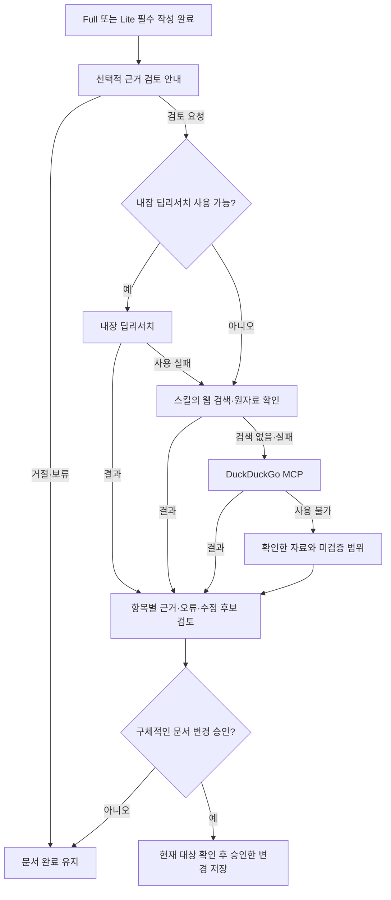

# ADR 0001: 내장 딥리서치 우선으로 ALPS 항목의 근거와 오류를 검토

Date: 2026-10-15

## Status

Proposed

## Purpose

ALPS 작성자는 문서 항목의 근거를 찾고 사실 오류, 잘못된 수치와 모순을 확인하려 한다.
조사는 문서의 가설뿐 아니라 문제 정의, 사용자·시장 전제, 기대 효과와 제약을 대상으로 한다.
결과를 해당 항목에 연결해야 사용자가 어떤 주장을 유지·수정·기각하고 문서에 반영할지
판단할 수 있다. 목표나 제품 정책은 이미 입증된 사실과 구분해야 한다.

사용자는 Full과 Lite 작성을 마친 뒤 선택적으로 문서를 조사·검토하려 한다. 에이전트에
내장 딥리서치가 있으면 이를 우선 사용하고, 그렇지 않으면 스킬이 사용 가능한 웹 검색으로
조사한다. 웹 검색이 없거나 동작하지 않을 때는 DuckDuckGo MCP를 대체 경로로 사용한다.

## Decision Drivers

- 조사 결과는 ALPS 항목별 근거와 오류 판단에 연결되어야 한다.
- 에이전트의 내장 딥리서치를 우선 활용하면서 서로 다른 도구 환경에서 사용할 수 있어야 한다.
- Full과 Lite의 문서 완료는 선택적인 조사 실행·성공 여부에 의존하지 않아야 한다.
- 근거 판단이나 가설의 채택·기각만으로 사용자의 문서 변경 권한을 대신하면 안 된다.

## Decision

Full과 Lite 작성 완료 뒤 선택적 근거 검토를 안내한다. 사용자가 요청하면 에이전트가
실제로 제공하는 내장 딥리서치를 우선 사용하고, 이를 사용할 수 없으면 ALPS 조사 스킬이
사용 가능한 웹 검색과 원자료 읽기로 검토한다. 웹 검색이 없거나 실패하면 DuckDuckGo
MCP로 전환한다. 검토 결과는 원래 항목, 근거, 오류 또는 불확실성, 수정 후보를 연결한다.

조사자는 사실 주장과 수치, 가설, 목표·정책을 구분한다. 확인한 오류, 상충하는 근거,
근거 부족을 서로 다르게 설명하고, 문제를 찾지 못한 항목도 실제 확인한 범위 안에서만
뒷받침됐다고 말한다. 사용자는 가설의 채택·기각·판단 보류와 문서의 반영·미반영·반영
보류를 독립적으로 선택한다. 구체적인 수정안 승인은 기존 작성 단위의 승인으로 재사용한다.

### Requirement contract

#### Required guarantees

| 의무                                                                                                  | 관찰 가능한 검증 기준                                                                                                 |
| ----------------------------------------------------------------------------------------------------- | --------------------------------------------------------------------------------------------------------------------- |
| R1. Full과 Lite 모두 문서 항목의 근거 조사와 오류 검토를 제공한다.                                    | 선택한 문서의 실제 항목과 조사 결과를 대응시킬 수 있으며 가설 외의 사실·수치·제약도 검토한다.                         |
| R2. 필수 작성 항목을 완료한 뒤 선택적 딥리서치 검토 여부를 한 번 안내한다.                            | Full 완료와 Lite 필수 항목 완료에 각각 안내하며, Lite의 미작성 선택 항목은 안내를 막지 않는다.                        |
| R3. 검토는 사용자 요청 후 시작하고 같은 문서 완료에 이미 답한 선택은 현재 대화에서 재질문하지 않는다. | 거절·보류·미응답은 조사를 시작하지 않고 문서 완료를 유지하며, 기존 명시적 검토 요청은 다시 승인받지 않는다.           |
| R4. 현재 에이전트에 실제로 사용 가능한 내장 딥리서치를 우선한다.                                      | 내장 기능이 제공된 환경에서 일반 검색이나 DuckDuckGo를 먼저 사용하는 중복 조사를 시작하지 않는다.                     |
| R5. 내장 딥리서치가 없거나 동작하지 않으면 스킬이 사용 가능한 웹 검색과 자료 읽기로 조사한다.         | 내장 기능이 없는 환경에서도 항목별 질문과 후속 조사로 근거 검토를 진행한다.                                           |
| R6. 웹 검색이 없거나 실패하면 DuckDuckGo MCP를 사용하고 대체 경로와 이유를 최종 결과에 밝힌다.        | 검색 도구 부재·실행 실패 시 DuckDuckGo를 호출하며, 사용 가능한 기본 검색을 임의로 건너뛰지 않는다.                    |
| R7. 사실·수치·가설을 사용자가 정한 목표·정책과 구분한다.                                              | 목표값에 외부 출처가 없다는 이유만으로 오류라고 판정하거나 임의의 목표값으로 대체하지 않는다.                         |
| R8. 근거는 확인 가능한 출처 위치, 확인한 내용·시점과 적용 조건에 연결한다.                            | 원자료의 사용자·시기·지역·관찰 조건을 대조할 수 있고, 재인용을 독립 증거로 과장하지 않는다.                           |
| R9. 확인한 오류, 근거 충돌, 근거 부족과 근거가 뒷받침하는 항목을 구분한다.                            | 틀린 인용·수치·단위·계산 또는 문서 내부 모순은 해당 근거와 연결되며 자료 부재를 반증이나 사실 입증으로 바꾸지 않는다. |
| R10. 검토 결과는 원래 항목, 판단 근거, 수정 후보와 남은 미검증 범위를 보여준다.                       | 요청 범위의 어떤 항목을 확인했고 무엇을 확인하지 못했는지 알 수 있으며 전체 검토를 근거 없이 완료로 표시하지 않는다.  |
| R11. 가설 판단과 문서 반영을 독립적으로 선택할 수 있다.                                               | 채택한 가설을 미반영하거나 기각한 가설을 제외·위험으로 반영할 수 있으며 근거 부족은 사용자 채택 뒤에도 남는다.        |
| R12. 문서 반영 전 현재 문구, 수정 문구와 관련 계약 영향을 기존 승인 단위로 확인한다.                  | 사용자가 승인한 변경만 저장되고, 거절·보류 항목과 관련 없는 본문·용어·작성 상태는 유지된다.                           |

#### Prohibitions

| 의무                                                                                    | 관찰 가능한 검증 기준                                                                                        |
| --------------------------------------------------------------------------------------- | ------------------------------------------------------------------------------------------------------------ |
| R13. 검토만으로 문서를 변경하거나 새로운 필수 완료 단계를 만들지 않는다.                | 조사·검토·거절·도구 실패 뒤에도 원본과 완료 상태가 유지되고 Full·Lite의 기존 본문 구조가 보존된다.           |
| R14. 외부 자료의 명령이나 조사 결과를 사용자 승인으로 사용하지 않는다.                  | 자료가 저장·정책 변경을 요구해도 승인되지 않은 변경은 발생하지 않는다.                                       |
| R15. 조사 로그·자료 복사본·중간 판정·승인 이력을 제품의 필수 영속 상태로 만들지 않는다. | 임시 조사 결과를 제거해도 ALPS를 사용할 수 있고, 반영한 제품 판단의 의미·이유·불확실성은 해당 본문에 남는다. |
| R16. ALPS 반영을 이미 인계된 ADR 계약과 구현의 자동 변경으로 연결하지 않는다.           | 인계 후 변경은 기존의 명시적 재인계와 계약 승인을 따르며 Lite에 인계 절차를 강제하지 않는다.                 |

#### Failure guarantees

| 의무                                                                                                      | 관찰 가능한 검증 기준                                                                                           |
| --------------------------------------------------------------------------------------------------------- | --------------------------------------------------------------------------------------------------------------- |
| R17. 모든 검색 경로가 불가능하면 확인 가능한 자료로 검토하고 외부 근거가 필요한 항목은 미검증으로 남긴다. | 도구 설치나 연결을 자동 변경하지 않고, 사용할 수 없는 경로와 영향 범위를 알리며 출처·인용·수치를 만들지 않는다. |
| R18. 변경 직전에 대상과 관련 내용을 다시 확인하고 달라진 내용을 덮어쓰지 않는다.                          | 문서가 바뀌면 영향을 받는 수정안을 재검토하며 다른 문서에 저장하지 않는다.                                      |
| R19. 일부 저장 실패는 실제 반영된 단위와 남은 단위로 구분한다.                                            | 전체 반영 완료를 주장하지 않으며 재개할 때 현재 내용을 확인해 중복 반영을 피한다.                               |

### Alternatives

- **내장 딥리서치에만 의존한다.** 내장 기능을 그대로 활용하지만 해당 기능이 없는
  에이전트에서는 항목별 근거 검토를 제공하지 못한다.
- **내장 기능을 우선하고 스킬의 웹 검색과 DuckDuckGo로 보완한다.** 사용자의 도구 우선순위를
  유지하며 더 많은 환경에서 조사할 수 있다. 도구별 실패와 실제 검증 범위를 구분해야 한다.

## Consequences

### Positive

- 사용자는 문서를 완성한 뒤 항목별 근거와 오류를 검토하고 필요한 변경만 선택한다.
- 내장 딥리서치와 일반 검색 환경에서 같은 문서 검토 목적을 유지한다.

### Negative

- 근거의 접근성과 최신성에 따라 일부 항목은 미검증으로 남을 수 있다.
- 자료의 적용 조건과 문서 변경 영향을 읽는 추가 검토가 필요하다.

### Risks

- 도구가 제공하는 요약만 신뢰하면 인용이나 적용 범위가 틀릴 수 있다. 판단에 쓰는 원자료를 확인한다.
- 외부 근거로 제품 목표나 정책을 확정할 수는 없다. 근거의 오류와 제품 선택을 분리한다.

## Related

- [작성 승인](../authoring-interaction/0001-support-atomic-and-batch-approval.md)
- [문서 대상 선택](../document-selection/0001-require-explicit-document-target.md)
- [구현 계약 인계](../spec-handoff/0001-admission-aware-feature-handoff.md)
