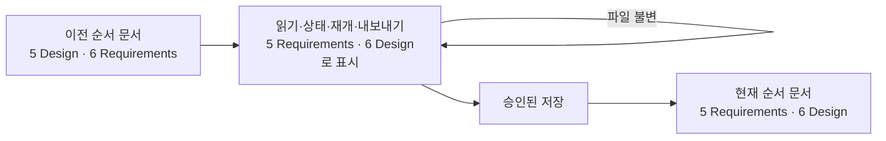

# ADR 0001: Full ALPS를 Section 번호 순서대로 작성

Date: 2026-11-23

## Status

Accepted (2026-11-23)

## Purpose

Full ALPS의 Design Specification은 Requirements Summary가 정한 Feature ID를 재사용한다. Design이
Section 5이고 Requirements가 Section 6이면 작성자는 Section 4 다음에 6을 쓰고 5로 돌아와야 한다.
작성자, 사용자와 에이전트가 Section 번호와 다른 작성 순서를 따로 기억해야 하고, 재개 지점과 검토
순서도 문서를 위에서 아래로 읽는 순서와 어긋난다.

Requirements Summary를 Section 5, Design Specification을 Section 6으로 두면 Feature ID를 먼저
정의한 뒤 화면 설계와 Feature 명세가 그 ID를 재사용하고, 문서를 Section 번호 순서대로 작성하고
읽을 수 있다.

이미 작성된 Full 문서는 Section 5가 Design, Section 6이 Requirements인 순서로 저장되어 있다.
사용자가 긴 Full 문서를 다시 작성하거나 내용을 잃어서는 안 되며, 사용자가 승인하지 않은 저장으로
원본 파일이 바뀌어서도 안 된다.

## Decision Drivers

- Full 작성 순서는 Section 번호 순서와 같아야 한다.
- Design Specification과 Feature 명세는 먼저 승인된 Feature ID를 재사용해야 한다.
- 이전 순서로 작성된 Full 문서는 내용 손실이나 재작성 없이 계속 쓸 수 있어야 한다.
- 승인된 저장 전에는 원본 파일이 바뀌지 않아야 한다.

## Decision

Full ALPS의 Section은 다음 순서이며 작성 순서는 `1 → 2 → 3 → 4 → 5 → 6 → 7 → 8 → 9`다.

1. **Overview**
2. **MVP Goals and Key Metrics**
3. **Demo Scenario**
4. **High-Level Architecture**
5. **Requirements Summary** — `5.1 Core Features (Functional Requirements)`,
   `5.2 Non-Functional Requirements`, `5.3 Feature Dependency Diagram`
6. **Design Specification** — `6.1 User Flow and Page Structure`(`6.1.1 Key Pages (Features)`,
   `6.1.2 Page Navigation`)
7. **Feature-Level Specification** — Section 5.1의 Feature마다 하나의 `7.x`
8. **MVP Metrics**
9. **Out of Scope**

Section 6 작성자는 Section 5를, Section 7 작성자는 Section 3과 5를, Section 8 작성자는 Section 2와
5를 먼저 읽는다. Section 7의 Feature 완료 판정은 Section 5.1에 선언된 Feature ID를 기준으로 한다.

이전 순서의 Full 문서는 Section 5 제목이 `Design Specification`이고 Section 6 제목이
`Requirements Summary`인 문서다. 서버는 이 문서를 거부하지 않고 읽기, 상태 조회, 재개와 내보내기에서
두 Section과 그 subsection 번호를 현재 순서로 바꿔 보여 준다. 이때 파일은 바뀌지 않는다. 첫 승인된
저장은 문서 전체를 현재 순서로 기록하며, 두 Section의 모든 내용, 다른 Section, 용어집과 문서
속성을 그대로 보존한다.

### Requirement contract

| 의무                                                                                                                                    | 관찰 가능한 검증 기준                                                                                                                  |
| --------------------------------------------------------------------------------------------------------------------------------------- | -------------------------------------------------------------------------------------------------------------------------------------- |
| Full ALPS의 Section 5는 Requirements Summary, Section 6은 Design Specification이며 나머지 Section 번호와 제목은 그대로다.               | 새 Full 문서의 Section 5·6 제목과 subsection 번호가 Decision의 목록과 같다.                                                            |
| Full 작성 순서는 `1 → 9`의 Section 번호 순서다.                                                                                         | 템플릿 overview, 스킬과 서버 안내가 같은 순서를 제시하고, 재개는 이 순서상 첫 미완료 Section에서 시작한다.                             |
| Design Specification과 Feature-Level Specification은 Section 5.1의 Feature ID를 재사용하고, MVP Metrics는 Section 5.2의 NFR을 검증한다. | Section 6·7·8 작성 전 Section 5를 읽고, Section 7 완료 판정이 Section 5.1의 Feature ID를 기준으로 한다.                                |
| Feature 분할은 Section 5와 Section 7의 Feature 경계를 함께 바꾼다.                                                                      | 분할 뒤 Section 5.1의 Feature 목록과 Section 7의 Feature가 일치한다.                                                                   |
| 이전 순서의 Full 문서는 읽기, 상태 조회, 재개와 내보내기에서 현재 순서로 보인다.                                                        | 이전 순서 문서를 읽으면 Section 5가 Requirements Summary로, Section 6이 Design Specification으로 보이고 subsection 번호도 함께 바뀐다. |
| 이전 순서 문서의 읽기, 상태 조회, 재개와 내보내기는 파일을 바꾸지 않는다.                                                               | 이 동작 전후의 파일 내용이 같다.                                                                                                       |
| 이전 순서 문서의 첫 승인된 저장은 문서 전체를 현재 순서로 기록하고 모든 내용을 보존한다.                                                | 저장 뒤 파일의 Section 5·6이 현재 순서이고, 이전 Section 5·6의 모든 subsection 내용, 다른 Section, 용어집과 문서 속성이 남아 있다.     |
| Section 번호를 쓰는 기존 규칙은 같은 Section 내용에 대해 그대로 적용된다.                                                               | Feature 커버리지, Lite 출처 파생, NFR focus set과 데모 연결이 바뀐 번호의 같은 Section을 가리킨다.                                     |

#### Failure guarantees

- Section 5와 6 중 한쪽 제목만 이전 순서와 일치하는 Full 문서는 변환하지 않고 저장된 번호 그대로
  읽는다.
- 이전 순서 문서의 Section 5·6에 서버가 인식하지 못하는 내용이 있으면 저장을 거부하고 파일을 바꾸지
  않는다. 거부 결과는 읽기, 상태 조회와 내보내기가 계속 동작함과, 그 내용이 있는 파일의 Section을
  모두, 그리고 그 내용을 subsection 안으로 옮기거나 문서 밖으로 뺀 뒤 다시 저장하는 다음 행동을
  알린다.

### Alternatives

1. **번호를 유지하고 작성 순서만 `6 → 5`로 둔다**
   - 장점: 문서 형식이 바뀌지 않는다.
   - 단점: 작성 순서와 Section 번호가 계속 다르다.

2. **번호를 유지하고 Design을 Feature ID 없이 먼저 쓴다**
   - 장점: 문서 형식이 바뀌지 않으면서 작성이 선형이 된다.
   - 단점: 화면 설계가 기능 목록보다 앞서고, Feature가 화면을 거꾸로 참조해야 한다.

3. **Section 5·6 번호를 교환하고 이전 순서 문서를 읽을 때 변환한다**
   - 장점: 작성 순서와 번호가 같고 기존 문서를 재작성 없이 쓴다.
   - 단점: 서버가 이전 순서를 인식하고 첫 저장에서 문서를 다시 기록해야 한다.

4. **Section 5·6 번호를 교환하고 이전 순서 문서를 거부한다**
   - 장점: 구현이 단순하다.
   - 단점: 사용자가 긴 Full 문서를 다시 작성해야 한다.

## Consequences

### Positive

- 사용자와 에이전트가 Full 문서를 Section 번호 순서대로 작성하고 읽는다.
- Feature ID가 화면 설계와 Feature 명세보다 먼저 정해진다.
- 기존 Full 문서를 재작성 없이 계속 쓴다.

### Negative

- 이전 순서 문서는 첫 저장에서 Section 5·6의 위치가 바뀌므로 파일 diff가 커진다.
- Section 번호를 인용하던 외부 문서나 메모는 새 번호로 읽어야 한다.

### Risks

- 이전 순서 판별이 틀리면 Section 내용이 엉뚱한 번호로 보일 수 있다. 두 제목이 모두 이전 순서와
  일치할 때만 변환한다.

## Related

- [ALPS 작성 승인 방식](../authoring-interaction/0001-support-atomic-and-batch-approval.md)
- [Full 기술 요구사항을 Lite 비즈니스 요구사항에서 파생](../requirement-derivation/0001-derive-full-alps-from-lite-business-requirements.md)
