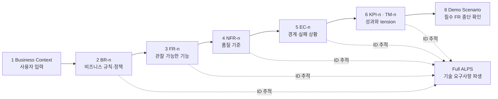

# ADR 0001: eval 가능한 비즈니스 요구사항을 정리하는 Lite ALPS 템플릿 제공

Date: 2026-08-20

## Status

Accepted (2026-11-23)

## Purpose

구현 에이전트가 만들고 독립 평가가 결과를 판정하는 개발 방식(소프트웨어 팩토리)은 명확한
성공 조건이 있어야 동작한다. 기획 문서가 비즈니스 규칙, 예외 상황과 성공 기준을 비워 두면
구현 에이전트가 제품의 의도를 임의로 정하고, 평가는 요구사항이 아니라 구현이 통과하기 쉬운
조건을 확인하게 된다.

기획자와 PM은 기술을 결정하지 않고도 대상 사용자의 문제와 의도, 비즈니스 요구사항, 기능
요구사항, 비기능 요구사항, 엣지케이스와 성공 기준을 정리하려 한다. Lite ALPS는 기술 작성자가
비즈니스 질문을 다시 하지 않아도 기술 요구사항을 추론할 수 있을 만큼 비즈니스 요구사항을
구체화한다. 각 항목은 구현과 독립적인 관찰 결과로 통과·실패를 판정할 수 있어야 한다.

사용자가 모든 요구사항을 처음부터 작성하면 부담이 크고 누락이 생긴다. 사용자는 대상
사용자·문제와 의도·원하는 결과를 제공하고, AI는 그 결과에서 요구사항, 엣지케이스, 성공
기준과 데모를 역설계해 제안한다. 금전·권한·규제처럼 여러 유효한 선택이 비즈니스 계약을
바꾸는 결정은 사용자가 정한다. AI 제안은 사용자가 승인하기 전까지 계약이 아니다.

KPI는 의도의 대리 지표라서 KPI만 최적화하면 점수는 오르고 의도는 훼손될 수 있다. 사용자는
KPI는 떠올려도 어뷰징·반대 실패 시나리오에서 나오는 tension metric은 떠올리기 어렵다. 출시
가능 여부를 판정하는 수용 조건과 출시 뒤 성과를 관찰하는 신호도 서로 다른 질문에 답한다.

Lite는 비즈니스 요구사항의 상위 기준이다. Full ALPS는 Lite를 기술 요구사항으로 전환하며
Lite의 비즈니스 의미를 바꾸지 않는다. 하위 문서가 요구사항을 손실 없이 추적하려면 요구사항마다
안정적인 식별자가 필요하다. 전환과 추적 방식은
[Full 기술 요구사항을 Lite 비즈니스 요구사항에서 파생](../requirement-derivation/0001-derive-full-alps-from-lite-business-requirements.md)이
정한다.

대상 사용자, 제품과 외부 관계자의 경계는 텍스트만으로 한눈에 검토하기 어렵다. C4 Context는
실행·배포 단위로 내려가지 않고 이 경계를 보여 줄 수 있지만, 비즈니스 독자가 읽는 Lite에서는
기술 표현 대신 비즈니스 역할 용어로 표시해야 한다.

데모 통과는 승인된 제품 동작을 확인할 뿐 비즈니스 성과나 시장 타당성을 증명하지 않는다.

## Decision Drivers

- 비즈니스 요구사항은 기술 결정 없이도 기술 요구사항을 추론할 수 있을 만큼 구체적이어야 한다.
- 모든 요구사항 항목은 구현과 독립적인 관찰 결과로 통과·실패를 판정할 수 있어야 한다.
- 사용자는 문제와 의도를 제공하고, AI가 제안한 요구사항을 종류별로 검토·승인하며, 보호된
  비즈니스 결정만 직접 정한다.
- KPI 개선이 의도를 훼손하지 않도록 tension metric을 항상 제안하고, 출시 수용 조건과 관찰용
  신호를 구분해야 한다.
- 하위 문서는 요구사항을 안정적인 식별자로 손실 없이 추적할 수 있어야 한다.
- Lite는 기술 스택, 인터페이스, 저장소, 배포와 코드 구조를 다루지 않는다.

## Decision

ALPS Writer는 **8-Section Lite ALPS 템플릿 프로필**을 제공한다. Lite는 Full ALPS와 같은
Section별 대화, approval digest, 명시적 승인과 저장 방식을 사용한다. 사용자는 Section 1의
비즈니스 맥락을 제공하고, AI는 승인된 Section 1에서 나머지 Section을 역설계해 제안한다.

Lite ALPS의 Section은 다음 여덟 개다.

1. **Business Context**
   - `Target User and Core Problem`
   - `Intent and Desired Outcome`
2. **Business Requirements**
   - `Business Requirements`
3. **Functional Requirements**
   - `Functional Requirements`
   - `Business Context Diagram`
4. **Non-Functional Requirements**
   - `Non-Functional Requirements`
5. **Edge Cases**
   - `Edge Cases`
6. **Success Criteria**
   - `KPIs and Tension Metrics`
7. **Out of Scope**
   - 선택 사항인 `Explicit Exclusions`
8. **Demo Scenario**
   - 필수인 `Demo Scenario`

작성 순서는 `1 → 2 → 3 → 4 → 5 → 6 → 7 → 8`이다. Section 7은 사용자가 제외 범위를 밝힌
경우에만 작성한다. 승인된 범위가 실질적으로 모호하면 제외 범위를 한 번 묻고, 명시적 제외가
없고 범위가 모호하지 않으면 질문 없이 Section 7을 건너뛴다.

Section 1 작성자는 대상 사용자와 핵심 문제를 확인한 뒤, 이 제품이 해결하려는 의도, 지켜야 할
우선순위와 사용자가 얻어야 할 최종 결과를 묻는다. 사용자가 이미 측정 신호를 가진 경우 함께
기록하지만 Section 1 완료 조건으로 강제하지 않는다. Section 1은 솔루션, 화면, 기술, 요구사항
목록이나 데모 절차를 요구하지 않는다.

Section 2~6과 8은 AI가 승인된 앞 Section에서 초안을 먼저 제안한다. 질문은 ALPS 작성 승인 방식의
공통 규칙을 따른다. AI는 제안할 근거가 없는 부족한 맥락, 정의되지 않은 용어와 보호된 비즈니스
결정(금전, 권한, 법률·규제, 개인정보·안전, 되돌리기 어려운 데이터 의미, 외부 약속, 인수 범위)을
묻고, 그 밖의 비즈니스 수준 후보는 제안해 사용자가 approval digest에서 승인, 수정 또는 거절하게
한다.

### Requirement contract

#### 요구사항 식별자와 필수 여부

Lite는 하위 문서가 추적할 요구사항마다 문서 안에서 유일한 식별자를 부여한다. 식별자는 기술
구현이 아니라 비즈니스 요구사항의 정체성을 나타낸다.

| 의무                                                                                                                                                                                      | 관찰 가능한 검증 기준                                                                                                                            |
| ----------------------------------------------------------------------------------------------------------------------------------------------------------------------------------------- | ------------------------------------------------------------------------------------------------------------------------------------------------ |
| 비즈니스 요구사항은 `BR-n`, 기능 요구사항은 `FR-n`, 비기능 요구사항은 `NFR-n`, 엣지케이스는 `EC-n`, KPI는 `KPI-n`, 채택한 tension metric은 `TM-n`을 사용한다.                             | `n`은 앞자리 0 없이 1부터 시작하는 양의 정수다.                                                                                                  |
| 각 식별자는 소유 subsection에서 정의한다. BR은 2.1, FR은 3.1, NFR은 4.1, EC는 5.1, KPI·TM은 6.1이 소유한다.                                                                               | 소유 subsection에서 표 행의 첫 칸, 목록 항목이나 제목의 시작에 쓴 식별자가 정의이고, 다른 위치의 식별자는 참조다.                                |
| 한 식별자는 한 요구사항만 정의한다.                                                                                                                                                       | 소유 subsection 안에서 같은 식별자를 두 번 정의한 저장은 거부된다.                                                                               |
| 승인된 식별자는 같은 요구사항을 계속 가리킨다.                                                                                                                                            | 표현이나 순서를 고쳐도 식별자가 바뀌지 않고, 삭제한 식별자를 다른 의미의 요구사항에 다시 쓰지 않는다.                                            |
| 항목은 관련 요구사항을 식별자로 연결한다.                                                                                                                                                 | FR은 관련 BR, NFR은 적용 범위(`Global` 또는 FR), EC는 관련 FR·BR, KPI는 관련 BR·FR, TM은 보호하는 KPI를, 데모 단계는 보여 주는 FR·EC를 가리킨다. |
| 각 BR·FR·NFR·EC는 필수 또는 선택을 표시한다.                                                                                                                                              | 필수 항목의 위반은 출시 수용을 막고, 선택 항목은 출시 수용을 막지 않는다.                                                                        |
| 상태 조회는 Lite에 정의되지 않은 식별자의 참조를 보고한다.                                                                                                                                | 끊어진 참조가 하나라도 있으면 Lite는 완료로 표시되지 않는다.                                                                                     |
| 승인된 항목을 바꾸거나 삭제하면 작성자는 그 식별자를 참조하는 뒤 Section 항목과 데모 단계를 같은 변경의 approval digest에 함께 보이고, 사용자가 승인한 범위에서 각 subsection을 저장한다. | 변경 뒤 승인된 문서에 바뀐 의미와 어긋난 참조나 끊어진 참조가 남지 않는다.                                                                       |

#### eval 가능성과 추론 가능성

모든 요구사항 항목은 구현과 독립적인 판정 기준을 가진다. 판정 기준은 적용 상황, 관찰할 결과와
그 결과가 옳다고 판단할 근거로 구성한다. 근거는 정책, 규제, 계약, 기존 업무 동작이나 사용자의
결정이다.

| 의무                                                                                                                                                                                                     | 관찰 가능한 검증 기준                                                                                      |
| -------------------------------------------------------------------------------------------------------------------------------------------------------------------------------------------------------- | ---------------------------------------------------------------------------------------------------------- |
| 각 BR·FR·NFR·EC는 통과와 실패를 구분할 수 있는 관찰 결과를 가진다.                                                                                                                                       | 결과가 있다는 사실만으로 통과하지 않고, 의도에 맞는 결과와 위반을 서로 다르게 판정할 수 있다.              |
| 판정 기준은 사용자가 보거나 비즈니스가 확인할 수 있는 결과로 표현한다.                                                                                                                                   | 구현 함수, 내부 상태, 기술 계층, 화면 구성 요소나 주관적인 인상을 판정 기준으로 쓰지 않는다.               |
| 품질 판단이 필요한 항목은 대표 상황과 판단 규칙을 포함한다.                                                                                                                                              | 같은 상황의 충분한 결과와 부족한 결과를 서로 다르게 판정할 수 있다.                                        |
| 요구사항 값과 규칙은 단위, 대상, 조건과 근거를 정확히 보존한다.                                                                                                                                          | "적절히", "합리적으로" 같은 표현으로 값과 규칙을 흐리지 않으며, 사용자가 정하지 않은 값을 확정하지 않는다. |
| 수용 여부를 바꾸는 미정 값이나 정책이 남은 Section은 승인·저장하지 않는다.                                                                                                                               | 미정 항목이 있으면 digest가 승인 대신 그 질문과 보류 선택을 보이고, 완료된 Lite에는 미해결 질문이 없다.    |
| 사용자가 업무상 필수로 밝힌 외부 시스템, 데이터 위치, 접근 채널 같은 제약은 그 선택이 고정하는 비즈니스 경계와 근거를 BR이나 NFR에 기록한다. 계약·규제·조직 정책이 의무화한 경우에만 제품 이름을 남긴다. | 업무상 필수 제약이 Lite에서 사라지지 않고, 교체 가능한 기술 선택은 기록되지 않는다.                        |

#### Section별 내용

| Section·subsection               | 의무                                                                                                                                                                                                                   | 관찰 가능한 검증 기준                                                                                                                                            |
| -------------------------------- | ---------------------------------------------------------------------------------------------------------------------------------------------------------------------------------------------------------------------- | ---------------------------------------------------------------------------------------------------------------------------------------------------------------- |
| 1.1 Target User and Core Problem | 주 대상 사용자와 해결할 핵심 문제, 필요하면 현재 상황과 결과를 기록한다.                                                                                                                                               | 솔루션이나 기술 없이 누구의 어떤 문제인지 읽을 수 있다.                                                                                                          |
| 1.2 Intent and Desired Outcome   | 제품의 의도, 사용자가 얻어야 할 최종 결과, 그 결과가 중요한 이유와 사용자가 밝힌 우선순위·범위를 기록한다.                                                                                                             | 이후 세부 판단이 다른 목적을 따르지 않도록 결과와 우선순위를 읽을 수 있다.                                                                                       |
| 2.1 Business Requirements        | 제품이 지켜야 할 비즈니스 규칙, 정책과 제약을 `BR-n`으로 기록하고 값·단위·근거·필수 여부와 지킨 결과의 판정 기준을 포함한다.                                                                                           | 각 BR을 지킨 결과와 위반한 결과를 비즈니스 관점에서 구분할 수 있다. 확인된 규칙이 없으면 그 사실을 한 문장으로 기록한다.                                         |
| 3.1 Functional Requirements      | 사용자가 관찰할 수 있는 제품 동작을 `FR-n`으로 하나 이상 기록한다. 각 FR은 행위자, 시작 상황, 비즈니스 입력, 적용 규칙·값과 관련 BR, 관찰 결과, 관련 실패 처리, 필수 여부와 Given·When·Then 형식의 수용 기준을 가진다. | 기술 작성자가 FR만 읽고 어떤 비즈니스 결과를 만들어야 하는지 추가 비즈니스 질문 없이 알 수 있으며, 수용 기준이 화면 구성, API, 저장소를 언급하지 않는다.         |
| 3.2 Business Context Diagram     | 대상 사용자, 이 제품과 외부 관계자의 관계를 비즈니스 역할 용어의 Mermaid `C4Context` 하나로 표시한다.                                                                                                                  | 다이어그램 제목·요소·관계 설명이 비즈니스 역할과 업무 행위로 쓰이고, 다이어그램 없이도 텍스트 요구사항을 검토할 수 있다.                                         |
| 4.1 Non-Functional Requirements  | 사용자나 비즈니스가 관찰하는 품질 기대를 `NFR-n`으로 기록하고 임계값·단위·대상·조건·근거·필수 여부와 적용 범위를 포함한다. Lite NFR에는 개수 제한이 없다.                                                              | 숫자로 정할 수 없는 기대는 예·아니오로 판정할 수 있는 조건으로 쓰며, 보안·개인정보·규제·계약 조건이 빠지지 않는다. 확인된 품질 기대가 없으면 그 사실을 기록한다. |
| 5.1 Edge Cases                   | 경계값, 잘못된 입력, 반복·동시 요청, 권한 위반, 외부 관계자 실패, 어뷰징 중 해당하는 상황을 `EC-n`으로 기록하고 관련 FR·BR, 필수 여부와 기대하는 비즈니스 결과(예: 거절, 기존 상태 보존, 복구, 안내)를 포함한다.       | 각 EC가 관련 FR·BR과 판정 가능한 기대 결과를 가지며, 근거 없는 새 정책을 만들지 않는다. 해당하는 상황이 없으면 그 사실을 기록한다.                               |
| 6.1 KPIs and Tension Metrics     | 의도의 성과를 나타내는 `KPI-n`과 채택한 `TM-n`을 비즈니스 계산 정의(대상, 분자, 분모, 단위, 방향, 관찰 기간), 기준선·목표, 관련 BR·FR, KPI별 tension 결정과 필수·관찰용 의미로 기록한다.                               | KPI·TM 정의만 읽고 같은 값을 계산할 대상과 식을 알 수 있으며, 사용자가 정하지 않은 목표값이 없다. 확인된 KPI가 없으면 그 사실을 기록한다.                        |
| 7.1 Explicit Exclusions          | 사용자가 확인한 제외 범위만 하나의 목록으로 기록한다.                                                                                                                                                                  | 제외 범위가 없으면 Section이 비어 있고, 승인된 범위가 모호하지 않으면 질문도 생기지 않는다.                                                                      |
| 8.1 Demo Scenario                | 모든 필수 FR을 한 번 이상 보여 주는 가장 짧은 종단 시나리오를 시작 상태, 데모 입력, 순차 행동, 관찰 결과와 단계별 FR·EC 식별자로 기록한다.                                                                             | 모든 필수 FR을 단계나 실행 블록에서 찾을 수 있다.                                                                                                                |

#### 성공 기준: 출시 수용과 성과 관찰

출시 수용은 필수 BR·FR·NFR·EC의 판정 기준이 모두 통과했는지로 판정한다. KPI와 TM은 출시 뒤
의도가 실제로 달성되는지 관찰하는 성과 평가이며, 사용자가 근거와 함께 필수로 확정한 경우에만
수용 조건이 된다.

| 의무                                                                                                                                 | 관찰 가능한 검증 기준                                                                                                                          |
| ------------------------------------------------------------------------------------------------------------------------------------ | ---------------------------------------------------------------------------------------------------------------------------------------------- |
| 확인했거나 제안한 KPI마다 어뷰징·편법·반대 실패 시나리오에서 같은 목적을 보호하는 tension metric 후보와 그 시나리오를 항상 제안한다. | 사용자가 tension metric을 떠올리기를 기다리지 않으며, 정량화가 부적절하면 관찰 가능한 반례를 제안한다.                                         |
| Tension metric의 채택은 사용자가 정하고, KPI마다 그 결정을 기록한다.                                                                 | 각 KPI에 채택한 `TM-n`, 편법을 견제하는 필수 요구사항 식별자, 사용자가 채택하지 않음 중 하나가 기록되고, 채택하지 않아도 완료가 막히지 않는다. |
| 필수 BR·FR·NFR·EC가 이미 편법을 잡으면 그 식별자를 견제 수단으로 명시한다.                                                           | 필수 요구사항의 위반을 tension이나 관찰용 신호로 낮춰 실패에서 제외하지 않는다.                                                                |
| 관찰용 신호와 필수 수용 조건을 구분한다.                                                                                             | KPI 상승이 필수 비즈니스·안전·권한 조건의 위반을 상쇄하지 않고, 관찰용 지표의 변화만으로 자동 실패를 선언하지 않는다.                          |
| 기준선과 목표값은 사용자가 제공하거나 승인한 값만 기록한다.                                                                          | 예시 수치가 기본 요구사항이 되지 않으며 목표가 없는 KPI도 계산 정의를 가진다.                                                                  |
| Lite의 KPI·TM은 비즈니스 계산 정의만 가진다.                                                                                         | 통계 표본 설계, 데이터 수집 방법, 계측과 평가기 구현을 요구하지 않는다. 이들은 Full이 정한다.                                                  |

#### Business Context Diagram

`Business Context Diagram`은 Mermaid `C4Context` 문법을 사용하지만 비즈니스 독자를 위한
표시 용어로 작성한다. AI는 승인된 Section 1~2와 Section 3.1 초안에서 다이어그램을 생성한다.

- 사람 요소는 대상 사용자와 업무 담당자를 비즈니스 역할 이름으로 표시한다.
- 시스템 요소는 이 제품 하나와, 제품이 협력하는 외부 관계자(파트너, 외부 서비스, 기존 조직
  업무)를 업무 책임으로 설명한다.
- 관계는 업무 행위로 설명한다.
- 다이어그램 제목과 설명에는 API, 데이터베이스, 서버, 앱 구성, 배포 단위, 기술 이름을 쓰지
  않는다. 업무상 필수로 기록한 외부 관계자의 이름은 남길 수 있다.

#### Demo Scenario

AI는 승인된 Section 1~6과 작성된 Section 7에서 가장 짧은 실행 가능한 Demo Scenario를
역설계한다.

| 의무                                                                                                                           | 관찰 가능한 검증 기준                                                                                |
| ------------------------------------------------------------------------------------------------------------------------------ | ---------------------------------------------------------------------------------------------------- |
| 모든 필수 FR을 한 번 이상 보여 준다. 선택 FR은 포함할 수 있다.                                                                 | 필수 FR 식별자 중 데모 단계에 없는 것이 없다.                                                        |
| 보여 준 결과가 의도를 충족하는지 구분하려면 관련 EC를 같은 시나리오 안의 반례로 포함한다.                                      | 반례 단계는 확인하는 EC 식별자와 기대 결과를 표시한다.                                               |
| 전체 통과는 데모에서 보여 준 모든 FR·EC의 판정 기준이 통과할 때만 선언한다.                                                    | 하나의 위반이 있으면 데모는 실패하며, 데모에 없는 필수 EC는 Section 5의 판정 기준으로 계속 판정된다. |
| 모든 FR을 하나의 흐름으로 연결하려면 승인되지 않은 비즈니스 계약이 필요하면 같은 Demo Scenario 안에 별도 실행 블록을 사용한다. | 데모를 이어 붙이기 위해 새 비즈니스 규칙을 만들지 않는다.                                            |
| 생성한 데모 전체, FR·EC 커버리지와 의도 연결을 승인 전에 보여 준다.                                                            | 사용자는 저장 전에 전체 절차와 커버리지를 검토할 수 있다.                                            |
| 데모 통과는 제품 동작 확인 결과로만 표시한다.                                                                                  | 데모 통과를 실제 비즈니스 성과나 시장 타당성 검증으로 표시하지 않는다.                               |

#### Required guarantees

- `lite-alps-init`은 8-Section Lite ALPS 작성과 재개를 지원한다.
- Lite ALPS 파일명은 `lite`, `alps`, `xml` 세 suffix segment를 점으로 연결한다.
- Lite ALPS 문서는 정확히 `Business Context`, `Business Requirements`, `Functional Requirements`,
  `Non-Functional Requirements`, `Edge Cases`, `Success Criteria`, `Out of Scope`,
  `Demo Scenario` 여덟 Section을 이 순서로 가진다.
- Lite 작성 흐름은 Section 목적 설명, 필요한 집중 질문, 답변 통합, approval digest, 명시적
  승인과 저장 순서를 사용한다.
- Section 1 질문은 대상 사용자, 핵심 문제, 제품의 의도와 원하는 최종 결과를 확인한다.
- Section 1은 솔루션, 화면, 기술, 요구사항 목록이나 데모 절차를 사용자에게 요구하지 않는다.
- 사용자가 성과 측정 신호를 이미 제공하면 보존하며, 측정 신호가 없다는 이유로 Section 1 완료를
  막지 않는다.
- Section 2~6과 8은 AI가 승인된 앞 Section에서 초안을 먼저 제안하며 사용자가 처음부터
  작성하도록 요구하지 않는다.
- Section 3.2는 Mermaid `C4Context` 다이어그램을 정확히 하나 포함한다.
- AI가 제안한 요구사항, 다이어그램, KPI와 Demo Scenario는 해당 Section의 approval digest가
  승인된 뒤에만 저장한다.
- Section 7은 선택 Section이며 사용자가 확인한 비범위만 포함한다.
- 사용자가 작성 모드를 지정하지 않으면 Section별 atomic 승인을 사용한다.
- 사용자가 batch 작성을 명시적으로 요청하거나 여러 Section을 포함한 완전한 구조화 입력을
  제공한 경우에만 batch 승인을 사용할 수 있다.
- 모든 저장은 현재 작성 단위의 의도, 범위, 요구사항 식별자와 필수 여부, 적용되는 값과 규칙,
  판정 기준과 미해결 질문을 포함한 plain-text approval digest의 명시적 승인 뒤에 수행한다.
- 문서를 재개하면 작성 순서상 첫 미완료 필수 Section에서 계속한다. Section 7에 명시적 제외
  범위가 없으면 건너뛴다.
- Lite는 필수 Section이 모두 작성되고 끊어진 식별자 참조가 없을 때 완료된다.
- 상태 조회는 Lite를 완료로 표시하지 않을 때 그 이유마다 이유를 해소할 다음 행동을 함께 보고한다.
  미작성 Section은 작성 순서상 다음에 쓸 Section을, 끊어진 참조와 중복 정의는 해당 식별자를 소유한
  subsection을 가리킨다.
  - 관찰 기준: 미완료 Lite의 상태 조회에는 이유마다 다음 행동이 있고, 사용자는 막힌 상태만 보고
    끝나지 않는다.
- Lite ALPS는 현재 상태를 Markdown으로 내보낼 수 있으며, 작성되지 않은 선택 Section을
  생략하고 작성된 선택 Section은 원래 순서에 포함한다.
- 작성 내용과 사용자 대화는 사용자가 사용한 언어를 따른다.
- Lite 작성, 재개, 상태 조회와 내보내기는 Full ALPS 문서나 작성 상태를 읽거나 갱신하지 않는다.
- Lite가 완료되면 작성자는 구현 준비가 필요할 때 이 Lite를 출처로 Full ALPS를 파생할 수 있음을
  안내할 수 있다. 이 안내는 Lite 완료를 바꾸지 않는다.
- Lite 행동 평가는 비즈니스 맥락 우선 질문, 요구사항 제안, 판정 기준, tension 제안, 데모
  역설계, 승인과 기술 배제를 검사하고 특정 사용자 노출 문구나 정확한 질문 표현을 통과 조건으로
  요구하지 않는다.

#### Prohibitions

- Lite의 C4 다이어그램은 `Business Context Diagram`의 `C4Context`만 사용한다. `C4Container`,
  `C4Component`, `C4Dynamic`, `C4Deployment`와 Code 수준 다이어그램을 생성하지 않는다.
- Lite 템플릿과 가이드는 기술 스택, 인터페이스, API, 저장소, 배포, 라이브러리, 코드 구조,
  Feature ID나 구현 계획 입력을 요구하지 않는다.
- 작성자는 다이어그램이나 비기능 요구사항을 만들기 위해 아키텍처 wizard나 별도 기술 질문을
  추가하지 않는다.
- AI는 사용자 확인 없이 금전, 권한, 법률·규제, 개인정보·안전, 되돌리기 어려운 데이터 의미,
  외부 약속과 인수 범위를 확정하지 않는다.
- 명시적 입력이 없는 제외 범위를 Section 7을 채우기 위해 발명하거나, 미해결 선택을 제외
  범위로 바꾸지 않는다.
- Demo Scenario를 FR 연결이 없는 기능 목록, 화면 투어나 결과 없는 행동 목록으로 작성하지 않는다.
- Lite 완료를 Full ALPS 완료, 구현 준비 완료 또는 ADR handoff 완료로 표시하지 않는다.
- Lite 문서와 Full ALPS 사이에 승인 상태나 완료 상태를 동기화하지 않는다.

#### Failure guarantees

- Lite 문서 초기화, 로드, 저장 또는 내보내기 실패는 기존 문서를 덮어쓰거나 현재 선택된
  문서를 다른 유형으로 변경하지 않는다.
- 잘못된 Section, subsection 식별자 또는 제목은 문서 내용을 변경하지 않고 거부한다.
- 현재 문서를 다른 프로필의 템플릿으로 저장하려는 요청은 문서 내용을 변경하지 않고 거부한다.
- 8-Section 형식이 아닌 Lite 문서는 원본을 변경하지 않고 거부한다. 사용자는 그 문서를 새 Lite
  작성의 참조 입력으로 제공할 수 있다.
- Section 3.2에 `C4Context`가 없거나 하나보다 많거나, `C4Context` 이외의 C4 수준이 있으면
  내용을 변경하지 않고 저장을 거부한다.
- 소유 subsection 안에서 같은 식별자를 두 번 정의한 저장은 내용을 변경하지 않고 거부한다.

#### Observable evidence

| Obligation                             | Observable evidence                                                                                                   |
| -------------------------------------- | --------------------------------------------------------------------------------------------------------------------- |
| 비즈니스 맥락을 먼저 확인한다.         | Section 1 질문은 대상 사용자·문제와 의도·원하는 결과만 요구하고 솔루션, 기술이나 요구사항 목록을 요구하지 않는다.     |
| AI가 요구사항을 먼저 제안한다.         | Section 1 승인 뒤 사용자가 요구사항을 쓰지 않아도 BR·FR·NFR·EC 후보가 식별자와 필수 여부와 함께 제시된다.             |
| 요구사항이 eval 가능하다.              | 각 BR·FR·NFR·EC에서 적용 상황, 관찰 결과와 판정 근거를 찾을 수 있다.                                                  |
| 기술 요구사항을 추론할 수 있다.        | 각 FR이 3.1의 필드를 모두 가지며, 완료된 Lite에 미해결 비즈니스 질문이 없다.                                          |
| 기술 표현을 배제한다.                  | 요구사항과 다이어그램에 API, 데이터베이스, 배포 단위, 라이브러리, 코드 구조가 나타나지 않는다.                        |
| tension metric을 항상 제안한다.        | KPI마다 tension 후보와 어뷰징·반대 실패 시나리오가 digest에 보이고, 저장된 KPI마다 tension 결정이 기록된다.           |
| 출시 수용과 성과 관찰을 구분한다.      | KPI·TM은 확정되지 않는 한 관찰용으로 표시되고 필수 BR·FR·NFR·EC 위반은 KPI로 상쇄되지 않는다.                         |
| 식별자로 추적할 수 있다.               | 모든 요구사항이 유일한 식별자를 가지고, 수정 뒤에도 승인된 식별자가 같은 요구사항을 가리키며, 끊어진 참조가 보고된다. |
| 다이어그램은 비즈니스 용어로 표시한다. | Section 3.2에 비즈니스 역할 용어로 쓴 `C4Context`가 정확히 하나 있다.                                                 |
| Demo Scenario가 필수 FR을 커버한다.    | 단계나 실행 블록에서 모든 필수 FR 식별자를 찾을 수 있고 전체 통과 조건이 보여 준 모든 판정 기준의 통과를 요구한다.    |
| 데모의 증명 범위를 제한한다.           | 데모 통과는 제품 동작 확인 결과로 표시되고 실제 비즈니스 성과 검증으로 표시되지 않는다.                               |
| Section 7은 선택 사항이다.             | 명시적 제외 범위가 없어 Section 7이 비어 있어도 필수 Section 완료 후 내보낼 수 있다.                                  |
| Lite는 Full을 읽지 않는다.             | Lite 작성·재개·상태·완료 결과가 Full 문서나 상태를 읽거나 변경하지 않는다.                                            |
| 실패 시 원본을 보존한다.               | 유효하지 않은 저장, 중복 정의, 다른 형식의 문서나 프로필 불일치 뒤에도 파일 내용이 요청 전과 같다.                    |

### Alternatives

1. **4-Section PoC Lite를 유지하고 요구사항은 Full에서만 작성한다**
   - 장점: Lite 작성량이 가장 적다.
   - 단점: 비즈니스 규칙·엣지케이스·KPI가 기술 작성 중에 처음 정해지고, 평가 기준을 기술
     작성자가 정해 비즈니스 의도가 흐려진다.

2. **비즈니스 요구사항을 eval 가능한 항목과 식별자로 구조화한 8-Section Lite**
   - 장점: 기술 결정 없이 판정 가능한 비즈니스 기준을 확정하고 하위 문서가 손실 없이 추적한다.
   - 단점: Section과 승인 단위가 늘어나 작성 시간이 길어진다.

3. **모든 요구사항을 하나의 Requirements Section의 subsection으로 묶는다**
   - 장점: Section 수가 적다.
   - 단점: 하나의 승인 단위가 커져 요구사항 종류별 검토와 수정이 어렵다.

#### 비즈니스 경계 표현

1. **텍스트 요구사항만 사용한다**
   - 장점: 작성량과 형식 비용이 가장 작다.
   - 단점: 사용자, 제품과 외부 관계자의 경계를 한눈에 검토하기 어렵다.

2. **비즈니스 역할 용어로 표시한 C4 Context 하나를 포함한다**
   - 장점: 기술 구조로 내려가지 않고 업무 관계자와 관계를 시각적으로 검토할 수 있다.
   - 단점: 모든 Lite 문서가 다이어그램 하나를 작성하고 검토해야 한다.

3. **C4 Context와 Container를 모두 포함한다**
   - 장점: 업무 경계와 주요 실행 단위를 함께 볼 수 있다.
   - 단점: Lite가 배제하는 기술 구조 결정을 요구한다.

## Consequences

### Positive

- 구현 전에 모든 비즈니스 요구사항이 판정 가능한 기준을 가지므로 독립 평가의 기준이 된다.
- 기술 작성자는 비즈니스 질문을 다시 하지 않고 기술 요구사항을 추론할 수 있다.
- KPI와 tension metric이 함께 정의되어 성과 개선이 의도를 훼손하는지 판단할 수 있다.
- 식별자로 Lite 요구사항이 Full과 그 아래 단계에서 누락되었는지 확인할 수 있다.
- 사용자는 비즈니스 맥락만 제공하고 AI가 제안한 요구사항을 종류별로 검토한다.
- 최종 Markdown은 작성하지 않은 선택 Section을 노출하지 않는다.

### Negative

- Section과 승인 단위가 늘어나 Lite 작성 시간이 길어진다.
- 8-Section 형식이 아닌 Lite 문서는 자동 변환되지 않고 새 Lite 작성의 참조 입력으로만 쓰인다.
- 모든 요구사항에 판정 기준을 쓰므로 품질 판단이 필요한 항목은 대표 상황과 판단 규칙을 먼저
  구체화해야 한다.
- 미정 비즈니스 결정이 있으면 해당 Section을 저장하지 못하고 보류해야 한다.

### Risks

- 비즈니스 의도가 추상적이면 AI가 제안하는 요구사항도 넓어질 수 있다. 작성자는 의도와 우선순위를
  먼저 확인하고 그 범위 안에서 제안한다.
- 요구사항에 기술 표현이 섞일 수 있다. 판정 기준은 사용자나 비즈니스가 관찰하는 결과로 제한한다.
- 다이어그램이 기술 구성도로 내려갈 수 있다. Lite는 비즈니스 역할과 업무 관계만 허용한다.
- AI가 보호된 비즈니스 결정을 일반 제안으로 확정할 수 있다. 계약을 바꾸는 선택은 사용자 답변으로
  확정한다.
- 데모나 KPI 달성이 실제 비즈니스 성과를 증명한 것처럼 보일 수 있다. 문서와 대화는 제품 동작
  수용과 비즈니스 성과 검증을 구분한다.

## Related

- [ALPS 작성 승인 방식](../authoring-interaction/0001-support-atomic-and-batch-approval.md)
- [Full 기술 요구사항을 Lite 비즈니스 요구사항에서 파생](../requirement-derivation/0001-derive-full-alps-from-lite-business-requirements.md)
