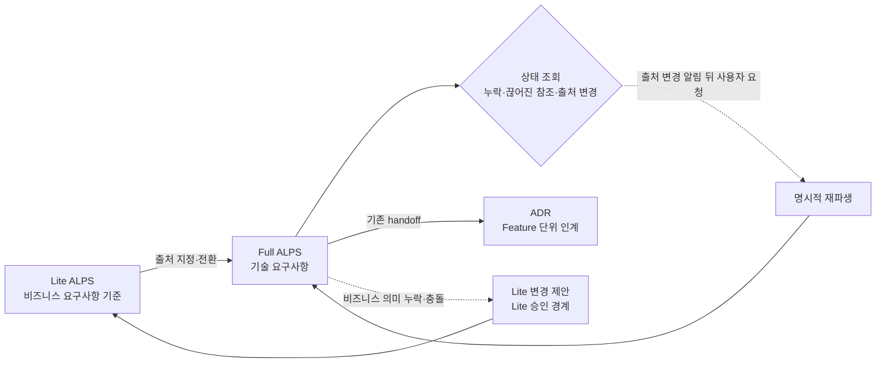

# ADR 0001: Full 기술 요구사항을 Lite 비즈니스 요구사항에서 파생

Date: 2026-11-23

## Status

Proposed

## Purpose

Full ALPS는 구현과 독립 평가가 사용할 기술 요구사항을 정리한다. Full이 비즈니스 맥락을 따로
다시 수집하면 같은 비즈니스 규칙이 두 문서에서 다르게 정해지고, 기술 작성 중에 비즈니스 규칙과
성공 기준을 기술 작성자가 임의로 정하게 된다. 구현 에이전트는 그렇게 흐려진 기준을 의도로
받아들인다.

Lite ALPS가 비즈니스 요구사항의 상위 기준이므로, Full은 Lite의 각 요구사항을 기능 명세,
측정 가능한 비기능 요구사항, 평가 사례와 지표 계측으로 전환하되 비즈니스 의미를 바꾸지 않아야
한다. 전환한 모든 항목은 출처 요구사항으로 추적되어 어떤 요구사항도 기술 단계에서 빠지지 않아야
한다. Lite의 KPI와 tension metric에는 비즈니스 계산 정의만 있으므로, Full은 같은 정의와
필수·관찰용 의미를 유지한 채 데이터 수집과 계측 방법을 더해야 한다.

Full에서 ADR로의 handoff는 Full 하나만 읽고, adr-writer는 ALPS 문서를 직접 읽지 않는다. 따라서
Full은 Lite를 가리키기만 하지 않고 전환한 내용을 스스로 담아 단독으로 읽혀야 한다.

Lite 없이 시작하는 Full 작성과 기존 Full 문서는 계속 동작해야 한다. 이 경우 Full이 비즈니스
맥락을 직접 수집하며, 작성자는 Lite를 먼저 쓰는 경로를 안내한다.

## Decision Drivers

- Full 작성 중 비즈니스 의미가 바뀌거나 새로 정해지면 안 된다.
- 모든 Lite 요구사항이 Full에서 추적되어야 하고, 누락과 출처 변경은 결정적으로 드러나야 한다.
- Full과 그 handoff는 Lite를 함께 읽지 않아도 이해할 수 있어야 한다.
- Lite의 비즈니스 계산 정의와 품질 기준에 기술 측정 방법을 더해야 구현과 평가가 같은 값을 쓴다.
- Lite 없는 Full 작성과 기존 Full 문서는 계속 동작해야 한다.

## Decision

Full ALPS는 선택적으로 **Lite 출처**에서 시작한다. 사용자가 Full 초기화에 Lite 문서를 출처로
지정하면, 서버는 그 Lite가 완료된 현재 형식의 문서인지 확인한 뒤 Full 문서를 만든다. 서버는
출처를 Full 문서 기준 상대 경로로 Full 문서 안에 기록하고, 그 시점 Lite 내용의 지문(fingerprint)도
함께 기록한다. 출처 지정은 기존 문서 초기화 요청의 선택 입력이며, alps-writer의 MCP 도구는
5개다.

Full은 9개 Section 구조와 Section·Feature 승인 단위, 저장 방식을 사용한다. 출처가 있으면 Full
작성자는 각 Section을 작성하기 전에 대응하는 Lite Section을 읽고, Lite 요구사항을 기술 해상도로
전환한 초안을 먼저 제안한다. Lite가 이미 답한 비즈니스 질문은 다시 묻지 않는다.

| Full Section                  | Lite 출처                                  | 전환 내용                                                                                                                                                                                |
| ----------------------------- | ------------------------------------------ | ---------------------------------------------------------------------------------------------------------------------------------------------------------------------------------------- |
| 1 Overview                    | 1 Business Context, 6 Success Criteria     | 대상 사용자·문제·의도와 성공 기준을 같은 의미로 요약하고 기술 수준의 Solution Strategy를 더한다.                                                                                         |
| 2 MVP Goals and Key Metrics   | 1.2 Intent and Desired Outcome, 6.1 KPI·TM | 가설과 KPI·TM을 같은 정의와 필수·관찰용 의미로 다시 쓴다.                                                                                                                                |
| 3 Demo Scenario               | 8 Demo Scenario                            | Lite 데모의 FR과 EC 반례를 유지한 종단 데모로 전환한다.                                                                                                                                  |
| 4 High-Level Architecture     | 3.2 Business Context Diagram, BR·NFR 경계  | 사람과 외부 관계자를 `C4Context`에 같은 관계로 보존하고 데이터·규제·외부 관계자 제약을 4.2 Architecture Constraints에 기록한다.                                                          |
| 5 Design Specification        | 3.1 FR                                     | FR을 화면과 이동 흐름으로 전환한다.                                                                                                                                                      |
| 6 Requirements Summary        | 3.1 FR, 4.1 NFR                            | FR을 vertical slice Feature로 묶고 NFR을 측정 방법이 있는 기술 NFR로 전환한다.                                                                                                           |
| 7 Feature-Level Specification | 2.1 BR, 3.1 FR, 5.1 EC                     | BR 값은 7.x.3 Technical Description의 값·규칙으로, FR 수용 기준은 7.x.6 Evaluation Rubric의 Ideal Cases로, EC는 7.x.4 Edge Cases, 7.x.5 Error Handling과 Rubric의 Edge Cases로 전환한다. |
| 8 MVP Metrics                 | 6.1 KPI·TM, 4.1 NFR                        | Lite의 계산 정의, 관찰 기간과 필수·관찰용 의미를 그대로 옮기고 데이터 수집 방법과 계측을 더한다.                                                                                         |
| 9 Out of Scope                | 7.1 Explicit Exclusions                    | 확인된 제외 범위를 보존한다.                                                                                                                                                             |

Lite에서 전환한 Full 내용은 출처 요구사항 식별자를 `Source requirements: FR-1, EC-2` 형식으로
표시한다. 문서 상태 조회는 Full 본문에서 참조되지 않은 Lite 식별자와 Lite에 정의되지 않은 식별자
참조를 보고한다. 출처가 있는 Full은 두 목록이 모두 비고 Full의 다른 완료 조건이 충족될 때만
완료된다. 이 커버리지는 Full 문서의 완료 조건이며 Feature 단위 handoff의 조건을 바꾸지 않는다.

Full 작성자가 기술 전환 중 비즈니스 의미의 누락, 충돌이나 모호함을 발견하면 Full에서 의미를
정하지 않고 Lite 변경을 제안한다. 사용자가 Lite Section의 승인 경계에서 승인하면 그 변경을
Lite 문서에 저장하고, 이미 저장된 Full 단위 중 바뀐 식별자를 참조하는 단위의 변경을 함께 제안한
뒤 Full 작성을 이어 간다. 사용자가 제안을 거절하면 현재 Lite 의미로 Full 작성을 이어 간다.

상태 조회는 현재 Lite의 지문이 마지막 Full 저장 때 기록한 지문과 다르면 출처가 바뀌었음을
알린다. 작성자는 이 알림을 보면 명시적 재파생을 한 번 제안한다. 재파생은 사용자 요청으로만
실행되며, 의미가 같은 Lite에는 아무것도 바꾸지 않는다.

### Requirement contract

#### 출처 지정

| 의무                                                                                 | 관찰 가능한 검증 기준                                                                                                                |
| ------------------------------------------------------------------------------------ | ------------------------------------------------------------------------------------------------------------------------------------ |
| Full 초기화는 Lite 문서를 선택적인 출처로 받는다.                                    | 출처 없이 초기화한 Full에는 출처 기록이 없다.                                                                                        |
| 출처는 완료된 현재 형식의 Lite여야 한다.                                             | 존재하지 않거나, Lite가 아니거나, 8-Section 형식이 아니거나, 완료되지 않은 출처를 지정하면 Full 문서를 만들지 않는다.                |
| 서버는 출처를 Full 문서 기준 상대 경로와 Lite 내용 지문으로 Full 문서 안에 기록한다. | 두 문서를 같은 상대 위치로 함께 옮겨도 Full이 같은 출처를 가리키며, 출처를 지정해 만든 Full을 다시 열면 같은 Lite를 출처로 보고한다. |
| 출처를 나중에 연결, 변경 또는 해제하지 않는다.                                       | 출처 없는 Full은 출처 없이 남고, 사용자는 그 문서를 Lite에서 새 Full을 만들 때 참조 입력으로 쓸 수 있다.                             |
| Lite 초기화에는 출처를 지정할 수 없다.                                               | Lite 초기화 요청에 출처가 있으면 파일을 만들지 않고 거부한다.                                                                        |
| 출처 지정은 기존 문서 초기화 요청의 선택 입력이다.                                   | alps-writer의 MCP 도구 수가 5개를 넘지 않는다.                                                                                       |

#### 의미 보존과 Full이 더하는 내용

| 의무                                                                                                                                               | 관찰 가능한 검증 기준                                                                                                                             |
| -------------------------------------------------------------------------------------------------------------------------------------------------- | ------------------------------------------------------------------------------------------------------------------------------------------------- |
| Full은 Lite의 값, 단위, 규칙, 권한, 필수 여부, 수용 기준, KPI·TM 계산 정의와 필수·관찰용 의미를 바꾸거나 약화하지 않는다.                          | 같은 식별자를 가리키는 Lite와 Full 내용이 같은 비즈니스 결과를 통과·실패로 판정한다.                                                              |
| Full은 출처 식별자 없는 비즈니스 규칙, 권한, 비즈니스 값이나 사용자 관찰 수용 기준을 만들지 않는다.                                                | 출처가 있는 Full의 비즈니스 규칙, 권한과 사용자 관찰 수용 조건은 모두 Lite 식별자로 거슬러 올라간다.                                              |
| Full은 측정 방법, 기술 경계, 오류 응답, 평가 방법과 기술 임계값처럼 기술 해상도의 내용을 더한다.                                                   | 더한 내용이 Lite 기준이 실패로 판정하는 결과를 통과시키지 않는다.                                                                                 |
| 기술 임계값과 Feature별 평가 지표는 Full의 기술 요구사항이며, 지원하는 Lite 식별자를 표시하고 Full approval digest에서 근거와 함께 승인을 받는다.  | Lite NFR "결과가 2초 안에 보인다"를 위한 기술 응답 시간 예산은 출처 NFR과 함께 승인될 수 있고, 3초 결과를 통과시키는 Full 기준은 승인되지 않는다. |
| 비즈니스 의미의 누락·충돌·모호함은 Lite 변경 제안으로 처리한다. 비즈니스 결정이 필요한 Full의 질문은 Lite 변경 제안으로 묻고 답은 Lite에 저장한다. | 제안은 영향받는 Lite 식별자와 함께 보이며, Lite 승인 전에는 그 의미에 의존하는 Full 단위가 저장되지 않는다.                                       |
| Lite 변경은 Lite 문서를 명시적 대상으로 한 Lite Section 승인과 저장으로만 반영한다.                                                                | Full 저장 요청이 Lite 문서를 바꾸지 않는다.                                                                                                       |
| 사용자가 Lite 변경 제안을 거절하면 현재 Lite 의미로 Full 작성을 이어 간다.                                                                         | 거절된 내용은 Lite와 Full 어디에도 확정 내용으로 남지 않고, 의존하던 Full 단위는 현재 Lite 의미로 작성된다.                                       |
| Full 작성 중 Lite 변경이 승인되면 작성자는 바뀐 식별자를 참조하는 저장된 Full 단위의 변경을 같은 작업에서 Full 승인 경계로 제안한다.               | 승인된 Lite 변경과 어긋난 Full 단위가 사용자에게 보이지 않은 채 남지 않는다.                                                                      |
| Lite가 이미 답한 비즈니스 질문은 Full 작성 중 다시 묻지 않는다.                                                                                    | Full의 직접 질문은 기술 해상도의 결정에만 쓰인다.                                                                                                 |

#### 기술 전환

| 의무                                                                                                                                                                              | 관찰 가능한 검증 기준                                                                                                            |
| --------------------------------------------------------------------------------------------------------------------------------------------------------------------------------- | -------------------------------------------------------------------------------------------------------------------------------- |
| FR은 bounded context와 vertical slice 기준으로 Full Feature에 묶는다. 하나의 FR은 필요하면 여러 Feature로 나눈다.                                                                 | 각 Feature가 자신이 전환한 FR 식별자를 표시하고 기술 계층으로 나뉘지 않는다.                                                     |
| FR의 수용 기준은 7.x.6 Evaluation Rubric의 Ideal Cases로, 관련 EC는 7.x.4 Edge Cases, 7.x.5 Error Handling과 Rubric의 Edge Cases로 필수성을 유지한 채 전환한다.                   | Lite의 필수 수용 기준과 필수 EC마다 Full에서 같은 결과를 판정하는 사례를 찾을 수 있다.                                           |
| BR의 값과 규칙은 이를 지키는 Feature의 7.x.3 Technical Description 값·규칙과 평가 사례, 또는 4.2 Architecture Constraints로 전환한다.                                             | BR의 값이 단위와 근거를 포함해 Full 평가 사례의 판정 규칙이나 제약에 나타난다.                                                   |
| 필수 Lite NFR은 Full 6.2의 mandatory constraint로 옮긴다. 선택 Lite NFR은 focus set이나 선택 NFR로 두거나 이유와 식별자를 남겨 Section 9로 미룬다.                                | Full NFR이 Lite NFR과 같은 값·단위·대상·조건을 유지하며 측정 방법을 가지고, 필수 Lite NFR이 focus set 개수 때문에 빠지지 않는다. |
| Full 2.2와 8은 KPI·TM의 계산 정의, 관찰 기간과 필수·관찰용 의미를 Lite와 같게 쓰고, 데이터 수집 방법과 계측을 더한다. 지표 대상을 바꾸는 제외 규칙은 Lite 변경 제안으로 처리한다. | 관찰용 지표가 필수로 승격되지 않고, 사용자가 정하지 않은 목표값이 생기지 않으며, KPI와 그 TM이 같은 관찰 조건을 쓴다.            |
| Lite에 tension 결정이 기록되지 않은 KPI에만 tension 후보를 Lite 변경 제안으로 제안한다.                                                                                           | Lite에서 채택하지 않음이나 견제 식별자를 기록한 KPI에는 같은 제안을 반복하지 않으며, 거절해도 Full 작성과 완료를 막지 않는다.    |
| Lite Demo Scenario는 FR과 EC 반례를 유지한 Full 3 데모로 전환한다.                                                                                                                | Full 데모가 Lite 데모의 모든 FR과 EC 반례를 다룬다.                                                                              |
| Lite Business Context Diagram의 사람, 외부 관계자와 관계는 Full 4.1 `C4Context`에 보존한다.                                                                                       | Lite 다이어그램의 각 사람·외부 관계자와 각 관계가 Full Context 다이어그램에 있다.                                                |
| Lite 제외 범위는 Full 9.1 Deferred Features에 보존한다.                                                                                                                           | Lite의 각 제외 항목이 Full 9.1에 있고, Full이 Lite가 제외한 범위를 MVP 기능으로 추가하지 않는다.                                 |

#### 추적과 커버리지

| 의무                                                                                                                                                                                                                                                        | 관찰 가능한 검증 기준                                                                                                         |
| ----------------------------------------------------------------------------------------------------------------------------------------------------------------------------------------------------------------------------------------------------------- | ----------------------------------------------------------------------------------------------------------------------------- |
| Lite에서 전환한 Full 내용은 출처 요구사항 식별자를 `Source requirements:` 형식으로 표시한다.                                                                                                                                                                | Feature, NFR, 지표와 데모에서 출처 Lite 식별자를 찾을 수 있다.                                                                |
| 참조는 Full 번호 Section 본문에 나타난 완전한 식별자 토큰으로 센다.                                                                                                                                                                                         | `FR-1`은 `FR-10`이나 `NFR-1`의 일부로 세지 않으며, 같은 두 문서에 대해 항상 같은 결과를 낸다.                                 |
| Lite의 정의된 식별자는 Lite 형식 계약의 소유 subsection 정의에서 찾는다.                                                                                                                                                                                    | Lite의 참조 위치에만 나타난 식별자는 커버리지 대상이 되지 않는다.                                                             |
| 상태 조회는 Full에서 참조되지 않은 Lite 식별자와 Lite에 정의되지 않은 식별자의 Full 참조를 보고한다.                                                                                                                                                        | 현재 Lite에 새 식별자가 생기면 다음 상태 조회부터 누락으로 보이고, Lite에서 사라진 식별자의 Full 참조는 끊어진 참조로 보인다. |
| 출처가 있는 Full은 누락과 끊어진 참조가 없고 Full의 다른 완료 조건이 충족될 때만 완료된다.                                                                                                                                                                  | 하나라도 남으면 상태 조회가 Full을 완료로 표시하지 않는다.                                                                    |
| 필수 FR은 6.1 Feature와 7.x 명세로, 필수 NFR은 6.2로, 필수 EC는 Feature의 Edge Cases로, KPI·TM은 2.2와 8로 전환한다. 선택 FR·NFR·EC는 전환하거나 이유와 식별자를 남겨 Section 9로 미룬다. BR은 이를 지키는 Feature 규칙, 평가 사례나 4.2 제약으로 전환한다. | 식별자만 언급하고 필수 요구사항을 미루거나 "불필요"로 표시해 커버리지를 채운 Full이 approval digest에서 승인되지 않는다.      |
| 기술 요구사항이 필요 없다는 판단은 다른 식별자의 사례로 완전히 판정되는 BR에만 쓰고, 그 판단과 해당 식별자를 approval digest에 보인다.                                                                                                                      | FR, 필수 NFR, 필수 EC와 KPI에는 이 판단이 쓰이지 않는다.                                                                      |
| 커버리지는 Full 문서의 완료 조건이며 Feature 단위 handoff의 조건을 바꾸지 않는다.                                                                                                                                                                           | 커버리지가 남은 Full에서도 기존 handoff 조건을 충족한 Feature는 인계될 수 있다.                                               |

서버의 커버리지 계산은 누락을 드러내는 결정적 하한이다. 전환 위치와 의미 보존은 approval
digest와 평가 사례에서 확인한다.

#### 출처 변경 감지와 재파생

| 의무                                                                                                     | 관찰 가능한 검증 기준                                                                                                  |
| -------------------------------------------------------------------------------------------------------- | ---------------------------------------------------------------------------------------------------------------------- |
| 서버는 Full을 저장할 때 읽을 수 있는 출처의 현재 지문을 기록한다.                                        | Full 저장 뒤 Lite가 바뀌지 않았으면 상태 조회가 출처 변경을 알리지 않는다.                                             |
| 상태 조회와 재개는 현재 Lite 지문이 기록된 지문과 다르면 출처가 바뀌었음을 알린다.                       | 마지막 Full 저장 뒤 Lite를 저장하면 다음 상태 조회에 출처 변경 알림이 보인다.                                          |
| 출처 변경 알림은 완료를 막지 않는다. 작성자는 알림을 보면 명시적 재파생을 한 번 제안한다.                | 사용자가 재파생을 원하지 않으면 Full 작성은 현재 내용으로 이어지고, 다음 Full 저장이 기록된 지문을 갱신한다.           |
| Lite 수정은 사용자가 명시적으로 재파생을 요청할 때만 Full에 반영한다.                                    | Lite 저장만으로 Full 내용이나 승인 상태가 바뀌지 않는다.                                                               |
| 재파생은 현재 Lite와 현재 Full을 비교하며, 의미가 같으면 아무것도 바꾸지 않는다.                         | 표현이나 순서만 다른 Lite로 재파생하면 Full 저장이 일어나지 않는다.                                                    |
| 변경되거나 추가된 Lite 요구사항은 영향받는 Full 단위의 변경 제안으로 만들고 Full 승인 경계에서 저장한다. | 승인 전에는 현재 Full 내용이 유지된다.                                                                                 |
| Lite에서 사라진 요구사항은 Full에서 자동으로 삭제하지 않는다.                                            | 사용자가 Full 내용의 삭제나 Lite 복원 제안을 고르기 전까지 해당 Full 내용과 끊어진 참조가 유지되고 상태 조회에 보인다. |

#### Lite 없는 Full, 독립성과 handoff

- 작성자는 출처 없이 새 Full을 초기화하려는 사용자에게, 그 작업에서 한 번 Lite를 먼저 작성하거나
  기존 Lite를 출처로 쓰는 경로를 안내한다. 사용자가 원하지 않으면 출처 없는 Full로 진행한다.
  - 관찰 기준: 안내는 한 번이며 거절이나 무응답이 Full 작성을 막지 않는다.
- 출처 없는 Full에는 출처 표시, Lite 커버리지와 출처 변경 감지를 적용하지 않는다.
  - 관찰 기준: 출처 없는 Full의 상태 조회와 완료 판정에 Lite 관련 결과가 나타나지 않는다.
- Lite 작성, 재개, 상태 조회와 내보내기는 Full을 읽지 않는다.
- Lite는 ADR이 따르는 현재 기준 레벨이 아니다. 인계된 Feature에 대한 Lite 변경은 재파생과
  명시적 재import로만 ADR에 닿는다.
  - 관찰 기준: Lite 저장이나 재파생만으로 ADR, ADR 색인이나 decision log가 바뀌지 않는다.
- adr-writer는 Lite를 읽지 않으며, Full에서 ADR로의 handoff는 Lite 경로, Lite 요구사항 식별자와
  `Source requirements` 표시를 ADR 본문과 색인으로 옮기지 않는다.
  - 관찰 기준: handoff 뒤 ADR과 ADR 색인에 Lite 문서 경로나 Lite 요구사항 식별자가 없다.
- Full Markdown 내보내기는 제목 아래에 출처 Lite의 상대 경로를 표시하고, 본문의 `Source
requirements` 표시를 유지한다.

#### Failure guarantees

- 출처가 유효하지 않아 Full 초기화를 거부하면 Full 파일을 만들지 않고 Lite 파일도 바꾸지 않는다.
- Lite 초기화 요청에 출처가 있으면 파일을 만들지 않고 거부한다.
- 기록된 출처를 읽을 수 없거나 출처가 더 이상 유효한 Lite가 아니면, 상태 조회는 출처를 사용할
  수 없음과 Lite 커버리지를 확인하지 못했음을 보고하고 Full을 완료로 표시하지 않는다. 이 상태에서도
  Full의 재개, 저장과 내보내기는 동작하며 기록된 지문은 바뀌지 않는다. 같은 상대 위치에 Lite를
  복원하면 상태 조회가 다시 출처를 사용한다.
- Full 문서의 저장, 상태 조회와 내보내기는 Lite 파일을 바꾸지 않는다.

#### Observable evidence

| Obligation                     | Observable evidence                                                                                                 |
| ------------------------------ | ------------------------------------------------------------------------------------------------------------------- |
| 완료된 Lite에서만 파생한다.    | 존재하지 않거나 미완료·다른 형식·Lite가 아닌 출처로 Full 초기화를 요청하면 파일이 생기지 않는다.                    |
| 출처를 Full 안에 기록한다.     | 출처를 지정해 만든 Full을 다시 열면 같은 Lite를 출처로 보고한다.                                                    |
| Lite 질문을 반복하지 않는다.   | Lite가 답한 대상 사용자·의도·규칙을 Full 작성자가 다시 묻지 않고 전환 초안을 제안한다.                              |
| 비즈니스 의미를 보존한다.      | Full의 Feature·NFR·지표가 같은 Lite 식별자의 값·규칙·필수성과 같은 결과를 판정하고, 출처 없는 비즈니스 규칙이 없다. |
| 의미 충돌은 Lite에서 해결한다. | 기술 전환 중 발견한 비즈니스 의미 누락은 Lite 변경 제안으로 보이고, 거절하면 현재 Lite 의미로 진행한다.             |
| KPI·TM에 계측을 더한다.        | Full 8에서 각 KPI·TM의 Lite와 같은 계산 정의와 수집 방법을 찾을 수 있고 관찰용 지표가 필수로 바뀌지 않는다.         |
| 누락을 결정적으로 드러낸다.    | Full에서 참조하지 않은 Lite 식별자와 끊어진 참조가 상태 조회에 보이고, 하나라도 있으면 Full이 완료되지 않는다.      |
| 출처 변경을 드러낸다.          | 마지막 Full 저장 뒤 Lite를 바꾸면 상태 조회가 알리고, 작성자가 재파생을 한 번 제안한다.                             |
| 재파생은 멱등이다.             | 의미가 같은 Lite로 재파생하면 Full이 바뀌지 않는다.                                                                 |
| Lite 없는 Full을 지원한다.     | 출처 없이 만든 Full은 Lite 안내 한 번 뒤 Lite 관련 결과 없이 작성·완료된다.                                         |
| ADR은 Lite에 의존하지 않는다.  | handoff 뒤 ADR과 색인에 Lite 경로나 식별자가 없다.                                                                  |

### Alternatives

1. **Full이 비즈니스 맥락을 따로 수집한다**
   - 장점: 문서 사이의 연결이 없어 단순하다.
   - 단점: 같은 비즈니스 규칙이 두 문서에서 다르게 정해지고 기술 작성자가 성공 기준을 정한다.

2. **Full은 Lite를 참조만 하고 기술 내용만 기록한다**
   - 장점: 비즈니스 내용이 한 문서에만 있다.
   - 단점: Full만 읽어서는 의도와 수용 기준을 알 수 없고, handoff가 두 ALPS 문서를 함께 읽어야 한다.

3. **Full이 Lite를 전환한 내용을 담고 Lite가 비즈니스 기준으로 남는다**
   - 장점: Full이 단독으로 읽히면서 비즈니스 의미의 변경은 항상 Lite에서 승인된다.
   - 단점: 같은 의도가 두 문서에 서로 다른 해상도로 기록되므로 Lite 수정 뒤 명시적 재파생이 필요하다.

4. **파생 시점에 Lite를 legacy로 두고 Full이 단일 기준이 된다**
   - 장점: 문서 하나만 관리한다.
   - 단점: 기술 작성 중 비즈니스 의미가 섞여도 상위 기준에서 확인할 수 없다.

## Consequences

### Positive

- 기술 작성자가 비즈니스 규칙과 성공 기준을 임의로 정하지 않는다.
- 상태 조회로 Lite 요구사항의 누락, 끊어진 참조와 출처 변경을 결정적으로 확인할 수 있다.
- KPI와 tension metric이 같은 정의를 유지한 채 계측 가능한 기술 지표가 된다.
- Full과 ADR handoff는 Lite 없이 읽힌다.
- Lite 없는 Full과 기존 Full 문서도 작성하고 완료할 수 있다.

### Negative

- Lite를 수정하면 Full에 반영하기 위해 명시적 재파생이 필요하다.
- 출처가 있는 Full은 모든 Lite 식별자를 참조해야 완료되므로 작성량이 늘어난다.
- 기존 Full 문서는 출처를 나중에 연결할 수 없다.
- 출처를 잃은 Full은 같은 상대 위치에 Lite를 복원하기 전까지 완료되지 않는다.

### Risks

- Full 작성자가 기술 전환을 이유로 비즈니스 의미를 바꿀 수 있다. 같은 식별자의 판정 결과가
  같아야 하며 의미 변경은 Lite 변경 제안으로만 처리한다.
- 식별자만 언급하고 내용을 전환하지 않아 커버리지를 형식적으로 채울 수 있다. 커버리지는 누락을
  드러내는 결정적 하한이며, 전환 위치와 의미 보존은 승인 digest와 평가 사례로 확인한다.
- 출처 변경 알림 뒤 사용자가 재파생 없이 Full을 저장하면 Full은 이전 Lite 의미를 유지한 채
  지문을 갱신한다. 알림을 본 작성자가 재파생을 제안하므로 이 선택은 사용자에게 보인다.

## Related

- [eval 가능한 비즈니스 요구사항을 정리하는 Lite ALPS 템플릿 제공](../lite-format/0001-lite-alps-authoring-profile.md)
- [ALPS 작성 승인 방식](../authoring-interaction/0001-support-atomic-and-batch-approval.md)
- [문서별 요청의 명시적 대상](../document-selection/0001-require-explicit-document-target.md)
- [PRD 기능 계약의 소유권을 ADR로 이전](../spec-handoff/0001-admission-aware-feature-handoff.md)
- [공개 플러그인 진입점 제한](../../delivery/plugin-surface/0001-limit-public-plugin-entrypoints.md)
