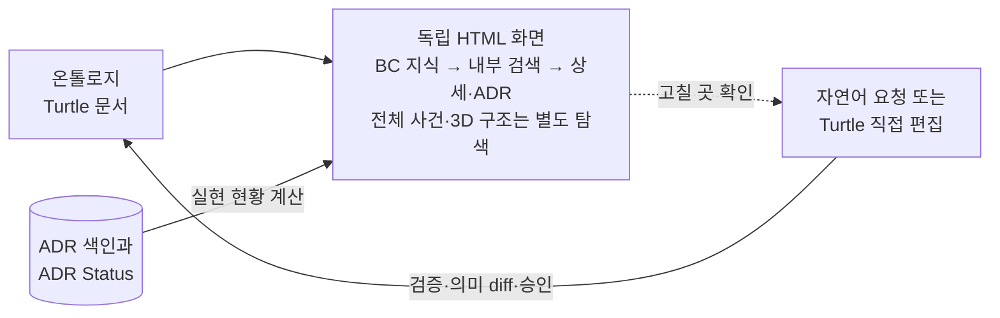

# ADR 0005: 온톨로지를 요청 시 읽기 전용 탐색 화면으로 시각화

Date: 2026-10-29

## Status

Accepted (2026-11-05)

## Purpose

업무 온톨로지는 Turtle 텍스트로 저장되므로 저장소 화면에서 흐름이 그림으로 보이지 않는다. 사용자는 전체 업무가
어떻게 이어지는지, 한 프로세스의 단계와 사건·정책이 어떻게 연결되는지, 어느 단계가 이미 기능으로 구현되었는지를 한눈에
보고 고칠 곳을 찾아야 한다. 요소가 많은 모델에서는 프로세스를 따라 내려가는 것만으로는 원하는 요소에 닿기 어렵다.
사용자는 이름만 알아도 요소를 찾고, 그 요소와 이어진 요소를 따라가며 살펴볼 수 있어야 한다. 사건을 중심으로 실제 업무를
따라가며 빠진 경로를 찾고, 추가 자료로 보완할지 완전성을 검토할지 다음 작업을 고를 수 있어야 한다.
사건의 원인인 주체·행동과 결과를 함께 읽고, 업무 문제 영역인 서브도메인과 같은 언어·규칙을 소유하는
바운디드 컨텍스트의 관계를 구별해야 한다. 사건의 나열이나 컨텍스트 이름만으로는 이 관계를 알 수 없다.

화면이 모델과 다른 내용을 보이면 무엇이 기준인지 흐려진다. 화면에서 모델을 고치는 두 번째 편집 경로가 생기면 검증·의미
diff·승인을 거치지 않은 변경이 생긴다. 실현 현황은 ADR 색인과 ADR Status에서 나오는 하위 레벨 정보라서, 모델에 적으면
하위 변경이 상위 레벨을 바꾸게 된다.

온톨로지 지식을 구성할 때의 레이어를 화면에도 적용한다. 최상위 BC 지식은 작고 가볍게 전체를 읽고, 무거운 BC 내부 지식은
선택한 경계에서 검색해 필요한 요소와 계약으로 내려가려는 사용자 의도다. 화면의 단순 확대나 요소 필터만으로 이 지식
레이어를 대신하지 않는다.

사용자는 BC 조망도 3차원으로 보고, BC가 확대되며 내부 지식이 펼쳐지는 이동으로 현재 읽는 레이어와 책임 범위를
파악하려 한다. 공간의 확대는 실제 지식 범위의 전환과 연결되어야 하며, 내부 전체를 미리 펼친 뒤 카메라만 움직이는
방식으로 선택적 읽기를 대신하지 않는다.

방향: 독립 HTML의 기본 화면은 BC의 책임·핵심 업무·협업을 담은 3차원 조망이다. BC를 선택하면 해당 영역으로
확대 이동하며 검색된 내부 업무를 펼치고, 요소·프로세스 상세와 실현 ADR로 내려간다. 목록 보기와 기존의 전체 사건
흐름·3차원 업무 구조도 제공한다. 화면은 읽기 전용 일회성 산출물로 남는다.

## Decision Drivers

- 사용자는 전체 업무와 프로세스 흐름을 그림으로 보고 고칠 곳을 찾아야 한다.
- 요소가 많은 모델에서도 사용자는 요소를 이름으로 찾고 관계를 따라 이동해야 한다.
- 화면은 모델의 파생물이어야 하며, 모델 변경은 검증·의미 diff·승인을 거치는 기존 편집 경로로만 일어나야 한다.
- 실현 현황은 보여줄 때 계산해야 하며 모델에 기록하면 안 된다.
- 화면은 ADR Writer의 리포트와 같은 전달 방식으로 독립 HTML을 만들어 기본 브라우저에서 한 번 열고, 열 수 없으면 원인과 절대 경로를
  알려야 한다.

## Decision

사용자가 요청하면 Ontology Writer는 모델과 ADR 색인을 읽어 외부 자료 없이 열리는 독립 HTML 화면을 만들고, 리포트 전달 규칙에
따라 기본 브라우저로 연다. 열기 금지나 특정 브라우저 요청은 그 규칙대로 따른다. 화면은 리뷰·평가·분석 리포트가 아닌 탐색 화면이므로 리포트 작성 계약의 대상이 아니며
전달 규칙만 따른다.

기본 화면은 BC의 이름·책임·핵심 업무와 명시된 협업만 보여준다. BC 내부의 사건·단계·정책을 처음부터 펼치지 않는다.
BC를 고르면 그 범위의 업무를 검색·페이지 탐색하고 요소와 프로세스 상세로 내려간다. 정확한 계약은 실현 ADR로 이어진다.
BC를 3차원 공간의 책임 영역으로 표시하고, 선택한 BC로 카메라가 이동하면서 그 범위의 현재 검색 페이지를 펼친다.
상세 선택은 해당 요소를 가까이에서 읽는 이동으로 연결한다. 상위로 돌아가면 이전 레이어의 조망과 탐색 상태를 복구한다.
공간의 크기·높이·배치를 업무 중요도, 실행 순서나 확인되지 않은 소속으로 해석하지 않게 하고, 업무 사실은 같은 원문의
목록·상세에서도 읽게 한다. 이동·회전·확대와 시점 초기화를 제공하며, 동작 줄이기 설정과 전환 효과 끄기를 지원한다.
연속 선택은 마지막 탐색을 따르고, 숨겨진 화면에서는 효과를 멈춘다. 입체 표현 없이도 같은 레이어와 내용을 탐색할 수 있다.
명시적으로 여는 전체 업무 전경에서는 프로세스와 프로세스 사이를 잇는 사건·정책을 함께 보여준다.
프로세스 흐름은 단계의 순서, 단계가 발생시키는 사건, 단계를 시작하게 하는 사건과 정책, 단계의 행위자와 컨텍스트를
그림으로 보여준다. 요소 상세는 그 요소의 모든 사실 속성, 관련 업무 규칙(단계에는 그 단계에 닿는 규칙, 다른 요소에는 그 요소를 제약하는
규칙), 식별자와 그 요소가 있는 모델
문서를 보여준다.

화면은 모든 요소를 이름이나 식별자로 찾게 하고, 바운디드 컨텍스트별로 묶은 목록에서 프로세스의 단계를 흐름 순서로
보여준다. 컨텍스트에 속하지 않는 요소는 따로 묶는다. 요소 상세는 관계로 이어진 모든 요소를 관계 이름과 방향과 함께
보여주고 그 요소로 이동하게 한다. 전체 업무 전경은 회전·확대할 수 있는 3차원 공간으로도 보여준다. 이 공간은 바운디드
컨텍스트별 묶음, 프로세스와 단계, 단계의 실현 현황, 프로세스 사이를 잇는 사건·정책을 담는다. 공간에서 고른 프로세스는
그 흐름으로, 다른 요소는 그 상세로 이동한다. 3차원 공간은 그림·목록·상세에 있는 사실만 보여준다.

화면은 단계마다 실현 기능별 ADR Status와 구현 여부를 겹쳐 보여준다. 실현 기능마다 `Accepted` ADR이 하나 이상 있고
`Proposed` ADR이 없을 때만 '구현됨'으로 표시하고, 시스템 밖 단계는 실현 대상이 아님을 표시한다. 실현 현황은 화면을 만들 때
현재 ADR 색인과 ADR Status에서 계산한다. 그림, 요소와 오류는 검증·조회와 같은 모델 해석에서 나온다. 은퇴한 프로세스는
조회와 같이 요청할 때만 은퇴 표시와 함께 그린다.

화면은 모델을 고치지 않는다. 사용자는 화면에서 고칠 곳을 찾은 뒤 자연어로 수정을 요청하고, 개발자는 Turtle 텍스트를 직접
고칠 수도 있다. 화면에 보이는 식별자와 모델 문서 위치는 그 요청과 편집의 대상을 정확히 가리키게 한다. 화면 파일은
저장소가 추적하지 않는 일회성 위치에 둔다.

### 이벤트 스토밍과 준비 상태의 탐색

화면의 업무 탐색은 이벤트 스토밍 결과물 형태의 보드로 제공한다. 행위자·업무 명령, 엔티티 또는 애그리거트의 변화,
도메인 이벤트, 반응 정책과 후속 행동을 구별한 카드와 연결선으로 업무 로직을 따라가게 한다. 이 보드는 Mermaid
다이어그램으로 대체하지 않는다. 저장된 모델에서는 확인 가능한 관계만 재구성한다. 사건을 따라가면 그 사건을 만든
행위자와 단계, 반응 정책과 다음 단계, 업무 개념과 책임 경계를 찾을 수 있다. 이 보기는 현재 모델의 파생물이며,
모델에 보존하지 않은 워크숍 순서, 원문 근거나 미채택 후보를 복원했다고 주장하지 않는다. 구축 중의 출처·판정·질문과
서브도메인 후보는 이벤트 스토밍 리포트에서 확인한다.

화면에서 업무 프로세스의 미정 범위와 다음 작업을 찾을 수 있어야 한다. 추가 자료를 통한 갱신, 자연어 편집, 직접
편집의 동기화, 읽기 전용 완전성·준비 상태 검토, 실제 실행을 포함하는 정렬 검토를 구별해 안내한다. 구현됨 표시는
ADR Status에서 계산한 실현 현황이며 프로세스의 완전성이나 실행 검증 성공을 뜻하지 않는다. 준비 상태 검토를 하지
않았다면 그 부분은 미확인으로 보이고, 화면 열기만으로 검토나 Status 전이가 실행되지 않는다.

엔티티 변화의 전후 상태는 출처가 뒷받침하는 업무 사실로만 표시한다. 업무 개념을 사용한다는 관계만으로 그 개념이
변경되었다고 추론하지 않는다. 확인되지 않은 변화는 미확인으로 보이며, 작성 중의 이벤트 스토밍 결과는 출처·판정과
함께 일회성 보드로 열 수 있다. 이 작업 산출물은 저장된 온톨로지의 어휘를 확장하거나 상태 기계의 두 번째 권위가
되지 않으며, 모델이 아직 없어도 후보 보드를 검토할 수 있다. 확정 모델 보기의 모델 없음 보장과 후보 보기는 구별한다.

### 지식 레이어와 전체 업무 탐색

저장 모델의 첫 화면은 작성된 BC 지식 레이어다. 선택한 BC의 검색·목록·상세에서 바깥 BC와 연결된 업무도 경계 연결로
드러내며, 관련 BC를 선택해 이동한다. 전체 업무 탐색을 명시적으로 열면 도메인 이벤트가 중심인 평면 사건 흐름에서
컨텍스트를 가로지르는 업무를 읽는다. 모델이 없는 후보 보드는 사건 흐름으로 시작한다. 사건은 활동의 부속 라벨이 아닌 주요 읽기 단위이고, 그 사건을 만드는 행동과
수행자, 다음 행동을 시작시키는 정책·조건을 구분한다. 연결은 확인된 인과와 진행 순서를 구별하며 분기·합류·순환을
보존한다. 화면의 위치만으로 시간, 인과, 상호 배타적인 분기나 확인되지 않은 사건을 만들어내지 않는다.

기록된 업무 규칙과 미정 경로는 관련 흐름 가까이에서 읽고 근거를 열 수 있게 한다. 프로세스 전체의 미정 범위와
특정 단계의 질문을 구별하며, 발생 지점이 확인되지 않은 질문을 특정 사건의 예외로 확정하지 않는다. 개념에 걸린
규칙은 관련 규칙으로 표시하고 특정 행동이 강제하거나 애그리거트가 원자적으로 보장한다고 추론하지 않는다.

업무 구조 탭은 바운디드 컨텍스트의 구역, 프로세스·단계의 계층, 사건·정책의 인계와 실현 현황을 3D로 보여준다.
프로세스의 책임과 계층은 이 보기에서 탐색한다. 사건 상세에서는 업무 구조의 동일 단계로
이동할 수 있고, 구역이나 요소를 선택하면 모델에 기록된 소속과 관계를 읽는다. 한 프로세스의 공간 배치만으로
모든 단계의 소속을 추론하지 않는다.

명시적으로 여는 전체 업무 탐색에는 사건 흐름과 업무 구조 두 탭을 제공한다. 사건 흐름은 사건을 읽기 쉬운 정면 배치를 유지하면서
입체감 있는 표면과 연결 표현을 사용한다. 두 보기는 같은 업무의 인과와 책임·구조를 각각 설명하며 전환으로 업무
사실이나 상태·판정이 달라지지 않는다. 탐색 상태는 같은 화면 안에서 유지한다. 사건 흐름 안에서는 개별 사건과
전체 업무 영역을 오가며 읽는다. 업무 영역은 도메인 범위 안에 서브도메인과 바운디드 컨텍스트를 묶고,
컨텍스트 사이의 기록된 사건 반응·진행 순서를 구별해 보여준다. 후보 보드도 같은 탐색과 원본 카드를 제공하며,
모델이 있어야 가능한 프로세스 계층·실현 현황은 만들지 않는다. BC 지식 레이어는 이 두 표현의 상위 탐색 경로이며,
후보 자료의 영역 배치나 전체 사건 지도를 상위 BC 지식으로 재분류하지 않는다.

영역의 이름·분류·소속과 외부 컨텍스트 여부는 자료에 기록된 근거와 판정에 따라 표시한다. 하나의 컨텍스트가 여러
서브도메인과 관련되면 동일한 컨텍스트의 복수 소속으로 표현하며 중간에 놓인 영역까지 소속으로 해석하게 하지 않는다.
식별자가 없는 소속이나 분류는 미확인으로 남긴다. 외부 행위자가 있다는 사실만으로 외부 컨텍스트를 만들지 않는다.
저장 모델에 없는 도메인·서브도메인·뷰는 복원한 사실처럼 표시하지 않으며, 후보 자료가 저장 어휘를 확장하지 않는다.

각 활동은 주체와 행동, 확인된 업무 대상의 변화, 발생 사건을 하나의 원인·결과 묶음으로 읽게 한다. 자료에 있는
뷰(행동에 참고하거나 결과를 확인하는 화면·조회 모델)는 입력과 결과의 역할을 구별해 함께 보여준다. 사람의 명령,
시스템의 자동 행동, 시간에 따른 행동과 외부 활동을 모두 표현할 수 있으며 모든 사건에 사람이나 화면을 요구하지 않는다.
뷰나 수행자가 미기록이면 이를 표시하고, 뷰가 사건을 직접 일으키거나 갱신됐다고 추가 추론하지 않는다.

사건 흐름의 기록된 이벤트 연결에는 은은한 설명용 신호가 출발에서 도착 방향으로 흐른다. 진행 순서만 있는
연결은 통신처럼 애니메이션하지 않으며, 이 효과는 실제 실행·통신·처리 성공의 증거가 아니다. 사용자는 효과를
멈추거나 다시 켤 수 있고, 모션 감소 설정에서는 자동 시작하지 않는다. 보이지 않는 화면에서는 효과를 그리지 않는다.
기본 보기와 확대·축소 상태에서도 신호의 이동을 식별할 수 있어야 하며, 재생 중인지 또는 사용자 정지·모션 감소·
보이지 않는 화면·재생할 연결 없음 때문에 멈췄는지 화면에서 알 수 있어야 한다.

사건 흐름의 주 연결선은 정책 카드에서 끝나지 않고 후속 행동이 만드는 사건까지 이어지는 업무 경로로 보여준다.
정책과 행동을 거친 관계를 사건 중심으로 배치한 보기이며, 관계를 선택하면 원래 정책·조건·행동·발생 사건과
근거를 확인할 수 있다. 사건이 기록되지 않은 단계는 중간 행동 표식으로 남기고, 진행 순서는 반응 경로와 구별한다.
사건을 선택하면 그 사건의 상류·하류 경로를 강조한다. 이 강조는 모델을 탐색하는 선택 상태이며 실제 실행 추적이나
처리 성공을 뜻하지 않는다.

화면은 아이콘의 범례를 외워야 업무를 읽을 수 있는 구성 대신, 활동마다 수행 주체·업무 대상·받는 사건과 반응 조건·
발생 사건을 원래 업무 언어로 드러낸다. 다른 컨텍스트의 사건이 시작 계기라면 해당 컨텍스트에 초점을 맞춘 화면에서도
그 계기를 읽을 수 있다. 사용 대상인 개념을 엔티티의 특정 상태나 개별 인스턴스로 오인하게 하지 않고, 확인된 변화만
전후 상태로 보여준다. 선택 표시와 검토용 탐색 조작도 업무 상태·실행 버튼과 구별한다.

### Requirement contract

#### Required guarantees

| 의무                                                                                                                                                                                                                                                                                      | 관찰 가능한 검증 기준                                                                                                                                                               |
| ----------------------------------------------------------------------------------------------------------------------------------------------------------------------------------------------------------------------------------------------------------------------------------------- | ----------------------------------------------------------------------------------------------------------------------------------------------------------------------------------- |
| R1. 사용자가 요청하면 Ontology Writer는 모델과 ADR 색인으로 외부 자료 없이 열리는 독립 HTML 화면을 만든다.                                                                                                                                                                                | 화면 파일 하나가 외부 자료 없이 열린다.                                                                                                                                             |
| R2. 화면은 리포트 전달 규칙에 따라 기본 브라우저로 한 번 열고, 열기 금지나 특정 브라우저 요청은 그 규칙대로 따른다.                                                                                                                                                                       | 별도 요청이 없으면 기본 브라우저로 한 번 열리고, 특정 브라우저를 요청하면 그 브라우저로 열리며, 열기 금지를 요청하면 열리지 않는다.                                                 |
| R3. 화면은 BC 전체에서 선택한 BC의 업무 검색·목록으로, 해당 업무에서 요소·프로세스 상세와 실현 ADR로 이동한다.                                                                                                                                                                            | BC, 업무 항목, 관계를 마우스와 키보드 각각으로 선택해 상세와 실현 ADR 경로·상태에 도달한다.                                                                                         |
| R4. 기본 최상위는 모델에 작성된 BC 이름·책임·핵심 업무와 BC 협업만 보여준다. 전체 프로세스와 사건·정책 전경은 명시적인 전체 업무 탐색에서 제공한다.                                                                                                                                       | 첫 화면에 내부 업무의 전체 목록이나 사건 캔버스가 없고, BC 원본 지식은 모델과 같으며 전체 업무 연결은 별도 진입 후 볼 수 있다.                                                      |
| R5. 프로세스 흐름은 단계의 순서, 단계가 발생시키는 사건(다른 프로세스의 정책을 촉발하는 사건 포함), 단계를 시작하게 하는 사건과 정책, 단계의 행위자와 컨텍스트를 그림으로 보여준다.                                                                                                       | 그 프로세스의 흐름·발생·촉발·시작·수행 관계가 모두 그림에 있다.                                                                                                                     |
| R6. 요소 상세는 그 요소 유형의 모든 사실 속성, 관련 업무 규칙(단계에는 그 단계에 닿는 업무 규칙, 다른 요소에는 그 요소를 제약하는 업무 규칙), 식별자와 그 요소가 있는 모델 문서를 보여주고, 설명 속성은 설명으로 구분해 보여준다.                                                         | 요소의 모든 사실 속성, 관련 업무 규칙과 식별자·모델 문서가 상세에 있고 값이 모델과 같으며, 설명 속성은 설명으로 표시된다.                                                           |
| R7. 화면은 단계마다 실현 기능별 ADR Status와 구현 여부를, 프로세스마다 Status를 보여준다. 실현 기능마다 `Accepted` ADR이 하나 이상 있고 `Proposed` ADR이 없을 때만 '구현됨'으로 표시하고, `Deprecated`와 `Superseded` ADR은 판정에서 뺀다.                                                | '구현됨' 표시가 이 규칙과 일치하고, 프로세스 Status가 모델과 같다.                                                                                                                  |
| R8. 시스템 밖 단계는 실현 대상이 아님을 표시하고, 실현 기능이 없는 시스템 단계는 미실현으로 구분해 표시한다.                                                                                                                                                                              | 시스템 밖 단계와 미실현 시스템 단계가 서로 다른 표시로 보인다.                                                                                                                      |
| R9. 실현 현황은 화면을 만들 때 현재 ADR 색인과 ADR Status에서 계산한다.                                                                                                                                                                                                                   | ADR Status가 바뀐 뒤 다시 만든 화면에 바뀐 실현 현황이 보인다.                                                                                                                      |
| R10. 화면의 그림, 요소와 오류는 검증·조회와 같은 모델 해석에서 나온다.                                                                                                                                                                                                                    | 같은 저장소 상태에서 화면에 그린 요소·관계·오류가 그 요소를 담는 프로세스, 업무 개념이나 업무 사건을 입력한 조회 결과에도 같은 식별자와 의미로 있다. 조회에만 있는 연결은 허용한다. |
| R11. 은퇴한 프로세스는 요청할 때만 은퇴 표시와 함께 그린다.                                                                                                                                                                                                                               | 기본 화면에 `Deprecated`와 `Superseded` 프로세스가 없고, 요청하면 은퇴 표시와 함께 보인다.                                                                                          |
| R12. 모델 문서에 커밋되지 않은 변경이나 `Accepted` 프로세스의 동기화 전 직접 편집이 있으면 화면은 그 사실과 추가·변경·삭제된 요소를 표시한다.                                                                                                                                             | 작업 트리에서 추가·변경·삭제한 요소와 `Accepted` 프로세스의 동기화 전 커밋된 직접 편집이 화면에 표시된다.                                                                           |
| R18. 화면은 보이는 모든 요소를 이름이나 식별자로 찾게 하고, 바운디드 컨텍스트별로 묶은 목록에서 프로세스의 단계를 흐름 순서로 보여준다. 컨텍스트에 속하지 않는 요소는 따로 묶는다.                                                                                                        | 화면에 보이는 모든 요소가 이름과 식별자 검색에 나오고, 목록에서 그 요소의 컨텍스트 아래에 있으며, 프로세스의 단계가 흐름 순서로 나열된다.                                           |
| R19. 요소 상세는 관계로 이어진 모든 요소를 관계 이름과 방향(그 요소에서 나가는 관계, 그 요소로 들어오는 관계)과 함께 보여주고, 그 요소를 선택하면 그 요소의 상세로 이동한다. 은퇴해 숨긴 요소는 R11을 따른다.                                                                             | 상세의 관계 목록이 모델에서 그 요소에서 나가고 들어오는 관계와 같고, 각 항목을 마우스와 키보드 각각으로 선택해 상대 요소의 상세로 이동한다.                                         |
| R20. 전체 업무 전경은 회전·확대할 수 있는 3차원 공간으로도 보여준다. 공간은 바운디드 컨텍스트별 묶음, 프로세스와 그 단계, 단계의 실현 현황, 프로세스 사이를 잇는 사건·정책을 담고, 공간에서 고른 프로세스는 그 흐름으로, 다른 요소는 그 상세로 이동한다. 3차원 공간에만 있는 정보는 없다. | 모든 프로세스와 단계, 프로세스 사이의 사건·정책 연결이 공간에 있고, 단계의 표시가 R7·R8의 실현 현황과 같으며, 공간이 보여주는 모든 사실이 그림·목록·상세에도 있다.                  |

**사건 중심 탐색과 다음 작업**

| 의무                                                                                                                                                                                                                                                                                                                                        | 관찰 가능한 검증 기준                                                                                                                                                                                      |
| ------------------------------------------------------------------------------------------------------------------------------------------------------------------------------------------------------------------------------------------------------------------------------------------------------------------------------------------- | ---------------------------------------------------------------------------------------------------------------------------------------------------------------------------------------------------------- |
| R21. 화면은 행위자·명령, 엔티티/애그리거트의 변화, 도메인 이벤트, 정책과 후속 행동을 구별하는 이벤트 스토밍 보드를 제공하며 Mermaid 그림으로 대체하지 않는다. 현재 모델에서 얻은 관계와 출처를 가진 작성 중 후보를 구별하고, 업무 개념의 사용만으로 상태 변화를 확정하지 않는다.                                                            | 사건을 선택하면 원인·반응과 업무 경계를 찾을 수 있고, 저장하지 않은 출처나 워크숍 이력이 현재 모델의 사실처럼 나타나지 않는다.                                                                             |
| R22. 화면은 미정 범위를 드러내고 추가 자료 기반 갱신, 자연어 편집, 직접 편집 동기화, 완전성·준비 상태 검토와 실행 정렬 검토의 진입 방법을 구별해 안내한다.                                                                                                                                                                                  | 사용자가 부족한 경로를 찾은 위치에서 해당 후속 작업을 선택할 수 있고, 화면 자체는 모델을 저장하거나 Status를 바꾸지 않는다.                                                                                |
| R23. 화면은 ADR Status 기반 실현 현황, 업무 완전성 검토와 실제 실행 검증을 구별하며 수행하지 않은 점검을 미확인으로 표시한다.                                                                                                                                                                                                               | 구현됨 배지가 업무 완전성 또는 실행 검증 통과로 읽히지 않고, 검토하지 않은 영역의 통과 표시가 없다.                                                                                                        |
| R24. 엔티티 변화의 전후 상태와 후보 관계는 근거·판정과 함께 보여주고, 확인되지 않은 변화는 미확인으로 남긴다. 모델이 없는 초기 구축도 일회성 후보 보드로 검토할 수 있다. 후보 보드는 모델·ADR·색인을 저장하거나 어휘·상태 계약을 추가하지 않는다.                                                                                           | 명시한 전후 상태와 출처를 보드에서 찾을 수 있고, 근거 없는 변화가 확정 표시되지 않으며, 후보 보드를 열기 전후 저장소 업무 문서의 diff가 없다.                                                              |
| R25. 별도 대상이 지정되지 않은 저장 모델의 첫 화면은 BC 지식 레이어다. BC나 요소를 지정한 주소는 해당 위치로 직접 진입할 수 있다. 전체 업무 탐색을 명시적으로 열면 사건을 주요 읽기 단위로 삼는 평면 사건 흐름에서 행동·수행자와 반응 정책·조건을 구별한다. 후보 보드의 기본 사건 탐색은 유지한다.                                          | 새로 열면 BC 전체가 보이고, 전체 업무 탐색에서는 사건·행동·정책과 확인된 연결을 읽으며 선택 내용이 원본 카드와 일치한다.                                                                                   |
| R26. BC 전체·선택 BC·상세와 전체 업무 탐색을 오갈 수 있다. 전체 업무 탐색 안의 사건 흐름과 3D 업무 구조는 두 탭으로 유지하며, 같은 문서에서 돌아온 탐색 위치·검색·선택 상태를 보존한다. 전환은 모델·ADR·색인·Status 또는 판정을 바꾸지 않는다. 후보 보드는 사건·원본 카드를 제공하며 모델 없는 계층·실현을 만들지 않는다.                   | BC 탐색과 전체 업무 탐색을 마우스·키보드로 오가고 검색·페이지·선택 및 기존 두 표현의 위치·확대가 유지되며, 저장소나 브라우저 영속 상태를 바꾸지 않는다.                                                    |
| R27. 전체 업무 구조에서 컨텍스트 구역, 프로세스·단계와 사건·정책 인계를 확인하고 사건 상세에서 동일한 단계로 이동한다. BC 지식 탐색에서는 실제 소속을 기준으로 내부·경계 연결을 구별하며 같은 이름의 다른 컨텍스트 식별자를 합치지 않는다.                                                                                                  | BC 간 관계와 실제 소속을 확인하고 상세 및 전체 업무 구조의 동일 요소에 도달하며, 표시 이름이 같은 BC도 식별자별로 구별된다.                                                                                |
| R28. 사건 흐름과 업무 구조의 기본 클릭 드래그는 이동이고 확대를 제공하며, 3D 업무 구조에서는 회전도 가능하다. 이동을 클릭 선택으로 오인하지 않고 상세는 평면에서 읽는다. 탐색 상태를 영속 저장하지 않으며 다시 열면 초기 상태로 시작한다.                                                                                                   | 드래그 뒤 시야가 이동하되 선택이 바뀌지 않고 확대·상세 확인과 3D 회전이 가능하며, 다시 연 화면과 저장소·브라우저 저장소에 탐색 상태가 남지 않는다.                                                         |
| R29. 사건 흐름은 기본 보기와 전체 보기에서 사건과 조건을 기울이지 않고 읽을 수 있게 배치한다. 입체감과 흐름 효과는 읽기 순서·관계·업무 사실을 바꾸지 않는다.                                                                                                                                                                                | 사건의 텍스트와 인과·순서 구별을 정면에서 읽으며, 확대·이동·효과의 전후에 원문·연결과 판정이 같다.                                                                                                         |
| R30. 사건 흐름의 기록된 이벤트 촉발 연결에는 출발에서 도착으로 움직이는 은은한 설명용 신호를 제공한다. 진행 순서만 있는 연결은 움직이는 통신으로 표현하지 않고, 실제 실행·통신·성공 여부를 뜻하지 않음을 밝힌다. 효과는 일시 정지·재개가 가능하고 모션 감소 설정에서는 자동 시작하지 않으며, 숨겨진 화면에서는 그리기를 멈춘다.             | 신호의 경로와 방향이 모델의 이벤트 연결과 일치하고, 정지·모션 감소·화면 숨김에서 동작이 멈추며, 판정·업무 데이터와 카메라는 신호 효과로 바뀌지 않는다.                                                     |
| R31. 활동의 수행 주체·대상·발생 사건과, 기록된 시작 사건·반응 조건을 업무 언어로 표시하고, 다른 컨텍스트에서 온 시작 계기도 집중 보기에서 확인하게 한다. 업무 대상·선택 표시를 상태 변화나 인스턴스 수로 표현하지 않으며, 없는 조건·전후 상태는 미기록·미확인으로 남긴다. 검토용 탐색의 사용 방법을 화면에서 알 수 있어야 한다.             | 처음 보는 사람이 아이콘 해석 없이 활동의 주체·대상·계기·결과를 읽고 관련 인계와 근거를 열 수 있으며, 결제 조건을 순서선으로 대체하거나 사용 관계를 상태 전이로 단정하지 않는다.                            |
| R32. 사건 흐름은 기록된 인과·진행 순서의 방향과 분기·합류·순환을 보존한다. 서로 연결되지 않은 항목을 이어진 이야기로 단정하거나, 사건이 없는 활동에 사건을 만들거나, 배치를 실제 발생 시간으로 표현하지 않는다.                                                                                                                             | 정상 흐름과 분기·순환·연결 없는 자료에서 연결의 양끝과 종류가 원문과 같고, 사건 미기록과 배치의 한계를 확인할 수 있다.                                                                                     |
| R33. 관련 업무 규칙과 미정 경로·질문을 해당 흐름 가까이에 표시하고 원문·범위·근거 판정을 보존한다. 프로세스 범위와 단계 범위를 구별하며, 사용 개념의 규칙을 특정 단계의 강제 보장이나 애그리거트 경계로 확정하지 않는다.                                                                                                                    | 관련 규칙과 미정 질문을 사건 흐름에서 읽고 근거를 확인할 수 있으며, 프로세스 전체의 질문이 특정 사건의 확정된 실패 분기로 표시되지 않는다.                                                                 |
| R34. 사건 흐름의 주 연결은 사건에서 후속 행동의 발생 사건까지 연속선과 화살표로 추적할 수 있어야 한다. 사건이 없으면 중간 행동으로 표시하고, 반응 경로와 진행 순서를 구별한다. 사건 선택은 원문에 연결된 상류·하류 경로를 강조하고, 관계 선택은 정책·행동·조건·발생 사건과 근거를 보여준다. 실제 실행 추적이나 미확인 인과를 만들지 않는다. | 주 연결이 정책 카드에서 끝나지 않고 실제 도착 사건 또는 중간 행동에 닿는다. 분기·순환에서 선택한 사건의 관련 경로를 확인하고 원문 관계를 열 수 있으며, 단순 순서는 사건 반응이나 통신으로 표시되지 않는다. |
| R35. 전체 업무 영역은 도메인·서브도메인·바운디드 컨텍스트를 근거와 판정에 따라 묶고 기록된 인계를 보여준다. 복수 소속은 하나의 컨텍스트로 유지하며, 같은 이름의 다른 식별자를 합치지 않는다. 미기록 소속·분류는 미확인으로 남기고 외부 컨텍스트를 행위자로부터 추론하지 않는다.                                                             | 단일·복수·미확인 소속과 외부 컨텍스트를 구별하고, 컨텍스트와 연결을 선택해 해당 사건·원문·근거에 도달한다. 저장 모델에 없는 영역 정보는 확인된 사실로 나타나지 않는다.                                     |
| R36. 주체·행동에서 업무 대상의 확인된 변화와 발생 사건으로 이어지는 묶음을 읽을 수 있고, 자료에 있는 뷰는 행동의 입력과 결과 확인 역할을 구별한다. 자동·시간·외부 활동에 사람이나 화면을 강제하지 않으며, 미기록 주체·변화·뷰는 미확인으로 남긴다.                                                                                          | 사람·시스템·외부 활동의 원인과 결과를 순서대로 읽고 뷰의 역할과 근거를 열 수 있다. 사건이 없거나 뷰·변화의 근거가 없는 입력에서도 사실이 추가되지 않는다.                                                  |
| R37. 흐름 효과는 기본 보기와 확대·축소에서 방향을 식별할 수 있고, 재생·사용자 정지·모션 감소·화면 숨김·재생할 연결 없음 상태를 구별해 설명한다.                                                                                                                                                                                             | 움직이는 신호가 확인되고 상태 표시가 실제 동작과 일치한다. 정지·재개와 표현 전환 후에도 방향·관계·판정과 탐색 위치가 유지된다.                                                                             |
| R38. 선택한 BC의 내부 업무는 이름·식별자와 업무 문구로 검색하고 결과를 유한한 페이지로 탐색한다. 다른 BC 내부를 전체 목록에 섞지 않고 경계 연결과 그 상대 BC로 이동할 방법을 남긴다.                                                                                                                                                        | 내부가 큰 BC에서도 보이는 목록이 제한되고 모든 페이지로 나머지를 읽으며, 검색된 내부 항목·관계와 상대 BC를 확인한다.                                                                                       |
| R39. BC 지식과 내부 상세는 같은 모델에서 읽고 상위 지식의 누락·검증 오류·변경 미확인을 표시한다. 없는 핵심 업무나 협업을 조회 시 생성하지 않고, 구조가 채워졌다는 표시를 업무 완전성·실행 성공으로 쓰지 않는다.                                                                                                                             | 상위 지식이 없는 기존 모델과 잘못된 모델에서도 부족함·오류가 보이고, 원문에 없는 설명이나 완료 판정이 생기지 않는다.                                                                                       |
| R40. 현재 BC와 전체로 돌아가는 경로를 항상 구별하고, 내부 항목에서 다른 BC의 항목으로 이동할 때 해당 책임 경계를 명시한다. 공유 프로세스·규칙·행위자는 임의로 한 BC만의 소유로 만들지 않는다.                                                                                                                                               | 뒤로 이동하면 같은 검색·페이지를 복구하고, 외부·공유 항목의 책임과 이동할 BC를 확인한다.                                                                                                                   |
| R41. 기본 BC 화면에서는 내부의 전체 사건·3D 캔버스와 모든 상세를 그리지 않는다. 내부 목록은 선택 시, 프로세스 그림과 상세는 요청 시 표시한다. 독립 HTML은 오프라인 사용에 필요한 원본·표현 자료를 포함할 수 있다.                                                                                                                           | 큰 모델을 처음 열 때 BC 수준 화면만 표시되고 상세 그림이 미리 렌더되지 않으며, 선택 후 필요한 내용이 외부 요청 없이 열린다.                                                                                |
| R42. BC 선택·검색·페이지·상세·돌아가기와 전체 보기 전환은 키보드로도 사용할 수 있고 좁은 화면에서 주요 조작과 내용을 읽을 수 있다.                                                                                                                                                                                                          | 키보드와 작은 화면의 실제 진입 경로에서 같은 항목과 상세를 확인한다.                                                                                                                                       |
| R43. 기본 BC 조망은 BC 책임 영역과 기록된 협업을 3차원으로 보여준다. 내부 업무는 BC를 선택하기 전에는 공간에 만들지 않으며, 공간 배치·크기·높이로 업무 사실이나 새 지식 레이어를 추론하지 않는다.                                                                                                                                           | 첫 조망에는 BC만 있고 내부 요소는 없으며, BC·협업과 설명이 원문 및 목록 보기와 일치한다.                                                                                                                   |
| R44. BC 선택은 해당 영역으로의 확대 이동과 현재 검색 페이지의 내부 업무 펼침으로 이어진다. 상세 선택과 상위 복귀도 해당 지식 범위에 맞게 이동하고, 같은 문서에서 이전 조망·검색·페이지·선택 상태를 복구한다.                                                                                                                                | BC·내부 요소·상위를 선택하면 카메라와 실제 표시 범위가 함께 바뀌고, 다른 BC의 내부를 미리 펼치지 않으며 복귀 후 탐색을 이어간다.                                                                           |
| R45. 3차원 레이어 전환은 연속 입력에서 마지막 탐색을 따르고, 화면이 숨겨지면 효과를 멈춘다. 사용자는 전환 효과를 끌 수 있고 동작 줄이기 설정에서는 애니메이션 없이 같은 결과에 도달한다.                                                                                                                                                    | 전환 도중 다른 BC나 상위를 선택해도 최종 화면·상세·주소가 일치하며, 숨김·효과 끄기·동작 줄이기에서 움직임이 멈추고 탐색 결과는 같다.                                                                       |
| R46. BC 공간은 이동·회전·확대·시점 초기화를 제공하고 드래그를 요소 선택으로 처리하지 않는다. 목록 보기에서도 같은 지식·검색·관계·상세에 도달하며 두 표현의 전환은 데이터와 영속 상태를 바꾸지 않는다.                                                                                                                                       | 공간 조작과 목록 전환을 실제 입력으로 실행하고, 조작 전후 원문·선택·검색 상태와 파일·브라우저 저장소가 보존된다.                                                                                           |

#### Prohibitions

| 의무                                                                                                            | 관찰 가능한 검증 기준                                              |
| --------------------------------------------------------------------------------------------------------------- | ------------------------------------------------------------------ |
| R13. 화면은 모델, ADR 색인이나 ADR을 고치지 않으며 편집 기능을 갖지 않는다.                                     | 화면에 저장 동작이 없고, 화면을 쓴 뒤 모델·색인·ADR의 diff가 없다. |
| R14. 화면 파일은 저장소가 추적하지 않는 일회성 위치에 만들고, 실현 현황을 모델이나 별도 파일로 영속하지 않는다. | 화면을 만든 뒤 추적 파일 변경과 새 untracked 파일이 없다.          |

#### Failure guarantees

| 의무                                                                                                       | 관찰 가능한 검증 기준                                       |
| ---------------------------------------------------------------------------------------------------------- | ----------------------------------------------------------- |
| R15. 모델에 검증 오류가 있으면 화면은 오류 위치를 표시하고 오류가 걸친 부분을 완전한 것처럼 그리지 않는다. | 끊어진 관계가 있는 모델의 화면에 오류와 영향 범위가 보인다. |
| R16. 모델 문서가 없는 저장소에서 화면을 요청하면 화면을 만들지 않고 모델이 없음을 알린다.                  | 모델 문서가 없을 때 빈 화면이 만들어지지 않는다.            |
| R17. 브라우저를 열 수 없으면 실제 실패 원인과 생성한 화면 파일의 절대 경로를 알린다.                       | 열기에 실패해도 사용자가 원인을 알고 파일을 찾을 수 있다.   |

### Alternatives

1. **생성한 Markdown·Mermaid 보기를 저장소에 커밋**
   - 장점: 저장소 화면과 PR에서 그림이 바로 보인다.
   - 단점: 모델 옆에 두 번째 표현이 생기고, 갱신을 빠뜨리면 오래된 그림이 남으며 에이전트가 어느 파일을 읽을지 혼동할 수
     있다. 요소 찾기, 관계 이동, 3차원 전경 같은 탐색을 담을 수 없다.

2. **화면에서 직접 편집하고 저장**
   - 장점: 그림에서 바로 고칠 수 있다.
   - 단점: 브라우저가 저장소 파일을 쓰려면 로컬 서버가 필요하고, 편집 경로가 둘이 되어 검증·의미 diff·승인을 우회할 위험이
     생긴다.

3. **외부 RDF 시각화 도구 사용**
   - 장점: 이미 있는 도구로 그래프를 볼 수 있다.
   - 단점: 실현 기능과 ADR Status를 겹쳐 보여주지 못하고 별도 설치가 필요하다.

4. **요청 시 생성하는 읽기 전용 독립 HTML 화면 (채택)**
   - 장점: 원본이 하나로 유지되고 실현 현황을 현재 상태로 보여준다.
   - 단점: 저장소 화면에서는 그림이 보이지 않고, 보려면 Ontology Writer로 화면을 만들어야 한다.

## Consequences

### Positive

- 사용자는 전체 업무와 프로세스 흐름을 그림으로 보고, 실현되지 않은 단계와 고칠 요소의 위치를 바로 찾는다.
- 요소가 많은 모델에서도 이름으로 요소를 찾고 관계를 따라가며, 3차원 전경에서 업무의 규모와 실현 정도를 한눈에 본다.
- BC 확대와 내부 펼침이 실제 지식 범위의 전환과 함께 일어나 현재 읽는 책임 범위를 추적할 수 있다.
- 모델의 원본과 편집 경로가 하나로 유지된다.

### Negative

- 저장소 화면이나 PR에서는 그림을 볼 수 없다.
- 화면을 보려면 매번 생성해야 한다.
- 3차원 공간을 그리느라 브라우저가 그림 하나보다 많은 자원을 쓴다.
- 입체 이동은 내용을 가리거나 움직임에 부담을 줄 수 있다. 목록·평면 상세와 효과 끄기, 동작 줄이기 설정을 함께 제공한다.

### Risks

- 프로세스가 크면 흐름 그림이 읽기 어려워질 수 있다. 전경, 흐름, 상세로 나누어 한 번에 보이는 범위를 줄인다.
- 3차원 공간은 키보드나 화면 낭독기로 쓰기 어렵다. 공간의 모든 사실을 그림·목록·상세에도 두고, 요소 선택은 검색과
  목록으로도 할 수 있게 한다.

## Related

- [업무 온톨로지를 ADR 위의 RDFS-lite 레벨로 도입](./0001-introduce-business-ontology-level.md)
- [에이전트의 업무 맥락 조회와 세션 지침](./0002-retrieve-business-context-for-agents.md)
- [온톨로지 변경의 승인과 하위 전파](./0003-govern-ontology-lifecycle-and-cascade.md)
- [도메인 우선 리포트 탐색](../reporting/domain-navigation/0001-domain-first-report-navigation.md)
