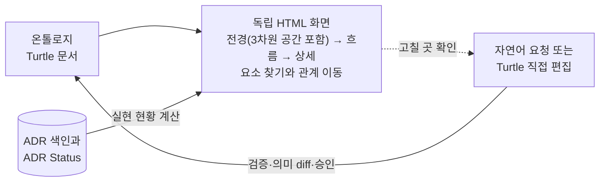

# ADR 0005: 온톨로지를 요청 시 읽기 전용 탐색 화면으로 시각화

Date: 2026-10-29

## Status

Accepted (2026-11-02)

## Purpose

업무 온톨로지는 Turtle 텍스트로 저장되므로 저장소 화면에서 흐름이 그림으로 보이지 않는다. 사용자는 전체 업무가
어떻게 이어지는지, 한 프로세스의 단계와 사건·정책이 어떻게 연결되는지, 어느 단계가 이미 기능으로 구현되었는지를 한눈에
보고 고칠 곳을 찾아야 한다. 요소가 많은 모델에서는 프로세스를 따라 내려가는 것만으로는 원하는 요소에 닿기 어렵다.
사용자는 이름만 알아도 요소를 찾고, 그 요소와 이어진 요소를 따라가며 살펴볼 수 있어야 한다.

화면이 모델과 다른 내용을 보이면 무엇이 기준인지 흐려진다. 화면에서 모델을 고치는 두 번째 편집 경로가 생기면 검증·의미
diff·승인을 거치지 않은 변경이 생긴다. 실현 현황은 ADR 색인과 ADR Status에서 나오는 하위 레벨 정보라서, 모델에 적으면
하위 변경이 상위 레벨을 바꾸게 된다.

방향: 사용자가 요청하면 Ontology Writer가 모델과 ADR 색인으로 독립 HTML 화면을 만들어 연다. 화면은 전체 업무에서 한 프로세스와
요소 상세로 내려가며 실현 현황을 겹쳐 보여주고, 요소를 이름으로 찾아 관계를 따라가게 하며, 전경을 3차원 공간으로도
보여준다. 화면은 읽기 전용 일회성 산출물로 남는다.

## Decision Drivers

- 사용자는 전체 업무와 프로세스 흐름을 그림으로 보고 고칠 곳을 찾아야 한다.
- 요소가 많은 모델에서도 사용자는 요소를 이름으로 찾고 관계를 따라 이동해야 한다.
- 화면은 모델의 파생물이어야 하며, 모델 변경은 검증·의미 diff·승인을 거치는 기존 편집 경로로만 일어나야 한다.
- 실현 현황은 보여줄 때 계산해야 하며 모델에 기록하면 안 된다.
- 화면은 ADR Writer의 리포트와 같은 전달 방식으로 독립 HTML을 만들어 기본 브라우저에서 한 번 열고, 열 수 없으면 원인과 절대 경로를
  알려야 한다.

## Decision

사용자가 요청하면 Ontology Writer는 모델과 ADR 색인을 읽어 외부 자료 없이 열리는 독립 HTML 화면을 만들고, 리포트 전달 규칙에
따라 기본 브라우저로 연다. 열기 금지나 특정 브라우저 요청은 그 규칙대로 따른다. 화면은 리뷰·평가·분석 리포트가 아닌 탐색 화면이므로 리포트 작성 계약의 대상이 아니며
전달 규칙만 따른다.

화면은 세 단계로 내려간다. 전체 업무 전경은 바운디드 컨텍스트, 프로세스와 프로세스 사이를 잇는 사건·정책을 보여준다.
프로세스 흐름은 단계의 순서, 단계가 발생시키는 사건, 단계를 시작하게 하는 사건과 정책, 단계의 행위자와 컨텍스트를
그림으로 보여준다. 요소 상세는 그 요소의 모든 사실 속성, 관련 업무 규칙(단계에는 그 단계에 닿는 규칙, 다른 요소에는 그 요소를 제약하는
규칙), 식별자와 그 요소가 있는 모델
문서를 보여준다.

화면은 모든 요소를 이름이나 식별자로 찾게 하고, 바운디드 컨텍스트별로 묶은 목록에서 프로세스의 단계를 흐름 순서로
보여준다. 컨텍스트에 속하지 않는 요소는 따로 묶는다. 요소 상세는 관계로 이어진 모든 요소를 관계 이름과 방향과 함께
보여주고 그 요소로 이동하게 한다. 전체 업무 전경은 회전·확대할 수 있는 3차원 공간으로도 보여준다. 이 공간은 바운디드
컨텍스트별 묶음, 프로세스와 단계, 단계의 실현 현황, 프로세스 사이를 잇는 사건·정책을 담는다. 공간에서 고른 프로세스는
그 흐름으로, 다른 요소는 그 상세로 이동한다. 3차원 공간은 그림·목록·상세에 있는 사실만 보여준다.

화면은 단계마다 실현 기능별 ADR Status와 구현 여부를 겹쳐 보여준다. 실현 기능마다 `Accepted` ADR이 하나 이상 있고
`Proposed` ADR이 없을 때만 '구현됨'으로 표시하고, 시스템 밖 단계는 실현 대상이 아님을 표시한다. 실현 현황은 화면을 만들 때
현재 ADR 색인과 ADR Status에서 계산한다. 그림, 요소와 오류는 검증·조회와 같은 모델 해석에서 나온다. 은퇴한 프로세스는
조회와 같이 요청할 때만 은퇴 표시와 함께 그린다.

화면은 모델을 고치지 않는다. 사용자는 화면에서 고칠 곳을 찾은 뒤 자연어로 수정을 요청하고, 개발자는 Turtle 텍스트를 직접
고칠 수도 있다. 화면에 보이는 식별자와 모델 문서 위치는 그 요청과 편집의 대상을 정확히 가리키게 한다. 화면 파일은
저장소가 추적하지 않는 일회성 위치에 둔다.

### Requirement contract

#### Required guarantees

| 의무                                                                                                                                                                                                                                                                                      | 관찰 가능한 검증 기준                                                                                                                                                               |
| ----------------------------------------------------------------------------------------------------------------------------------------------------------------------------------------------------------------------------------------------------------------------------------------- | ----------------------------------------------------------------------------------------------------------------------------------------------------------------------------------- |
| R1. 사용자가 요청하면 Ontology Writer는 모델과 ADR 색인으로 외부 자료 없이 열리는 독립 HTML 화면을 만든다.                                                                                                                                                                                | 화면 파일 하나가 외부 자료 없이 열린다.                                                                                                                                             |
| R2. 화면은 리포트 전달 규칙에 따라 기본 브라우저로 한 번 열고, 열기 금지나 특정 브라우저 요청은 그 규칙대로 따른다.                                                                                                                                                                       | 별도 요청이 없으면 기본 브라우저로 한 번 열리고, 특정 브라우저를 요청하면 그 브라우저로 열리며, 열기 금지를 요청하면 열리지 않는다.                                                 |
| R3. 화면은 전체 업무 전경에서 프로세스 흐름으로, 프로세스 흐름에서 요소 상세로 이동할 수 있다.                                                                                                                                                                                            | 전경에서 프로세스를, 흐름에서 요소를 마우스와 키보드 각각으로 선택해 상세로 이동한다.                                                                                               |
| R4. 전체 업무 전경은 바운디드 컨텍스트, 프로세스와 프로세스 사이를 잇는 사건·정책을 보여준다.                                                                                                                                                                                             | 프로세스 사이의 모든 사건·정책 연결이 전경에 있다.                                                                                                                                  |
| R5. 프로세스 흐름은 단계의 순서, 단계가 발생시키는 사건(다른 프로세스의 정책을 촉발하는 사건 포함), 단계를 시작하게 하는 사건과 정책, 단계의 행위자와 컨텍스트를 그림으로 보여준다.                                                                                                       | 그 프로세스의 흐름·발생·촉발·시작·수행 관계가 모두 그림에 있다.                                                                                                                     |
| R6. 요소 상세는 그 요소 유형의 모든 사실 속성, 관련 업무 규칙(단계에는 그 단계에 닿는 업무 규칙, 다른 요소에는 그 요소를 제약하는 업무 규칙), 식별자와 그 요소가 있는 모델 문서를 보여주고, 설명 속성은 설명으로 구분해 보여준다.                                                         | 요소의 모든 사실 속성, 관련 업무 규칙과 식별자·모델 문서가 상세에 있고 값이 모델과 같으며, 설명 속성은 설명으로 표시된다.                                                           |
| R7. 화면은 단계마다 실현 기능별 ADR Status와 구현 여부를, 프로세스마다 Status를 보여준다. 실현 기능마다 `Accepted` ADR이 하나 이상 있고 `Proposed` ADR이 없을 때만 '구현됨'으로 표시하고, `Deprecated`와 `Superseded` ADR은 판정에서 뺀다.                                                | '구현됨' 표시가 이 규칙과 일치하고, 프로세스 Status가 모델과 같다.                                                                                                                  |
| R8. 시스템 밖 단계는 실현 대상이 아님을 표시하고, 실현 기능이 없는 시스템 단계는 미실현으로 구분해 표시한다.                                                                                                                                                                              | 시스템 밖 단계와 미실현 시스템 단계가 서로 다른 표시로 보인다.                                                                                                                      |
| R9. 실현 현황은 화면을 만들 때 현재 ADR 색인과 ADR Status에서 계산한다.                                                                                                                                                                                                                   | ADR Status가 바뀐 뒤 다시 만든 화면에 바뀐 실현 현황이 보인다.                                                                                                                      |
| R10. 화면의 그림, 요소와 오류는 검증·조회와 같은 모델 해석에서 나온다.                                                                                                                                                                                                                    | 같은 저장소 상태에서 화면에 그린 요소·관계·오류가 그 요소를 담는 프로세스, 업무 개념이나 업무 사건을 입력한 조회 결과에도 같은 식별자와 의미로 있다. 조회에만 있는 연결은 허용한다. |
| R11. 은퇴한 프로세스는 요청할 때만 은퇴 표시와 함께 그린다.                                                                                                                                                                                                                               | 기본 화면에 `Deprecated`와 `Superseded` 프로세스가 없고, 요청하면 은퇴 표시와 함께 보인다.                                                                                          |
| R12. 모델 문서에 커밋되지 않은 변경이나 `Accepted` 프로세스의 동기화 전 직접 편집이 있으면 화면은 그 사실과 추가·변경·삭제된 요소를 표시한다.                                                                                                                                             | 작업 트리에서 추가·변경·삭제한 요소와 `Accepted` 프로세스의 동기화 전 커밋된 직접 편집이 화면에 표시된다.                                                                           |
| R18. 화면은 보이는 모든 요소를 이름이나 식별자로 찾게 하고, 바운디드 컨텍스트별로 묶은 목록에서 프로세스의 단계를 흐름 순서로 보여준다. 컨텍스트에 속하지 않는 요소는 따로 묶는다.                                                                                                        | 화면에 보이는 모든 요소가 이름과 식별자 검색에 나오고, 목록에서 그 요소의 컨텍스트 아래에 있으며, 프로세스의 단계가 흐름 순서로 나열된다.                                           |
| R19. 요소 상세는 관계로 이어진 모든 요소를 관계 이름과 방향(그 요소에서 나가는 관계, 그 요소로 들어오는 관계)과 함께 보여주고, 그 요소를 선택하면 그 요소의 상세로 이동한다. 은퇴해 숨긴 요소는 R11을 따른다.                                                                             | 상세의 관계 목록이 모델에서 그 요소에서 나가고 들어오는 관계와 같고, 각 항목을 마우스와 키보드 각각으로 선택해 상대 요소의 상세로 이동한다.                                         |
| R20. 전체 업무 전경은 회전·확대할 수 있는 3차원 공간으로도 보여준다. 공간은 바운디드 컨텍스트별 묶음, 프로세스와 그 단계, 단계의 실현 현황, 프로세스 사이를 잇는 사건·정책을 담고, 공간에서 고른 프로세스는 그 흐름으로, 다른 요소는 그 상세로 이동한다. 3차원 공간에만 있는 정보는 없다. | 모든 프로세스와 단계, 프로세스 사이의 사건·정책 연결이 공간에 있고, 단계의 표시가 R7·R8의 실현 현황과 같으며, 공간이 보여주는 모든 사실이 그림·목록·상세에도 있다.                  |

#### Prohibitions

| 의무                                                                                                            | 관찰 가능한 검증 기준                                              |
| --------------------------------------------------------------------------------------------------------------- | ------------------------------------------------------------------ |
| R13. 화면은 모델, ADR 색인이나 ADR을 고치지 않으며 편집 기능을 갖지 않는다.                                     | 화면에 저장 동작이 없고, 화면을 쓴 뒤 모델·색인·ADR의 diff가 없다. |
| R14. 화면 파일은 저장소가 추적하지 않는 일회성 위치에 만들고, 실현 현황을 모델이나 별도 파일로 영속하지 않는다. | 화면을 만든 뒤 추적 파일 변경과 새 untracked 파일이 없다.          |

#### Failure guarantees

| 의무                                                                                                       | 관찰 가능한 검증 기준                                       |
| ---------------------------------------------------------------------------------------------------------- | ----------------------------------------------------------- |
| R15. 모델에 검증 오류가 있으면 화면은 오류 위치를 표시하고 오류가 걸친 부분을 완전한 것처럼 그리지 않는다. | 끊어진 관계가 있는 모델의 화면에 오류와 영향 범위가 보인다. |
| R16. 모델 문서가 없는 저장소에서 화면을 요청하면 화면을 만들지 않고 모델이 없음을 알린다.                  | 모델 문서가 없을 때 빈 화면이 만들어지지 않는다.            |
| R17. 브라우저를 열 수 없으면 실제 실패 원인과 생성한 화면 파일의 절대 경로를 알린다.                       | 열기에 실패해도 사용자가 원인을 알고 파일을 찾을 수 있다.   |

### Alternatives

1. **생성한 Markdown·Mermaid 보기를 저장소에 커밋**
   - 장점: 저장소 화면과 PR에서 그림이 바로 보인다.
   - 단점: 모델 옆에 두 번째 표현이 생기고, 갱신을 빠뜨리면 오래된 그림이 남으며 에이전트가 어느 파일을 읽을지 혼동할 수
     있다. 요소 찾기, 관계 이동, 3차원 전경 같은 탐색을 담을 수 없다.

2. **화면에서 직접 편집하고 저장**
   - 장점: 그림에서 바로 고칠 수 있다.
   - 단점: 브라우저가 저장소 파일을 쓰려면 로컬 서버가 필요하고, 편집 경로가 둘이 되어 검증·의미 diff·승인을 우회할 위험이
     생긴다.

3. **외부 RDF 시각화 도구 사용**
   - 장점: 이미 있는 도구로 그래프를 볼 수 있다.
   - 단점: 실현 기능과 ADR Status를 겹쳐 보여주지 못하고 별도 설치가 필요하다.

4. **요청 시 생성하는 읽기 전용 독립 HTML 화면 (채택)**
   - 장점: 원본이 하나로 유지되고 실현 현황을 현재 상태로 보여준다.
   - 단점: 저장소 화면에서는 그림이 보이지 않고, 보려면 Ontology Writer로 화면을 만들어야 한다.

## Consequences

### Positive

- 사용자는 전체 업무와 프로세스 흐름을 그림으로 보고, 실현되지 않은 단계와 고칠 요소의 위치를 바로 찾는다.
- 요소가 많은 모델에서도 이름으로 요소를 찾고 관계를 따라가며, 3차원 전경에서 업무의 규모와 실현 정도를 한눈에 본다.
- 모델의 원본과 편집 경로가 하나로 유지된다.

### Negative

- 저장소 화면이나 PR에서는 그림을 볼 수 없다.
- 화면을 보려면 매번 생성해야 한다.
- 3차원 공간을 그리느라 브라우저가 그림 하나보다 많은 자원을 쓴다.

### Risks

- 프로세스가 크면 흐름 그림이 읽기 어려워질 수 있다. 전경, 흐름, 상세로 나누어 한 번에 보이는 범위를 줄인다.
- 3차원 공간은 키보드나 화면 낭독기로 쓰기 어렵다. 공간의 모든 사실을 그림·목록·상세에도 두고, 요소 선택은 검색과
  목록으로도 할 수 있게 한다.

## Related

- [업무 온톨로지를 ADR 위의 RDFS-lite 레벨로 도입](./0001-introduce-business-ontology-level.md)
- [에이전트의 업무 맥락 조회와 세션 지침](./0002-retrieve-business-context-for-agents.md)
- [온톨로지 변경의 승인과 하위 전파](./0003-govern-ontology-lifecycle-and-cascade.md)
- [도메인 우선 리포트 탐색](../reporting/domain-navigation/0001-domain-first-report-navigation.md)
