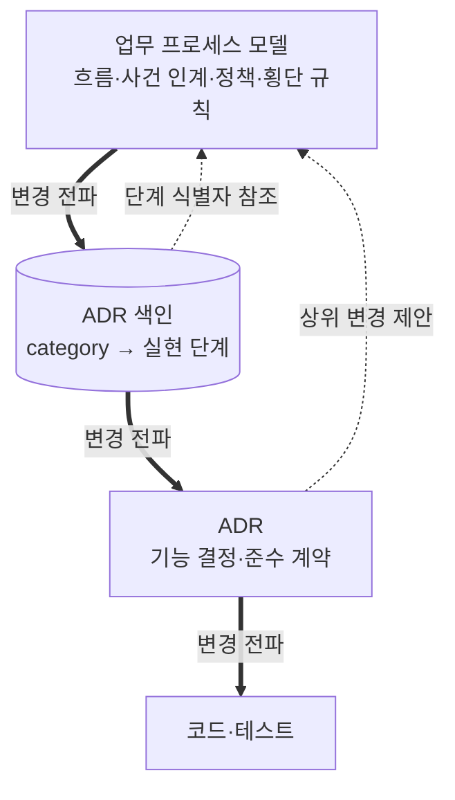

# ADR 0001: 업무 프로세스 모델을 ADR 위의 RDFS-lite 레벨로 도입

Date: 2026-10-29

## Status

Proposed

## Purpose

ADR 사이클로 기능을 바꾸는 에이전트는 대상 기능의 ADR을 읽고 구현한다. ADR은 기능 하나의 결정과 요구사항
계약을 담는다. 그 기능이 끝에서 끝까지의 업무 흐름에서 어디에 있는지, 어떤 사건을 받아 어떤 결과를 다음 기능에
넘기는지, 다른 기능이 어떤 사건과 규칙에 의존하는지는 담지 않는다. 컨텍스트 수준 ADR은 여러 기능이 공유하는
결정을 담지만, 흐름과 기능 사이의 사건 연결을 소유하는 레벨은 없다. PRD는 인계 뒤 구현 경로가 읽지 않고, 기존
프로젝트 가져오기의 업무 흐름 맵은 일회성 조사 자료이며, ADR 색인의 `dependsOn`은 구현 선행 보장만 기록한다.
그래서 에이전트가 자기 기능의 ADR을 모두 지키면서도 다른 기능이 의존하는 사건과 규칙을 깨뜨릴 수 있고, 사용자는
이런 오동작을 가끔 겪었다.

이 결정은 기능을 가로지르는 업무 흐름과 관계를 하위 레벨과 독립된 현재 기준으로 보존한다. 이 레벨은 전체
업무의 흐름을 파악하고 기능 사이의 관계를 설명하고 추론하는 데 집중한다. 상태 기계, 정확한 값과 세부 조건은
ADR이 소유한다. ADR 재배치나 코드 리팩터링은 업무 모델을 바꾸지 않고, 업무 변경은 모델에서 ADR을 거쳐 코드로
내려간다.

방향: ADR 위에 업무 프로세스 모델 레벨을 둔다. 모델은 닫힌 온톨로지(모델에 쓸 수 있는 요소, 관계와 속성의
종류를 정한 어휘)를 쓰는 가벼운 RDFS 그래프이고, 사용자 저장소에 Turtle 텍스트로 저장한다. 구현 계약의 권위는
ADR이 가진다. 모델의 사건 인계, 정책과 업무 규칙은 실현 ADR의 준수 계약으로 내려가 구현을 제약하고, 실현 ADR의
계약은 모델의 흐름과 행위자 책임에 모순되지 않아야 한다. 기능과 단계의 연결은 ADR 색인에만 둔다.

- 가정: 업무 흐름과 기능 사이의 관계는 개별 기능의 결정보다 드물게 바뀐다 — 거짓이면 별도 상위 레벨 대신 ADR
  수준의 공유 결정을 재검토한다.
- 가정: 아홉 가지 요소 유형과 열네 가지 관계 유형으로 대상 업무의 흐름과 관계를 표현할 수 있다 — 거짓이면 저장소별
  확장 대신 이 ADR의 어휘를 재검토한다.
- 가정: 사용자는 주로 대화로 모델을 고치고, 직접 편집은 Turtle을 읽을 수 있는 개발자가 한다 — 거짓이면 Markdown이나
  YAML 같은 사람 친화 원본 형식을 재검토한다.

## Decision Drivers

- 에이전트는 기능을 바꾸기 전에 그 기능의 앞뒤 단계, 그 기능의 사건에 반응하는 다른 기능, 그 기능이 기대는 사건과
  규칙을 얻어야 한다.
- 상위 레벨은 ADR, 색인 구성과 코드의 변경·재배치에 영향받지 않아야 하고, 변경은 상위에서 하위로만 흘러야 한다.
  코드가 계약을 찾으려고 두 레벨을 동시에 읽으면 안 된다.
- 레벨마다 답하는 질문이 달라야 하고, 같은 사실이 두 레벨의 현재 기준이 되면 안 된다. 상위 레벨은 전체 흐름과
  관계를 설명하고 추론하는 데 필요한 해상도만 가진다.
- 에이전트가 만들고 자주 읽는 모델은 기계적으로 검증되고 같은 질의에 같은 답을 줘야 한다. 그러려면 요소, 관계와
  속성의 종류가 저장소마다 달라지지 않아야 한다.
- 플러그인을 제거해도 모델이 표준 형식의 텍스트로 남아 사람과 다른 도구가 읽을 수 있어야 한다.
- 업무 프로세스 모델을 쓰지 않는 사용자는 그 레벨의 스킬과 세션 지침을 설치하지 않아야 한다.
- 모델 변경, ADR 색인 연결과 그 검증은 ADR 사이클과 같은 변경 단위에서 맞아야 한다.

## Decision

ADR 위에 **업무 프로세스 모델** 레벨을 둔다. 이 레벨은 ADR Writer와 따로 설치하는 Ontology Writer 플러그인이 맡고,
ADR Writer는 ADR과 ADR 색인을 맡는다. 현재 기준을 가진 레벨은 프로세스 모델, ADR, 코드 순서로 의존하고, PRD는 기획
입력으로 남는다. 레벨마다 답하는 질문이 다르다.

| 레벨               | 답하는 질문                                                                 | 소유하는 사실                                                                                                                                                            | 보여주지 않는 것                                                                                                       |
| ------------------ | --------------------------------------------------------------------------- | ------------------------------------------------------------------------------------------------------------------------------------------------------------------------ | ---------------------------------------------------------------------------------------------------------------------- |
| 업무 프로세스 모델 | 업무가 어떻게 흐르고, 단계와 기능이 어떤 사건·정책·규칙으로 서로 이어지는가 | 흐름, 사건 인계와 그에 반응하는 정책, 행위자 책임, 단계를 가로지르는 업무 규칙의 관계와 의미, 업무 개념과 개념 사이 관계, 업무 용어, 업무 수준 관찰 기준, 현행·목표 구분 | 상태 기계와 전이 조건, 정확한 값과 임계값, 단계 안의 동작·권한·실패 처리, 아키텍처, 기술, API, 스키마, 코드, 실현 현황 |
| ADR                | 각 기능이 그 업무를 어떤 결정과 계약으로 실현하는가                         | 아키텍처 결정과 근거, 기능 계약(상태 기계, 정확한 값, 세부 조건, 단계 안의 권한과 실패 보장), 기능 해상도의 준수 계약, 기능 수준 관찰 증거                               | 업무 흐름 전체, 코드 구조·이름·튜닝 값                                                                                 |
| 코드·테스트        | 그 계약을 어떻게 구현하고 검증하는가                                        | 구현, 식별자, 의존성, 테스트, 실행 증거                                                                                                                                  | —                                                                                                                      |

구현 계약과 구현 판정의 권위는 ADR 하나에 둔다. 모델의 사건 인계, 정책과 업무 규칙은 실현 ADR의 준수 계약(모델의
관계를 지키도록 실현 ADR에 둔 계약 행)으로 내려가고, 구현과 구현 리뷰는 ADR 계약 행으로 판정한다. 준수 계약은 모델
문장을 옮겨 적지 않는다. 이 기능이 그 관계를 지키려고 받는 입력과 내는 사건, 거절과 실패 시 동작, 정확한 값과
조건, 중복 수신이나 일관성 같은 아키텍처 보장을 기능 해상도로 적는다. 모델과 ADR이 어긋나면 모델이 기준이고,
사용자가 프로세스 변경을 승인하지 않는 한 고칠 쪽은 ADR이다. 흐름과 행위자 책임도 같아서, 실현 ADR의 단계 안
권한이 모델의 수행 행위자를 막으면 고칠 쪽은 ADR이다. 코드는 바로 위 레벨인 ADR만 따르면 되고, 업무 변경은 ADR
변경을 거쳐 코드에 닿는다.

모델은 흐름과 관계만 담는다. 기능 사이의 상태 의존은 상태를 요소로 두지 않고 그 변화를 알리는 사건과 그 사건에
반응하는 정책으로 표현한다. 다른 기능의 상태를 전제로만 쓰는 의존은 그 상태를 바꾸는 단계와 기대는 단계에 함께
닿는 업무 규칙으로 잇는다. 업무 규칙과 반응 조건은 '환불 기한은 배송 완료부터 센다'처럼 관계와 의미만 적고, 기한이
30일이라는 값은 실현 ADR의 요구사항 계약이 소유한다. 여러 기능이 함께 정하는 상태 기계나 값은 기존 구조 규칙대로
컨텍스트 수준 ADR이 소유한다. 단계를 가로지르는 권한 규칙(예: 승인한 사람과 집행하는 사람은 다르다)은 모델의 업무
규칙이고, 단계 하나 안의 권한은 실현 ADR이 소유한다.

모델은 몇 개의 기능이 단계를 실현하는지와 무관하게 흐름과 관계를 소유하므로, category를 나누거나 합쳐도 사실의
소유 레벨이 바뀌지 않는다. 모델이 있는 저장소에서 업무 용어와 바운디드 컨텍스트의 책임은 모델이 소유하고, ADR
용어집은 그 정의를 다시 적지 않는다. 이미 용어집에 있던 같은 용어는 모델 변경의 승인 경로에서 정리한다. ADR category 키는 문서 분류로서 기존 업무 경계 규칙을 따른다.

### 온톨로지

요소 유형은 아홉 가지다.

| 요소 유형         | 의미                                                                                    |
| ----------------- | --------------------------------------------------------------------------------------- |
| 행위자            | 단계를 수행하는 사람의 역할, 운영자, 외부 기관·시스템 또는 자동 처리를 맡는 시스템 역할 |
| 바운디드 컨텍스트 | 용어와 규칙의 의미가 일관되게 적용되는 업무 경계                                        |
| 업무 개념         | 한 컨텍스트 안에서 정의된 업무 명사                                                     |
| 업무 사건         | 업무에서 이미 일어난 사실. 기술적 전달 방식과 무관하다.                                 |
| 프로세스          | 시작 조건에서 업무 결과까지 이어지는 흐름                                               |
| 단계              | 프로세스 안에서 행위자가 수행하는 업무 활동                                             |
| 정책              | 업무 사건에 반응해 조건이 맞으면 단계를 시작하게 하는 결정 규칙                         |
| 업무 규칙         | 둘 이상의 단계에 걸쳐 항상 성립해야 하는 조건                                           |
| 관찰 기준         | 프로세스의 시작 조건과 관찰할 업무 결과                                                 |

관계 유형은 열네 가지다.

| 관계          | 출발                             | 도착                            | 의미                                             |
| ------------- | -------------------------------- | ------------------------------- | ------------------------------------------------ |
| 포함          | 프로세스                         | 단계                            | 프로세스가 단계를 담는다                         |
| 흐름          | 단계                             | 단계                            | 같은 프로세스 안의 진행 순서                     |
| 수행          | 행위자                           | 단계                            | 행위자가 단계를 맡는다                           |
| 발생          | 단계                             | 업무 사건                       | 단계의 결과로 사건이 일어난다                    |
| 촉발          | 업무 사건                        | 정책                            | 사건이 정책을 깨운다                             |
| 시작          | 정책                             | 단계                            | 조건이 맞으면 정책이 단계를 시작한다             |
| 사용          | 단계, 정책                       | 업무 개념                       | 단계나 정책이 개념을 읽거나 바꾸거나 판단에 쓴다 |
| 제약          | 업무 규칙                        | 단계, 정책, 업무 개념, 프로세스 | 규칙이 대상에 적용된다                           |
| 구성          | 업무 개념                        | 업무 개념                       | 한 개념이 다른 개념을 부분으로 가진다            |
| 참조          | 업무 개념                        | 업무 개념                       | 한 개념이 다른 개념을 가리킨다                   |
| 대응          | 업무 개념                        | 업무 개념                       | 다른 컨텍스트의 같은 대상을 가리키는 개념        |
| 컨텍스트 소속 | 단계, 정책, 업무 개념, 업무 사건 | 바운디드 컨텍스트               | 요소가 속한 업무 경계                            |
| 기준 소속     | 관찰 기준                        | 프로세스                        | 기준이 확인하는 프로세스                         |
| 경유          | 관찰 기준                        | 업무 사건                       | 기준의 시작 조건에서 결과까지 지나는 사건        |

흐름은 순서일 뿐 원인이 아니다. 한 단계에서 나가는 흐름이 여럿이면 모두 진행되고, 선택 분기, 한 단계가 다른 단계를
움직이는 원인과 프로세스 사이의 연결은 사건과 정책으로 표현한다. 그래서 에이전트는 사건 하나를 바꿀 때 그 사건에
반응하는 정책과 다른 기능의 단계를 같은 질의로 찾을 수 있고, 관계에 별도 속성을 붙일 필요가 없다. 수행 행위자가
여럿이면 그중 누구든 그 단계를 수행할 수 있고, 정책을 촉발하는 사건이 여럿이면 그중 하나가 일어날 때마다 반응한다.

업무 규칙이 닿는 단계는 규칙이 제약하는 단계, 제약하는 정책이 시작하는 단계, 제약하는 업무 개념을 사용하는 단계와
제약하는 프로세스가 포함하는 단계다. 규칙은 둘 이상의 단계에 닿아야 한다. 다른 기능의 상태를 전제로 하는 규칙은 그
상태를 바꾸는 단계에도 닿아야 하므로(R22), 상태를 바꾸는 기능과 그 상태에 기대는 기능 모두의 조회에 드러난다.

속성은 업무 사실을 담는 사실 속성, 사람을 위한 설명 속성, 프로세스의 관리 상태를 담는 생명주기 속성의 세 종류다.
설명 속성은 판정에 쓰지 않고, 생명주기 속성은 생명주기 결정이 정한 전이로만 바뀐다. 그래서 정렬 검토가 Status를
바꿔도 업무 내용 변경으로 판정되지 않는다.

### 저장과 연결

모델 문서는 사용자 저장소의 `docs/process/` 디렉터리에 둔다. 공유 요소 문서와 프로세스별 문서로 나누면 필요한
부분만 읽을 수 있고, 어떻게 나누어도 모든 모델 문서를 합친 그래프 하나가 모델이다.

어휘는 Ontology Writer가 RDFS 문서로 공개한다. RDFS의 domain과 range는 제약이 아니라 추론 규칙이므로, 여러 유형을 받는
관계에는 선언하지 않는다. 유형 조합과 개수 제약은 Ontology Writer 검증이 닫힌 세계로 판정한다. 모델은 어휘의
클래스·속성과 `rdf:type`, `rdfs:label`(이름), `rdfs:comment`(메모)만 쓰고 OWL 구문, blank node와 reification을 쓰지
않는다. Ontology Writer는 저장할 때 정해진 정렬과 서식으로 다시 써서 같은 그래프가 같은 텍스트가 되게 한다. 그래서 Turtle
주석은 보존되지 않으며, 사람의 메모는 메모 속성으로 쓴다. 프로세스의 Status와 한 줄 요약은 프로세스 요소의
속성이므로 별도 색인 파일을 두지 않는다.

모델 문서는 ADR과 코드를 가리키지 않는다. 어떤 category가 어떤 단계를 실현하는지(실현 기능)는 ADR 색인의 category
항목에만 기록하고, 하위 레벨인 색인이 상위 레벨의 단계 식별자를 안다. 모델 문서가 category를 직접 가리키면 category
이름 변경·분할·rollup이 모델을 바꾸게 된다. 그 기록의 형식은 ADR Writer가 정한다. Ontology Writer는 모델 변경과 같은
변경 단위로 그 기록을 쓰고, 끊어진 연결을 검증한다. ADR 작업은 category를 나누거나 합칠 때 그 기록을 옮기고, 그 밖에는
그대로 둔다.

모델은 선택적 레벨이다. 모델이 없는 저장소의 ADR 사이클은 모델을 읽거나 요구하지 않고, 모델은 일부 프로세스부터
점진적으로 작성할 수 있다. ADR Writer는 모델을 해석하지 않으며, 모델이 있는 저장소의 ADR 작업은 Ontology Writer의
조회로 업무 맥락을 얻는다. 에이전트의 업무 맥락 조회, 모델의 변경·승인·하위 전파, 문서에서 모델을 만드는 경로와
시각화는 같은 category의 다른 ADR이 정한다.

### Requirement contract

#### Required guarantees

**레벨과 권위**

| 의무                                                                                                                                                                                                                        | 관찰 가능한 검증 기준                                                                                                                                    |
| --------------------------------------------------------------------------------------------------------------------------------------------------------------------------------------------------------------------------- | -------------------------------------------------------------------------------------------------------------------------------------------------------- |
| R1. 프로세스 모델은 ADR 위의 선택적 레벨로서 업무 흐름과 단계 사이의 관계에 답한다.                                                                                                                                         | 모델만 읽고 한 단계의 앞뒤 단계, 그 단계의 사건에 반응하는 정책과 다음 단계, 적용되는 업무 규칙을 설명할 수 있다.                                        |
| R2. 모델은 업무 흐름, 사건 인계와 그에 반응하는 정책, 행위자 책임, 둘 이상의 단계에 걸치는 업무 규칙의 관계와 의미, 업무 개념과 개념 사이의 관계, 업무 용어와 업무 수준 관찰 기준을 실현 기능의 수와 관계없이 소유한다.     | 이 사실들이 모델에 있고, category를 나누거나 합쳐도 사실의 소유 레벨이 바뀌지 않는다.                                                                    |
| R3. 실현 ADR은 상태 기계와 전이 조건, 정확한 값과 임계값, 세부 조건, 단계 하나 안의 권한과 실패 보장, 아키텍처 결정을 소유한다. 여러 기능이 함께 정하는 상태 기계와 값은 그 컨텍스트 수준 ADR이 소유한다.                   | 모델의 관계가 그대로이면 이 사실들을 바꿔도 모델 문서의 diff가 없다.                                                                                     |
| R4. 구현 계약과 구현 판정의 권위는 ADR이다. 모델의 사건 인계, 정책과 업무 규칙은 실현 ADR의 준수 계약을 통해서만 구현 판정에 쓰인다.                                                                                        | 구현 리뷰가 ADR 계약 행으로만 판정하고, 모델이 바뀌어도 해당 준수 계약이 바뀌기 전에는 구현 판정이 바뀌지 않는다.                                        |
| R5. 준수 계약은 모델 문장을 옮겨 적지 않고, 그 기능이 모델의 관계를 지키려고 받는 입력과 내는 사건, 거절과 실패 시 동작, 정확한 값과 조건, 아키텍처 보장을 기능 해상도로 적는다.                                            | 준수 계약마다 그 기능의 입력·출력이나 거절·실패 동작이 관찰 증거와 함께 있다.                                                                            |
| R6. 모델의 흐름, 사건 인계, 정책, 업무 규칙이나 행위자 책임과 실현 ADR의 계약이 어긋나면 모델이 기준이다.                                                                                                                   | 차이는 정렬 문제로 보고되고, 사용자가 승인한 프로세스 변경 없이는 모델이 ADR 내용에 맞춰 바뀌지 않는다.                                                  |
| R7. 단계를 가로지르는 권한 규칙은 모델의 업무 규칙이고, 단계 하나 안의 권한은 실현 ADR이 소유한다.                                                                                                                          | 모델의 권한 규칙은 둘 이상의 단계에 닿고, 한 단계에만 닿는 권한 규칙은 모델에 없다.                                                                      |
| R8. 모델이 있는 저장소에서 업무 개념의 정의와 바운디드 컨텍스트의 책임·용어는 모델이 소유하고, ADR 루트 용어집에는 그 밖의 용어만 둔다. 모델이 정의를 갖게 된 용어의 기존 용어집 항목은 모델 변경의 승인 경로에서 정리한다. | Ontology Writer가 저장한 모델과 용어집에 같은 업무 용어의 정의가 함께 있지 않고, 모델이나 용어집의 직접 편집으로 생긴 공존은 프로세스 동기화가 보고한다. |
| R9. 모델이 있는 저장소에서도 ADR category 키는 문서 분류로서 기존 업무 경계 규칙을 따른다.                                                                                                                                  | category 키를 바꿔도 모델이 바뀌지 않는다.                                                                                                               |
| R10. Ontology Writer만으로 모델을 작성하고 검증할 수 있다.                                                                                                                                                                  | ADR Writer가 없는 설치에서도 모델을 만들고 검증할 수 있다.                                                                                               |
| R11. 모델 문서와 ADR 색인 연결이 모두 없는 저장소에서 모델은 ADR 사이클에 관여하지 않는다.                                                                                                                                  | 검증과 ADR 작성·구현·리뷰·동기화가 모델을 읽거나 요구하지 않는다.                                                                                        |
| R43. 업무 프로세스 모델의 스킬과 업무 맥락 조회 지시는 Ontology Writer에만 있다.                                                                                                                                            | ADR Writer만 설치하면 프로세스 모델 스킬이 없고, 모델이 없는 저장소의 세션 지침에 모델에 관한 줄이 없다.                                                 |

**온톨로지**

| 의무                                                                                                                                                                                                                                                                                                                                                                                                           | 관찰 가능한 검증 기준                                                                                                                                                                                                                                                 |
| -------------------------------------------------------------------------------------------------------------------------------------------------------------------------------------------------------------------------------------------------------------------------------------------------------------------------------------------------------------------------------------------------------------- | --------------------------------------------------------------------------------------------------------------------------------------------------------------------------------------------------------------------------------------------------------------------- |
| R12. 요소 유형은 행위자, 바운디드 컨텍스트, 업무 개념, 업무 사건, 프로세스, 단계, 정책, 업무 규칙, 관찰 기준의 아홉 가지다.                                                                                                                                                                                                                                                                                    | 모든 요소가 아홉 유형 중 정확히 하나를 가진다.                                                                                                                                                                                                                        |
| R13. 관계 유형은 온톨로지 절 관계 표의 열네 가지이며 양 끝은 표의 출발·도착 조합을 따른다.                                                                                                                                                                                                                                                                                                                     | 모든 관계의 양 끝 유형이 표와 일치하고 양 끝 요소가 모델에 있다.                                                                                                                                                                                                      |
| R14. 속성은 사실 속성(이름, 정의, 단계 구분, 반응 조건, 근거 종류, 근거, 시작 조건, 업무 결과, 관찰 결과, 미정 범위), 설명 속성(한 줄 요약, 메모), 생명주기 속성(Status, 대체 대상)의 닫힌 세 종류다.                                                                                                                                                                                                          | 모든 속성이 정확히 한 종류에 속하고, 설명 속성은 조회와 정렬 검토의 판정 근거로 쓰이지 않는다.                                                                                                                                                                        |
| R15. 식별자는 모델 전체에서 유일하고 모든 요소는 이름을 가진다. 관찰 기준을 뺀 요소는 정의를, 단계는 시스템 단계·시스템 밖 단계의 구분을, 정책은 반응 조건·근거 종류·근거를, 업무 규칙은 근거 종류·근거를, 프로세스는 시작 조건·업무 결과·미정 범위·Status를, 관찰 기준은 시작 조건과 관찰 결과를 가진다.                                                                                                      | 식별자가 중복되거나 필수 속성이 하나라도 빠진 요소는 검증 오류다.                                                                                                                                                                                                     |
| R16. 근거 종류는 규정, 계약, 운영 정책, 사용자 결정 중 하나다.                                                                                                                                                                                                                                                                                                                                                 | 그 밖의 근거 종류는 검증 오류다.                                                                                                                                                                                                                                      |
| R17. 단계는 정확히 하나의 프로세스와 하나의 컨텍스트에 속하고 수행 행위자를 하나 이상 가진다. 정책·업무 개념·업무 사건은 정확히 하나의 컨텍스트에, 관찰 기준은 정확히 하나의 프로세스에 속하며, 프로세스는 관찰 기준을 하나 이상 가진다.                                                                                                                                                                       | 소속 개수가 다른 요소, 수행자가 없는 단계와 관찰 기준이 없는 프로세스는 검증 오류다.                                                                                                                                                                                  |
| R18. 정책은 촉발 사건과 시작 단계를 각각 하나 이상 가지고, 대응은 서로 다른 컨텍스트의 개념 사이에만 성립한다.                                                                                                                                                                                                                                                                                                 | 촉발 사건이나 시작 단계가 없는 정책과 같은 컨텍스트 안의 대응은 검증 오류다.                                                                                                                                                                                          |
| R19. 업무 규칙은 제약 대상을 하나 이상 가지고 둘 이상의 단계에 닿는다. 규칙이 닿는 단계는 규칙이 제약하는 단계, 제약하는 정책이 시작하는 단계, 제약하는 업무 개념을 사용하는 단계와 제약하는 프로세스가 포함하는 단계다.                                                                                                                                                                                       | 제약 대상이 없거나 닿는 단계가 둘 미만인 규칙은 검증 오류다.                                                                                                                                                                                                          |
| R20. 흐름은 같은 프로세스 안의 진행 순서이고, 한 단계에서 나가는 흐름이 여럿이면 모두 진행된다. 선택 분기, 단계를 시작하게 하는 원인과 프로세스 사이의 연결은 사건과 정책으로만 표현한다.                                                                                                                                                                                                                      | 서로 다른 프로세스의 단계를 잇는 흐름은 검증 오류이고, 흐름만 있는 두 단계는 원인 관계로 해석되지 않는다.                                                                                                                                                             |
| R21. 수행 행위자가 여럿이면 그중 누구든 그 단계를 수행할 수 있고, 정책을 촉발하는 사건이 여럿이면 그중 하나가 일어날 때마다 정책이 반응한다. 함께 참여해야 하는 수행이나 여러 사건이 모두 일어나야 하는 조건은 업무 규칙이나 반응 조건으로 표현한다.                                                                                                                                                           | 다중 수행자는 대체 수행자로, 다중 촉발은 각각의 반응으로 해석된다.                                                                                                                                                                                                    |
| R22. 기능 사이의 상태 의존은 그 변화를 알리는 사건과 그 사건에 반응하는 정책으로 표현하고, 다른 기능의 상태를 전제로만 쓰는 의존은 그 상태를 바꾸는 단계와 기대는 단계에 함께 닿는 업무 규칙으로 표현한다. 모델은 업무 상태나 상태 전이를 요소나 관계로 두지 않는다. Ontology Writer는 모델을 저장하기 전과 프로세스 동기화에서 다른 기능의 상태를 전제로 하는 규칙이 그 상태를 바꾸는 단계에 닿는지 검토한다. | 모델에 상태 요소와 전이 관계가 없고, 기능이 기대는 상태 변화는 그 변화를 알리는 사건이나 그 변화를 만드는 단계와 기대는 단계에 함께 닿는 업무 규칙으로 조회되며, 그 상태를 바꾸는 단계에 닿지 않는 그런 규칙은 저장 전 작성 검토와 프로세스 동기화를 통과하지 않는다. |
| R23. 업무 규칙과 반응 조건은 관계와 의미를 업무 언어로 적고, 정확한 값, 임계값과 세부 조건은 적지 않는다.                                                                                                                                                                                                                                                                                                      | 모델의 규칙과 반응 조건에 수치 한도나 상세한 판정 조건이 없고, 그런 값과 조건은 실현 ADR의 요구사항 계약에 있다.                                                                                                                                                      |
| R24. 같은 이름이 컨텍스트마다 다른 의미를 가지면 컨텍스트별로 다른 업무 개념으로 두고 둘의 관계는 대응으로 표현한다.                                                                                                                                                                                                                                                                                           | 한 개념의 정의에 서로 다른 컨텍스트의 상충하는 의미가 섞이지 않는다.                                                                                                                                                                                                  |
| R25. 프로세스는 미정 범위 속성을 가진다. 미정 범위의 항목은 다루지 않은 경로를 적은 미정 경로이거나, 업무에 그 경로나 세 축(R26) 중 한 축의 경로가 없음을 사용자가 확인한 해당 없음이다. 미정 경로와 해당 없음 항목이 모두 없으면 그 값으로 미정 범위가 없음을 명시한다.                                                                                                                                       | 미정 범위 속성이 없는 프로세스는 검증 오류이고, 해당 없음 항목만 있는 프로세스는 미정 범위가 없는 것으로 판정된다.                                                                                                                                                    |
| R26. 각 프로세스는 시작·종료와 정상 흐름, 수행자와 규칙, 예외·반려·인계의 세 축을 다룬다. 다루지 않은 축의 경로는 프로세스나 단계의 미정 범위에 미정 경로로 적고, 업무에 그 축의 경로가 없으면 프로세스의 미정 범위에 그 축을 해당 없음으로 적는다. Ontology Writer는 모델을 저장하기 전과 프로세스 동기화에서 이 세 축을 검토한다.                                                                            | 세 축마다 모델의 요소, 미정 경로나 해당 없음 항목 중 하나가 있고, 어느 것도 없는 축이 있는 프로세스는 저장 전 작성 검토와 프로세스 동기화를 통과하지 않는다.                                                                                                          |

**저장과 연결**

| 의무                                                                                                                                                                                          | 관찰 가능한 검증 기준                                                                                                                                      |
| --------------------------------------------------------------------------------------------------------------------------------------------------------------------------------------------- | ---------------------------------------------------------------------------------------------------------------------------------------------------------- |
| R27. 모델 문서는 사용자 저장소의 `docs/process/` 디렉터리에 있는 Turtle 문서이고, 모델 문서가 하나 이상 있으면 모델이 있는 것으로 본다.                                                       | 플러그인 없이 텍스트 편집기와 표준 RDF 도구로 모든 요소와 관계를 읽을 수 있다.                                                                             |
| R28. 모델 디렉터리의 Turtle이 아닌 문서는 그래프와 구조 검증의 대상이 아니다.                                                                                                                 | 변경 기록 Markdown 문서가 있어도 그래프와 검증 결과가 바뀌지 않는다.                                                                                       |
| R29. 어휘는 Ontology Writer가 소유하는 RDFS 문서로 공개하고, 여러 유형을 받는 관계에는 domain과 range를 선언하지 않는다. 유형 조합과 개수 제약은 Ontology Writer 검증이 닫힌 세계로 판정한다. | 표준 RDFS 추론기가 모델을 읽어도 어휘의 요소 유형 중 선언되지 않은 유형이 추론되지 않고, 유형 조합과 개수 위반은 Ontology Writer 검증에서 오류로 보고된다. |
| R30. 모델은 어휘의 클래스·속성과 `rdf:type`, `rdfs:label`(이름), `rdfs:comment`(메모)만 쓴다.                                                                                                 | 그 밖의 클래스나 속성이 있으면 검증 오류다.                                                                                                                |
| R31. 사실은 식별자가 있는 요소 사이의 관계와 속성 값으로만 표현한다.                                                                                                                          | OWL 구문, blank node나 reification이 있으면 검증 오류다.                                                                                                   |
| R32. 모든 모델 문서를 합친 그래프가 모델이다.                                                                                                                                                 | 요소를 다른 모델 문서로 옮겨도 합친 그래프가 같으면 검증 결과가 같다.                                                                                      |
| R33. Ontology Writer는 모델을 저장할 때 정해진 정렬과 서식으로 다시 쓴다.                                                                                                                     | 같은 그래프는 같은 텍스트로 저장되고, 서식만 다른 편집은 의미 변경으로 분류되지 않는다.                                                                    |
| R34. Turtle 주석은 모델에 속하지 않으며 Ontology Writer가 다시 쓸 때 보존되지 않는다. 사람의 메모는 메모 속성으로 쓴다.                                                                       | 검증이 주석이 있는 문서를 경고하고, 그 문서를 다시 쓰기 전에 승인 요약이 주석 제거를 표시한다.                                                             |
| R35. 프로세스 목록, Status와 한 줄 요약은 프로세스 요소의 속성으로 기록하고 별도 색인 파일을 두지 않는다.                                                                                     | 프로세스 목록이 모델에서 나오고, 같은 정보를 담은 두 번째 파일이 없다.                                                                                     |
| R36. 기능과 단계의 연결은 ADR 색인의 category 항목에만 기록하며 그 기능이 실현하는 단계를 가리킨다. 실현 단계가 빈 기록은 연결하지 않기로 확인한 기능을 뜻하며 연결이 아니다.                 | category 이름 변경, ADR 분할과 rollup은 색인만 바꾸고 모델 문서는 바꾸지 않으며, 빈 기록은 연결로 판정되지 않는다.                                         |
| R37. 존재하지 않는 단계를 가리키는 색인 연결은 검증 오류다.                                                                                                                                   | 모델에서 단계가 사라지거나 모델 문서가 없어지면 검증이 남은 연결과 category를 보고한다.                                                                    |

#### Prohibitions

| 의무                                                                                                                                                                        | 관찰 가능한 검증 기준                                                                                                                 |
| --------------------------------------------------------------------------------------------------------------------------------------------------------------------------- | ------------------------------------------------------------------------------------------------------------------------------------- |
| R38. 모델은 상태 기계와 전이 조건, 정확한 값과 임계값, 단계 하나 안의 동작·권한·실패 보장, 아키텍처 선택, 기술 구성 요소, API, 데이터 스키마와 코드 위치를 기록하지 않는다. | 모델에 상태 전이 조건, 수치 한도, 단계 내부 동작, 기술 선택 서술, 기술 구성 요소 이름, API 경로, 테이블·필드 정의와 파일 경로가 없다. |
| R39. 모델 문서는 ADR 경로·번호·category key를 기록하지 않는다.                                                                                                              | ADR 재배치와 코드 리팩터링 뒤에도 모델 문서의 diff가 없다.                                                                            |
| R40. 모델이 있는 저장소의 실현 ADR 본문은 모델 문서의 위치와 요소 식별자를 기록하지 않는다.                                                                                 | 요소 식별자를 바꿔도 실현 ADR 본문을 고칠 필요가 없다.                                                                                |
| R41. 어휘나 도구 변경만으로 요소·관계·속성 집합을 넓히거나 줄이지 않는다. 집합 변경은 이 ADR의 계약 변경이다.                                                               | 이 ADR이 바뀌지 않으면 검증이 허용하는 집합도 바뀌지 않는다.                                                                          |

#### Failure guarantees

| 의무                                                                                                          | 관찰 가능한 검증 기준                                                                 |
| ------------------------------------------------------------------------------------------------------------- | ------------------------------------------------------------------------------------- |
| R42. 모델 문서를 해석할 수 없으면 검증은 그 문서와 위치를 보고하고, 해석한 부분만으로 통과를 보고하지 않는다. | 문법 오류가 있는 모델 문서가 하나라도 있으면 검증 결과가 실패이고 오류 위치가 보인다. |

### Alternatives

레벨의 위치:

1. **기능 횡단 정보를 ADR 수준의 공유 결정으로 기록** — 새 레벨과 도구가 필요 없지만, 끝에서 끝까지의 흐름이 여러
   결정에 흩어지고 업무 사실을 하위 변경과 분리할 수 없다. `dependsOn`의 선행 보장과 실행 중 업무 관계도 섞인다.
2. **ALPS PRD를 계속 갱신하는 업무 권위로 유지** — 데모 시나리오와 사용자 흐름이 이미 있지만, PRD는 한 번의 제품
   기획 범위를 다루고 인계 뒤 구현 경로가 읽지 않는다. 계속 갱신하면 PRD와 ADR이 공동 권위가 된다.
3. **ADR 위의 별도 레벨 (채택)** — 업무 흐름이 하위 레벨과 독립된 현재 기준을 갖는다. 새 레벨과 도구를 유지해야 한다.

모델의 해상도:

1. **업무 상태와 허용 전이, 정확한 값까지 모델에 기록** — 모델만 읽어도 세부 규칙을 알 수 있지만, ADR이 소유하는 상태
   기계와 값을 다시 그리게 되어 같은 사실이 두 레벨의 기준이 되고, 조건이나 값이 바뀔 때마다 상위 레벨이 흔들린다.
2. **흐름과 관계만 기록하고 상태 기계·값·세부 조건은 ADR이 소유 (채택)** — 상위 레벨이 전체 흐름의 설명과 추론에
   집중한다. 세부 규칙을 확인하려면 업무 맥락에서 실현 ADR로 내려가야 한다.

구현 권위:

1. **모델도 구현과 리뷰의 판정 기준** — 업무 규칙을 바로 구현 판정에 쓰지만, 코드가 두 레벨을 동시에 따라야 하고
   ADR을 유일한 구현 권위로 둔 기존 결정과 충돌한다.
2. **ADR이 유일한 구현 권위이고 모델의 관계는 준수 계약으로 내려감 (채택)** — 레벨마다 바로 위 레벨만 따른다. 변경
   전파와 정렬 검토가 준수 계약의 누락을 찾아야 한다.

저장 형식:

1. **구조화된 Markdown 표와 Mermaid 다이어그램** — 저장소 화면에서 바로 그림이 보이지만, 표와 다이어그램이 같은
   흐름을 따로 담아 어긋날 수 있고 유형 검증이 약하다.
2. **JSON-LD나 YAML** — JSON-LD는 해석이 쉽지만 사람이 고치기 어렵고, YAML은 고치기 쉽지만 표준 RDF 의미가 없다.
3. **완전한 OWL·BPMN 같은 표준 모델이나 외부 모델링 도구** — 전용 편집기와 추론을 쓸 수 있지만, 문맥 비용이 크고
   흐름과 개념을 한 형식으로 함께 다루기 어렵다. 외부 도구는 모델을 저장소 밖에 둔다.
4. **닫힌 어휘를 RDFS로 공개하고 Turtle로 저장 (채택)** — 표준 형식이라 다른 도구로 읽을 수 있고, 생성 결과를
   기계적으로 검증할 수 있으며, 그래프 하나가 흐름의 유일한 원본이다. 손으로 고치기는 Markdown보다 어렵고 그림은
   별도 화면이 그린다.

소유 플러그인:

1. **ADR Writer에 포함** — 모델이 없으면 모델을 읽지 않는 선택적 레벨로 쓸 수 있고, 변경 전파와 색인 연결을 한
   플러그인 안에서 맞춘다. 그러나 모델을 쓰지 않는 사용자도 세션마다 프로세스 모델 스킬 다섯 개의 설명을 싣는다. 그
   분량은 나머지 ADR 스킬 설명을 모두 합친 것과 비슷하다.
2. **별도 플러그인 Ontology Writer (채택)** — 계층마다 플러그인이 하나씩 맞고, 모델을 쓰지 않는 사용자는 그 레벨을
   설치하지 않는다. 모델 변경과 색인 연결은 Ontology Writer가 같은 변경 단위로 쓴다. 업무 맥락을 확인하는 ADR 작업과
   ADR에 닿는 하위 전파는 두 플러그인이 함께 있어야 하고, 한쪽만 있는 설치를 다뤄야 한다.

## Consequences

### Positive

- 기능을 가로지르는 흐름, 사건 인계, 정책과 업무 규칙이 하나의 현재 기준을 갖고, 에이전트와 사람은 그 지도로 전체
  관계를 설명하고 추론한다.
- 레벨마다 답하는 질문이 달라, 세부 조건이나 값이 바뀌어도 상위 레벨은 흔들리지 않는다.
- 코드는 ADR만 따르고, 업무 변경은 ADR 준수 계약을 거쳐 코드에 닿는다.
- 모델은 표준 RDF 텍스트라 플러그인 없이도 읽히고, 에이전트가 만든 모델을 기계적으로 검증할 수 있다.
- 업무 프로세스 모델을 쓰지 않는 사용자는 ADR Writer만 설치하고, 프로세스 모델 스킬과 지침을 세션마다 싣지 않는다.

### Negative

- 문서 레벨, 어휘와 검증 도구를 유지해야 한다.
- 세부 규칙을 확인하려면 모델에서 실현 ADR로 내려가야 한다.
- Turtle을 직접 고치기는 Markdown보다 어렵고, 저장할 때 Turtle 주석이 사라진다. 저장소 화면에서 그림이 바로 보이지
  않는다.
- ADR 색인이 상위 레벨 연결을 함께 유지한다.
- 업무 맥락을 확인하는 ADR 작업과 ADR에 닿는 모델 변경에는 ADR Writer와 Ontology Writer가 함께 설치되어야 한다. ADR
  색인과 Status를 읽고 쓰는 코드와 리포트 도구는 두 플러그인에 같은 사본으로 유지한다.
- 모델을 도입하는 저장소는 기존 ADR에 흩어진 기능 횡단 사실과 업무 용어를 모델로 옮기는 초기 정리가 필요하다. 용어를
  정의하는 ADR 작성과 PRD 인계도 먼저 모델의 정의를 확인해야 한다.

### Risks

- 준수 계약이 모델 문장을 옮겨 적기만 하면 두 레벨이 같은 말을 하게 된다. R5가 기능 해상도의 동작을 요구하고 정렬
  검토가 의미로 대조한다.
- 모델이 너무 성기면 에이전트가 필요한 관계를 얻지 못한다. 미정 범위와 세 축 검토(R25·R26)가 빈 곳을 드러낸다.
- 닫힌 어휘가 실제 업무를 표현하지 못할 수 있다. 어휘 변경은 이 ADR의 계약 변경으로 다룬다.
- 단계 식별자가 자주 바뀌면 색인 연결 변경이 늘어난다. 업무 언어에 기반한 안정적인 식별자를 권하지만 형식은
  계약으로 두지 않고, 식별자가 바뀌어 끊어진 연결은 검증이 보고한다(R37).

## Related

- [업무 경계와 기능별 문서 구성](../document-authoring/domain-organization/0001-organize-features-by-bounded-context.md)
- [지속적인 아키텍처 결정만 기록](../adr-authoring/decision-boundary/0001-admit-only-architectural-decisions.md)
- [PRD 기능 계약의 소유권을 ADR로 이전](../alps-authoring/spec-handoff/0001-admission-aware-feature-handoff.md)
- [ADR 상호작용은 Decision Digest와 semantic diff를 우선 표시](../adr-authoring/decision-presentation/0001-present-decision-digest-and-semantic-diff.md)
- [기존 프로젝트의 기능과 계약을 ADR에 정리](../adr-authoring/project-import/0001-import-existing-project-decisions.md)
- [에이전트의 업무 맥락 조회와 세션 지침](./0002-retrieve-business-context-for-agents.md)
- [프로세스 모델 변경의 승인과 하위 전파](./0003-govern-process-model-lifecycle-and-cascade.md)
- [문서 묶음에서 모델 후보 구축](./0004-build-process-model-from-documents.md)
- [읽기 전용 탐색 화면](./0005-render-read-only-process-views.md)
