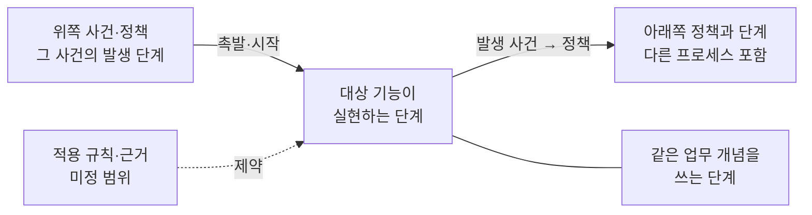

# ADR 0002: 에이전트는 기능을 바꾸기 전에 결정적 조회로 업무 맥락을 확인

Date: 2026-10-29

## Status

Proposed

## Purpose

업무 프로세스 모델은 에이전트가 한 기능을 바꾸면서 다른 기능이 의존하는 사건과 규칙을 깨뜨리지 않게 하려고 둔다.
그 목적은 에이전트가 변경 전에 모델을 실제로 확인할 때만 이루어진다. 에이전트는 변경마다 자주 확인해야 하지만,
모델 전체를 매번 읽으면 문맥 비용이 크다. 이름으로 검색하면 다른 프로세스에서 같은 사건에 반응하는 단계나 같은 업무
개념을 쓰는 단계를 놓칠 수 있고, 같은 질문의 답이 실행마다 달라질 수 있다.

확인 결과를 쓰는 방식에도 경계가 있다. 구현 계약의 권위는 ADR이므로, 업무 맥락이 ADR에 없는 새 의무로 구현 판정에
쓰이면 구현 의도의 출처가 둘이 된다. 모델은 일부 프로세스만 담을 수 있으므로, 모델에 없다는 사실을 업무가 없다는
뜻으로 읽어도 안 된다.

방향: 에이전트는 기능, 프로세스, 업무 개념 또는 업무 사건을 입력으로 한 번의 결정적 조회를 실행해 업무 맥락(대상과
업무적으로 연결된 단계·사건·정책·규칙·개념의 묶음)을 얻는다. 코드보다 ADR을 먼저 확인하듯, ADR을 만들거나 고치는
경로는 먼저 모델을 확인한다. ADR Writer의 세션 시작 지침은 조회하라는 지시만 더하고, ADR 작성과 구현은 이 맥락으로
선택이 모델과 모순되지 않는지 확인한다.

- 가정: 에이전트는 ADR 사이클 밖에서 코드를 바꿀 때도 세션 시작 지침의 조회 지시를 따른다 — 거짓이면 코드 변경
  경로가 조회를 직접 요구하는 방식을 재검토한다.

## Decision Drivers

- 조회는 다른 프로세스의 반응 단계와 같은 업무 개념을 쓰는 단계까지 빠짐없이 찾아야 한다. 이 연결을 놓치면 자기
  기능의 ADR을 모두 지켜도 다른 기능이 깨질 수 있다.
- 변경마다 조회해도 비용이 작고, 같은 질문에는 같은 답이 나와야 한다. 결과는 대상과 연결된 범위로 한정되어야 한다.
- 하위 레벨을 바꾸기 전에는 바로 위 레벨을 먼저 확인해야 한다. 코드를 바꾸기 전에 ADR을 확인하듯, ADR을 쓰거나 고치기
  전에는 업무 모델을 확인해야 한다.
- 세션 시작 지침은 짧은 지시만 담고 ADR 색인이나 모델의 내용을 렌더하지 않는다는 개발 흐름 계약을 지켜야 한다.
- 구현 의도와 계약의 권위는 ADR에 있으므로, 업무 맥락은 구현 판정의 새 의무가 아니라 모순 확인과 승인받을 준수
  계약·연결 제안의 근거여야 한다.
- 모델이 불완전할 수 있으므로 모델에 없는 내용을 업무 부재로 해석하면 안 된다.

## Decision

ADR Writer는 저장소의 모델 문서와 ADR 색인만 읽는 결정적 조회를 제공한다. 가장 자주 쓰는 입력은 기능(category)이고,
결과는 대상에서 출발하는 다섯 가지 연결을 담는다.

- 그 기능이 실현하는 단계와 앞뒤 단계
- 그 단계를 움직이는 위쪽 사건·정책과, 그 사건을 발생시키는 단계
- 그 단계의 사건에 반응하는 아래쪽 정책과, 그 정책이 시작하는 단계(다른 프로세스 포함)
- 같은 업무 개념을 쓰는 다른 단계(다른 프로세스 포함)
- 적용되는 업무 규칙과 근거, 미정 범위

결과의 모든 단계에는 소속 프로세스와 그 Status, 실현 기능과 그 ADR의 Status를 붙인다. 그래서 에이전트는 다른
프로세스의 흐름이 현행 업무인지 아직 구현되지 않은 목표인지 구분할 수 있다. 결과는 이 연결로 이어진 요소만 담아
모델 전체를 읽지 않게 한다. 정확한 값, 상태 기계와 세부 조건은 모델에 없으므로, 에이전트는 결과의 실현 ADR로
내려가 그것을 확인한다.

확인 순서는 의존 방향과 같다. ADR의 결정이나 계약을 만들거나 바꾸는 모든 경로는 먼저 모델이 있는지 확인하고, 있으면
ADR 내용을 확정하기 전에 대상 기능의 업무 맥락을 조회한다. 새 ADR 작성, edit-in-place 수정, ADR 동기화의 본문 수정, 기존
프로젝트 가져오기, PRD 인계와 사용자가 승인하는 폐기·대체가 이 경로다. 의미를 바꾸지 않는 category 분할·합치기와 rollup은
업무 맥락을 조회하지 않고 실현 단계 연결만 옮기며, `/adr-impl`의 승격이나 ADR 동기화의 되돌림 같은 자동 생명주기 전이도 이
경로가 아니다. 모델이 없는 저장소에서는 이 확인이 출력이나 질문을 더하지 않고, 아래의 연결 판단과 제안도 일어나지 않는다.

모델이 있는 저장소에서 대상 기능이 어떤 단계에도 연결되어 있지 않으면, 그 기능이 기존 단계를 실현하는지, 모델에 새
단계가 필요한지, 업무 흐름과 무관한지 판단해 승인 요약이나 보고에 제시한다. 사용자가 연결하지 않기로 확인하면 ADR 색인에
빈 실현 기록을 남겨 같은 판단을 다시 묻지 않는다. category를 나누거나 합치면 빈 기록은 이어지지 않는다.

ADR 색인과 모델이 모두 있으면 ADR Writer의 세션 시작 지침은 "ADR의 결정이나 계약을 만들거나 바꾸기 전에 업무 맥락을 먼저 확인하라"와
"프로세스 단계에 연결된 기능의 코드를 바꾸기 전에 업무 맥락을 조회하라"는 두 지시를 더한다. 지침은 모델이나 색인의 내용을
담지 않는다.

ADR 작성과 구현은 연결된 기능의 업무 맥락을 읽는다. ADR이 정하지 않은 세부는 모델과 모순되지 않는 쪽을 고르고, 그런
선택이 없거나 변경이 흐름, 사건, 정책, 기능 횡단 규칙이나 모델이 소유하는 업무 용어를 바꿔야 할 때만 프로세스 변경
제안으로 올린다. 그 제안이 승인되기 전이나 거절된 동안에는 그 뜻에 기대는 ADR 내용을 확정하지 않고
미정으로 표시해 남기며, 미정 행이 있는 ADR은 `Proposed`로 남는다. 거절되면 현재 모델의 뜻으로 그 부분을 다시 쓰거나
사용자가 정할 때까지 미정으로 둔다. 초안을 승인받는 작성 경로가 모델의
관계에 대한 준수 계약이 빠진 것을 발견하면 그 초안에 준수 계약을 제안하고, 같은 계약이 빠진 다른 실현 ADR도 함께 보고한다. `Proposed` 프로세스의 맥락에서는 실현 ADR에 반영되지 않은 모델
의미를 먼저 확인하고, 그런 의미에서 나온 준수 계약은 프로세스 변경 승인 요약에 합쳐 묻는다. ADR 동기화가 발견한 누락은 정렬 문제로 보고한다. 커밋되지 않은 모델 편집과 `Accepted` 프로세스의 동기화 전
직접 편집이 걸친 맥락은 확정된 기준으로 쓰지 않는다. 확인한 업무 맥락은 ADR 작성의 승인 요약과 구현 계획에 밝히고, ADR
본문에는 모델 문서 위치와 요소 식별자를 남기지 않는다. 완료 판정은 ADR 계약 행으로만 한다.

### Requirement contract

#### Required guarantees

**기능 입력 조회**

| 의무                                                                                                                                                                                                                                                  | 관찰 가능한 검증 기준                                                                                         |
| ----------------------------------------------------------------------------------------------------------------------------------------------------------------------------------------------------------------------------------------------------- | ------------------------------------------------------------------------------------------------------------- |
| R1. 기능(category)을 입력한 조회는 그 기능이 실현하는 단계, 그 단계의 앞뒤 단계와 각 단계의 실현 기능을 돌려준다.                                                                                                                                     | 결과만으로 그 기능의 단계와 앞뒤 단계, 그 단계들을 실현하는 기능을 알 수 있다.                                |
| R2. 기능을 입력한 조회는 그 기능의 단계를 시작하게 하는 사건·정책과, 그 사건을 발생시키는 단계와 실현 기능을 돌려준다.                                                                                                                                | 그 기능을 움직이는 다른 기능을 결과에서 찾을 수 있다.                                                         |
| R3. 기능을 입력한 조회는 그 기능의 단계가 발생시키는 사건에 반응하는 정책과, 그 정책이 시작하는 단계와 실현 기능을 다른 프로세스까지 포함해 돌려준다.                                                                                                 | 다른 프로세스의 단계가 그 사건에 반응하면 그 단계와 실현 기능이 결과에 있다.                                  |
| R4. 기능을 입력한 조회는 그 기능의 단계가 사용하는 업무 개념과, 같은 개념을 사용하는 다른 단계, 같은 개념을 사용하는 정책이 시작하는 단계와 각 단계의 실현 기능을 다른 프로세스까지 포함해 돌려준다.                                                  | 같은 업무 개념을 사용하는 모든 단계와 그 개념을 사용하는 정책이 시작하는 단계가 실현 기능과 함께 결과에 있다. |
| R5. 기능을 입력한 조회는 적용 규칙과 그 근거, 프로세스와 단계의 미정 범위를 돌려준다. 적용 규칙은 그 기능의 단계에 닿는 업무 규칙, 즉 그 단계, 그 단계의 프로세스, 그 단계를 시작하게 하는 정책이나 그 단계가 사용하는 업무 개념을 제약하는 규칙이다. | 이 정의에 드는 업무 규칙이 모두 근거와 함께 결과에 있고, 미정 범위가 결과에 있다.                             |
| R6. 조회 결과의 모든 단계에는 소속 프로세스와 그 Status, 실현 기능과 그 ADR의 Status가 붙는다.                                                                                                                                                        | 결과의 모든 단계에서 소속 프로세스가 `Proposed`인지 `Accepted`인지와 실현 ADR의 Status가 보인다.              |

**다른 입력과 조회 성질**

| 의무                                                                                                                                                                                                                                                                                                                                        | 관찰 가능한 검증 기준                                                                                                                                                                                                                                                                                                                                                                                                               |
| ------------------------------------------------------------------------------------------------------------------------------------------------------------------------------------------------------------------------------------------------------------------------------------------------------------------------------------------- | ----------------------------------------------------------------------------------------------------------------------------------------------------------------------------------------------------------------------------------------------------------------------------------------------------------------------------------------------------------------------------------------------------------------------------------- |
| R7. 프로세스를 입력한 조회는 그 프로세스의 모든 요소(단계, 각 단계의 수행 행위자와 컨텍스트, 관찰 기준)와 미정 범위, 각 단계에 대해 기능 입력 조회와 같은 연결(위쪽 사건·정책과 그 발생 단계, 다른 프로세스에서 반응해 시작되는 단계, 같은 개념을 사용하는 단계, 적용 규칙과 근거)과 각 단계의 실현 기능을 돌려준다.                        | 결과에 각 단계의 수행 행위자와 컨텍스트, 적용 규칙과 근거, 다른 프로세스의 반응 단계, 이 프로세스를 시작하게 하는 다른 프로세스의 단계, 같은 개념을 사용하는 단계와 각 단계의 실현 기능, 미정 범위가 있다.                                                                                                                                                                                                                          |
| R8. 업무 개념을 입력한 조회는 정의, 소유 컨텍스트, 구성·참조·대응으로 연결된 개념, 그 개념을 사용하는 단계와 그 개념을 사용하는 정책이 시작하는 단계의 실현 기능, 그 개념을 제약하는 업무 규칙을 돌려준다.                                                                                                                                  | 결과에 정의, 소유 컨텍스트와 연결된 개념, 그 개념을 사용하는 모든 단계와 정책이 시작하는 단계, 각 단계의 실현 기능과 제약 규칙이 있다.                                                                                                                                                                                                                                                                                              |
| R9. 업무 사건을 입력한 조회는 소유 컨텍스트, 발생 단계와 실현 기능, 반응 정책과 그 정책이 시작하는 단계와 실현 기능, 그 사건을 경유하는 관찰 기준을 돌려준다.                                                                                                                                                                               | 결과에 소유 컨텍스트, 발생 단계, 그 사건의 모든 소비자와 경유 관찰 기준이 있다.                                                                                                                                                                                                                                                                                                                                                     |
| R10. 조회 결과는 오류와 변경 표시를 빼면 입력별로 정한 연결로 이어진 요소만 담는다.                                                                                                                                                                                                                                                         | 대상과 연결이 없는 프로세스, 단계와 규칙이 결과에 없다.                                                                                                                                                                                                                                                                                                                                                                             |
| R11. 조회는 저장소 파일만 읽는 결정적 계산이다.                                                                                                                                                                                                                                                                                             | 같은 입력과 저장소 상태에서 결과가 같고, 네트워크 없이 동작하며, 폐기 가능한 캐시를 지워도 결과가 같다.                                                                                                                                                                                                                                                                                                                             |
| R12. 조회는 `Deprecated`와 `Superseded` 프로세스를 요청할 때만 포함한다.                                                                                                                                                                                                                                                                    | 기본 결과에 은퇴한 프로세스의 단계가 없고, 요청하면 은퇴 표시와 함께 포함된다.                                                                                                                                                                                                                                                                                                                                                      |
| R13. 조회는 검증과 같은 모델 해석으로 같은 오류를 같은 위치에 보고한다.                                                                                                                                                                                                                                                                     | 검증이 보고한 오류 중 조회 범위에 걸친 것이 같은 위치로 결과에 표시된다.                                                                                                                                                                                                                                                                                                                                                            |
| R14. 모델 문서에 커밋되지 않은 변경이 있거나, `Accepted` 프로세스의 업무 구성(프로세스 모델 변경 결정이 정한 요소 묶음)이나 미정 범위가 마지막으로 `Accepted`가 된 뒤 그래프에서 바뀌었으면, 조회는 조회 범위에서 추가·변경·삭제된 요소와 범위 밖에도 그런 변경이 있다는 사실을 표시한다. 같은 뜻의 문구 수정도 바뀐 것으로 표시될 수 있다. | 작업 트리에서 고친 요소와 `Accepted` 프로세스의 동기화 전 커밋된 직접 편집(미정 범위 변경 포함)이 결과에 표시되고, 범위 밖 변경은 있다는 사실만 보인다. `Proposed` 프로세스의 커밋된 직접 편집은 이 표시의 대상이 아니다. 프로세스 동기화나 승인 저장이 확인해 다시 기록한 `Accepted`가 커밋된 뒤에는 그 이전의 편집이 표시되지 않고, 확인한 날짜가 마지막 `Accepted` 날짜와 같아 다시 기록되지 않은 편집은 다음 확인까지 표시된다. |

**세션 지침과 사용**

| 의무                                                                                                                                                                                                                                                                                                                                                                                                                                                                                                                                                                                                                                                                                                                                                                                                                                                                                                                                                                                                                                                   | 관찰 가능한 검증 기준                                                                                                                                                                                                                                                                                                                                                                                                   |
| ------------------------------------------------------------------------------------------------------------------------------------------------------------------------------------------------------------------------------------------------------------------------------------------------------------------------------------------------------------------------------------------------------------------------------------------------------------------------------------------------------------------------------------------------------------------------------------------------------------------------------------------------------------------------------------------------------------------------------------------------------------------------------------------------------------------------------------------------------------------------------------------------------------------------------------------------------------------------------------------------------------------------------------------------------ | ----------------------------------------------------------------------------------------------------------------------------------------------------------------------------------------------------------------------------------------------------------------------------------------------------------------------------------------------------------------------------------------------------------------------- |
| R15. ADR 색인과 모델 문서가 모두 있는 저장소의 세션 시작 지침은 ADR의 결정이나 계약을 만들거나 바꾸기 전에 업무 맥락을 먼저 확인하라는 지시와, 프로세스 단계에 연결된 기능의 코드를 바꾸기 전에 업무 맥락을 조회하라는 지시를 포함한다.                                                                                                                                                                                                                                                                                                                                                                                                                                                                                                                                                                                                                                                                                                                                                                                                                | 두 가지가 모두 있을 때만 두 지시가 보이고, 하나라도 없으면 지침에 이 지시가 없다.                                                                                                                                                                                                                                                                                                                                       |
| R16. ADR의 결정이나 계약을 만들거나 바꾸는 모든 경로(새 ADR 작성, edit-in-place 수정, ADR 동기화의 본문 수정, 기존 프로젝트 가져오기, PRD 인계, 사용자가 승인하는 폐기와 대체)는 먼저 모델 문서가 있는지 확인하고, 있으면 ADR 내용을 확정하기 전에 대상 기능의 업무 맥락을 조회한다. 폐기와 대체는 그 기능이 실현하던 단계 중 실현을 잃는 단계를 승인 요약에 보인다. 의미를 바꾸지 않는 category 분할·합치기와 rollup은 업무 맥락을 조회하지 않는다. 분할·합치기는 옮길 단계의 준수 계약 위치만 확인해 실현 단계 연결을 옮기고, rollup은 category를 바꾸지 않으므로 연결과 빈 실현 기록을 그대로 둔다. 합치면 연결을 합치고, 나누면 각 단계의 연결을 그 단계의 준수 계약을 가진 ADR의 category로 옮기며, 그런 ADR이 없거나 여럿이면 배정을 승인 요약에 보인다. 분할·합치기로 생긴 category는 빈 실현 기록을 이어받지 않고 판단 전 상태가 되며, 연결이 있는 category와 합치면 그 연결만 남는다. 자동 생명주기 전이(`/adr-impl`의 `Accepted` 승격, ADR 동기화의 `Proposed` 되돌림)는 이 경로가 아니다. 모델이 없는 저장소에는 R17–R21이 적용되지 않는다. | 모델이 있는 저장소에서는 그 경로의 승인 요약이나 보고에 확인한 업무 맥락이 있고, 폐기·대체의 승인 요약에 실현을 잃는 단계가 보이며, 의미 변경 없는 분할·합치기와 rollup 뒤에도 모든 실현 단계 연결이 어느 category에든 남고, 분할·합치기로 생긴 category에는 빈 실현 기록이 이어지지 않으며, 자동 전이는 조회를 기다리지 않는다. 모델이 없는 저장소에서는 이 확인과 R17–R21이 출력, 질문이나 색인 변경을 더하지 않는다. |
| R17. 모델이 있는 저장소에서 R16 경로의 대상 기능이 어떤 단계에도 연결되어 있지 않으면, 그 경로는 그 기능이 기존 단계를 실현하는지, 모델에 새 단계가 필요한지, 업무 흐름과 무관한지 판단하고 연결 후보, 프로세스 변경 제안 또는 무관 판단의 이유를 승인 요약이나 보고에 제시한다. 대체 없이 폐기하는 기능에는 이 판단을 하지 않는다. 사용자가 연결하지 않기로 확인하면 그 category의 실현 단계 기록을 빈 목록으로 남기고, 빈 기록이 있는 기능에는 세 판단을 다시 제시하지 않는다.                                                                                                                                                                                                                                                                                                                                                                                                                                                                                                                                                                       | 연결 없는 기능의 결과에 세 판단 중 하나와 그 이유가 있고, 연결 후보와 빈 기록은 승인 전에는 ADR 색인에 저장되지 않으며, 빈 기록이 있는 기능의 다음 작성·수정에서는 세 판단이 다시 나오지 않는다.                                                                                                                                                                                                                        |
| R18. ADR 작성과 구현은 대상 기능의 업무 맥락을 읽고, ADR이 정하지 않은 세부는 모델과 모순되지 않는 선택을 고른다. 그런 선택이 없을 때만 R19·R21의 경로로 올린다.                                                                                                                                                                                                                                                                                                                                                                                                                                                                                                                                                                                                                                                                                                                                                                                                                                                                                       | 모순 없는 선택이 가능했던 세부에 모순되는 결과가 없고, ADR 작성의 승인 요약과 구현 계획이 확인한 업무 맥락을 밝힌다.                                                                                                                                                                                                                                                                                                    |
| R19. ADR 작성과 구현이 흐름, 사건, 정책, 기능 횡단 규칙이나 모델이 정의를 소유하는 업무 개념·용어의 변경을 필요로 하면 그 내용을 프로세스 변경 제안으로 올린다. 그 제안이 승인되기 전이나 거절된 동안에는 그 뜻에 기대는 ADR 내용을 확정하지 않는다. ADR 작성은 그 계약 행에 미정과 기다리는 업무 변경을 적어 남기고, 미정 행은 승인된 계약이 아니므로 구현하지 않는다. 거절되면 현재 모델의 뜻으로 그 행을 다시 쓰거나 사용자가 정할 때까지 미정으로 둔다. PRD 인계는 그 기능을 미해결로 남긴다. 미정 행이 있는 ADR은 `Proposed`로 남고 구현 리뷰는 그 행을 미결로 보고하며, 미정 행은 프로세스 동기화가 다시 보고한다. 기다리는 업무 변경은 모델의 위치나 식별자 없이 업무 언어로 적는다.                                                                                                                                                                                                                                                                                                                                                            | 제안이 프로세스 변경 경로로 제시되고, 승인 전에는 그 변경이 ADR이나 코드에 반영되지 않으며, 미정 행에는 기다리는 업무 변경이 업무 언어로 적혀 있고 그 행은 구현되지 않으며, 미정 행이 있는 ADR은 `Accepted`가 되지 않는다.                                                                                                                                                                                              |
| R20. 초안을 승인받는 ADR 작성 경로(새 작성, edit-in-place 수정, 기존 프로젝트 가져오기, PRD 인계)가 업무 맥락의 사건 인계, 정책이나 업무 규칙에 대한 준수 계약이 빠진 것을 발견하면 승인받을 ADR 초안에 그 준수 계약을 제안한다. 같은 인계·정책·규칙이 준수 계약을 요구하는 다른 실현 ADR에 그 계약이 없으면 그 차이도 정렬 문제로 함께 보고한다. `Proposed` 프로세스의 맥락에서는 제안 전에 실현 ADR에 반영되지 않은 모델 의미를 먼저 확인하고, 그런 의미에서 나온 준수 계약은 프로세스 변경 승인 요약에 합쳐 한 번에 묻는다. ADR 동기화가 발견한 누락은 R21의 정렬 문제로 보고하고 프로세스 동기화로 넘긴다.                                                                                                                                                                                                                                                                                                                                                                                                                                         | 작성의 승인 요약에 빠진 준수 계약 후보와 같은 계약이 빠진 다른 실현 ADR이 함께 보이고 승인 전에는 ADR에 저장되지 않는다. 실현 ADR에 반영되지 않은 `Proposed` 프로세스의 의미에서 나온 준수 계약은 프로세스 승인 없이 ADR에 저장되지 않고, ADR 동기화는 준수 계약을 직접 추가하지 않고 정렬 문제로 보고한다.                                                                                                             |
| R21. 업무 맥락과의 모순을 알게 된 ADR·코드 변경은 완료 보고에 그 모순을 정렬 문제(모델과 실현 ADR 계약의 차이)나 프로세스 변경 제안으로 함께 보고하고, 완료 판정은 ADR 계약 행으로만 한다.                                                                                                                                                                                                                                                                                                                                                                                                                                                                                                                                                                                                                                                                                                                                                                                                                                                             | 완료 보고에 모순과 그 제안이 보이고, 모순만으로 ADR의 완료 판정이 바뀌지 않는다.                                                                                                                                                                                                                                                                                                                                        |

#### Prohibitions

| 의무                                                                                                                                                                                                                                                   | 관찰 가능한 검증 기준                                                                                                                                                                                |
| ------------------------------------------------------------------------------------------------------------------------------------------------------------------------------------------------------------------------------------------------------ | ---------------------------------------------------------------------------------------------------------------------------------------------------------------------------------------------------- |
| R22. 세션 시작 지침은 모델과 ADR 색인의 내용을 렌더하지 않는다.                                                                                                                                                                                        | 지침에 모델의 요소·규칙이나 category가 없다.                                                                                                                                                         |
| R23. 모델에 없는 흐름, 정책이나 규칙을 그 업무가 없다는 근거로 쓰지 않는다. 미정 범위의 미정 경로는 확인 대상으로 남기고, 사용자가 확인한 해당 없음 항목은 그 업무 수준 경로가 없다는 근거로만 쓰며 단계 안의 실패 보장을 생략하는 근거로 쓰지 않는다. | 미정 경로나 모델 밖 동작에 대해 에이전트가 규칙 없음으로 판정하지 않고 확인 대상으로 남기며, 해당 없음 항목은 다시 확인 대상으로 만들지 않고, 해당 없음 때문에 실현 ADR의 실패 보장이 빠지지 않는다. |
| R24. 업무 맥락을 ADR에 없는 의무로 구현 판정이나 완료 조건에 쓰지 않는다.                                                                                                                                                                              | 업무 맥락만을 근거로 ADR에 없는 의무가 구현 완료 조건에 추가되지 않는다.                                                                                                                             |
| R25. 조회 결과를 영속 기록이나 두 번째 권위로 저장하지 않는다.                                                                                                                                                                                         | 조회 결과와 캐시를 지워도 모델, 색인과 ADR의 의미가 같다.                                                                                                                                            |

#### Failure guarantees

| 의무                                                                                                                                                                                                                                                                                                                                                                                                                                                                               | 관찰 가능한 검증 기준                                                                                                                                                              |
| ---------------------------------------------------------------------------------------------------------------------------------------------------------------------------------------------------------------------------------------------------------------------------------------------------------------------------------------------------------------------------------------------------------------------------------------------------------------------------------- | ---------------------------------------------------------------------------------------------------------------------------------------------------------------------------------- |
| R26. 조회 범위에 걸치거나 범위를 판정할 수 없게 하는 검증 오류(해석할 수 없는 문서 포함)가 있으면, 조회는 오류 위치와 영향 범위를 표시하고 불완전한 결과를 완전한 결과처럼 돌려주지 않는다.                                                                                                                                                                                                                                                                                        | 끊어진 관계가 있는 모델과 해석할 수 없는 문서가 있는 모델의 조회 결과에 오류와 영향 범위가 표시된다.                                                                               |
| R27. 입력 대상이 모델과 색인에 없으면 조회는 대상 없음을 보고한다. 색인에 있지만 단계 연결이 없는 기능은 연결 없음(빈 실현 기록이면 연결하지 않기로 확인됨)과 함께, 업무 규칙이 없다는 뜻이 아니라 확인할 대상이라고 표시한다.                                                                                                                                                                                                                                                     | 없는 category를 넣으면 빈 결과가 아니라 대상 없음이 보이고, 연결 없는 기능의 결과에 확인 필요 표시가 있다.                                                                         |
| R28. 대상 기능의 업무 맥락에 검증 오류, 커밋되지 않은 변경이나 `Accepted` 프로세스의 동기화 전 직접 편집이 걸치면 ADR 작성과 구현은 그 사실을 보고하고 그 범위를 확정된 기준으로 쓰지 않는다. 그 범위에 대한 준수 계약은 프로세스 동기화와 그 승인을 먼저 제시한 뒤에만 제안한다. 저장소 이력으로 변경 표시를 판정할 수 없으면 조회는 판정하지 못한 부분과 그 이유를 표시하고, ADR 작성과 구현은 그 범위의 `Accepted` 프로세스를 동기화 전 직접 편집이 있을 수 있는 것으로 다룬다. | 그런 범위에 근거한 선택이 확정된 업무 기준으로 설명되지 않고, 그 범위에서 나온 준수 계약이 프로세스 승인 없이 ADR에 저장되지 않으며, 판정하지 못한 변경 표시는 이유와 함께 보인다. |

### Alternatives

조회 방식:

1. **에이전트가 필요할 때 모델 문서를 직접 읽거나 검색**
   - 장점: 별도 조회 기능이 없어도 된다.
   - 단점: 전체를 읽으면 문맥 비용이 크고, 검색은 다른 프로세스의 반응 단계나 같은 개념을 쓰는 단계를 놓칠 수 있으며,
     결과가 실행마다 달라진다.

2. **세션 시작 때 모델 요약을 지침에 넣음**
   - 장점: 모든 세션이 처음부터 맥락을 가진다.
   - 단점: 변경 대상과 무관한 내용으로 모든 세션의 문맥을 소비하고, 짧은 지시만 담는 기존 세션 지침 계약과 충돌한다.

3. **조회 범위를 바로 이웃한 요소로 제한**
   - 장점: 결과가 작다.
   - 단점: 다른 프로세스의 반응 단계와 같은 개념을 쓰는 단계가 빠져 모델을 둔 목적을 잃는다.

4. **대상 중심의 결정적 업무 맥락 조회와 짧은 세션 지시 (채택)**
   - 장점: 필요한 연결만 빠짐없이 같은 답으로 얻고, 세션 지침은 짧게 유지된다.
   - 단점: 조회 기능과 그 결과 범위를 유지해야 하고, 에이전트가 지시를 따르지 않으면 효과가 없다.

상위 레벨 확인의 범위:

1. **이미 단계에 연결된 기능의 ADR만 모델을 확인**
   - 장점: 연결 없는 기능의 작성·수정에는 조회와 판단 비용이 들지 않는다.
   - 단점: 모델에 없는 단계와 빠진 연결은 바로 연결 없는 기능에서 드러나므로, 그 빈 곳을 놓친다.

2. **ADR의 결정이나 계약을 바꾸는 모든 경로에서 모델을 먼저 확인 (채택)**
   - 장점: 연결 없는 기능도 연결 판단을 거쳐 모델의 빈 곳이 드러나고, 사용자가 연결하지 않기로 한 판단은 다시 묻지 않는다.
   - 단점: 모델이 있는 저장소의 모든 ADR 작성·수정에 조회와 판단 비용이 든다.

## Consequences

### Positive

- 에이전트는 기능을 바꾸기 전에 그 기능의 사건에 반응하는 다른 기능과 같은 개념을 쓰는 단계를 한 번에 확인한다.
- ADR을 쓰거나 고칠 때마다 상위 모델을 먼저 확인하므로, 기능 사이의 관계가 ADR 단계에서 빠지지 않는다.
- 결과의 Status로 다른 프로세스의 흐름이 현행인지 목표인지 구분한다.
- 업무 맥락은 모순 확인과 승인받을 제안에만 쓰이므로 구현 계약의 권위가 ADR에 남는다.

### Negative

- 많은 단계가 같은 개념을 쓰면 결과가 길어질 수 있다.
- 정확한 값과 세부 조건을 확인하려면 결과의 실현 ADR을 따로 읽어야 한다.
- 모델이 있는 저장소에서는 모든 ADR 작성·수정이 조회와 연결 판단을 거치므로 작성 시간이 늘어난다.
- 세션 지시, 상위 레벨 확인과 연결 판단은 에이전트가 실제로 따르는지 행동 평가 시나리오로 확인해야 한다.

### Risks

- 에이전트가 조회 결과를 새 요구사항으로 오해할 수 있다. R24와 완료 판정 규칙(R21)으로 경계를 둔다.
- 모델이 오래되면 업무 맥락도 오래된다. 프로세스 동기화와 정렬 검토가 모델과 ADR의 차이를 드러내고, 커밋되지 않은
  변경과 `Accepted` 프로세스의 동기화 전 직접 편집은 R14가 표시한다. `Proposed` 프로세스의 커밋된 직접 편집은 조회가
  표시하지 못하므로, 프로세스 동기화가 실현 ADR에 반영되지 않은 의미를 비교해 드러낸다.
- 빈 실현 기록은 다시 묻지 않으므로, 기능이 나중에 기존 단계를 실현하게 되어도 판단 없이 지나갈 수 있다. category를
  나누거나 합치면 빈 기록이 이어지지 않아 첫 작성·수정에서 다시 판단하고, 문서 기반 구축은 빈 기록이 있는
  기능에도 연결 후보를 제시한다.

## Related

- [업무 프로세스 모델을 ADR 위의 RDFS-lite 레벨로 도입](./0001-introduce-business-process-model-level.md)
- [프로세스 모델 변경의 승인과 하위 전파](./0003-govern-process-model-lifecycle-and-cascade.md)
- [안전하고 비례적인 개발 워크플로우](../delivery/development-flow/0001-safe-proportional-development-gates.md)
- [PRD 기능 계약의 소유권을 ADR로 이전](../alps-authoring/spec-handoff/0001-admission-aware-feature-handoff.md)
