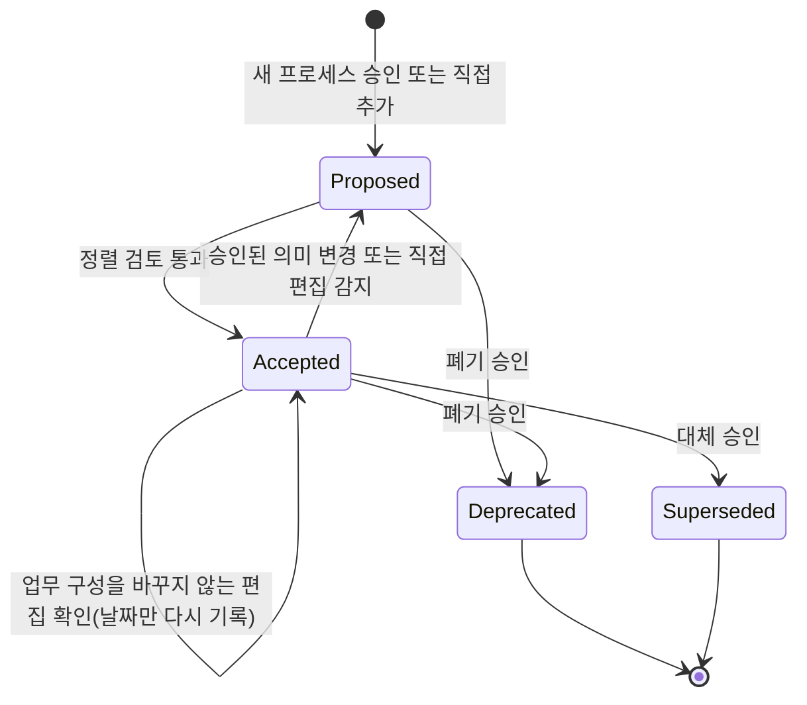
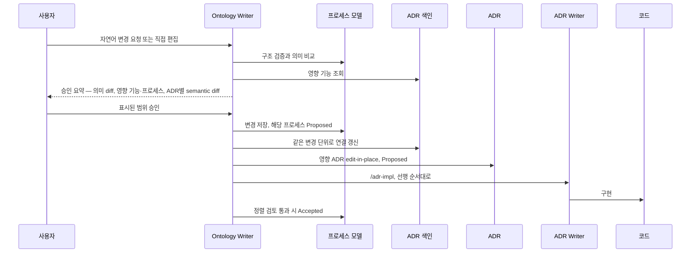

# ADR 0003: 프로세스 모델 변경을 승인 후 ADR과 코드로 전파하고 정렬 검토로 현행 여부를 판정

Date: 2026-10-29

## Status

Proposed

## Purpose

업무 프로세스 모델은 ADR 위의 업무 기준이다. 사용자는 업무가 바뀌면 모델을 먼저 고치고, 그 변경이 영향받는 기능의
ADR과 코드로 내려가기를 원한다. 이 경로가 정해지지 않으면 모델과 ADR이 조용히 어긋나고, 에이전트는 모델에 적힌 흐름이
지금 운영되는 업무인지 아직 구현되지 않은 목표인지 구분할 수 없다. 프로세스 승인과 ADR 승인을 따로 받으면 같은 변경을
여러 번 확인하게 되고, 하위 레벨 작업이 모델의 내용을 바꾸면 상위 기준이 흔들린다.

이 결정은 모델 변경이 사용자가 승인한 범위에서만 위에서 아래로 전파되고, 기능들이 실제로 함께 동작할 때만 프로세스가
현행 업무로 표시되게 한다. 그 뒤 하위 레벨이 어긋나면 Status를 되돌리지 않고 정렬 문제로 드러낸다. 방향: 프로세스는
ADR과 같은 Status 이름을 쓰되 업무 의미를 가진다. `Proposed`는 승인된 목표 업무이고 `Accepted`는 현행 업무다. 의미
변경은 업무 구성이 바뀐 프로세스를 `Proposed`로 만들고, 승인 요약 하나에서 프로세스 변경과 영향 ADR revision을 함께
확인한다. 영향 ADR이 구현되고 정렬 검토가 통과하면 프로세스는 자동으로 `Accepted`가 된다. 사용자는 주로 대화로 모델을
고치고, 개발자는 Turtle을 직접 고칠 수 있으며, 두 경로는 같은 검증과 승인으로 모인다.

- 가정: 대상 저장소는 실현 기능들을 실제 진입점으로 함께 실행해 볼 수단을 갖는다 — 거짓이면 프로세스가 `Proposed`에
  머무르므로 관찰 기준의 증거 정책을 재검토한다.

## Decision Drivers

- 업무 변경은 사용자가 승인한 범위에서만 ADR과 코드로 내려가야 하고, 한 번의 승인으로 그 범위의 ADR revision까지 확인할
  수 있어야 한다.
- 에이전트와 사용자는 모델에 적힌 흐름이 현행 업무인지 승인된 목표인지 구분해야 하고, 다른 프로세스의 목표 변경이 현행
  프로세스를 목표로 바꾸면 안 된다.
- ADR 편집, ADR Status 변화와 코드 변경은 모델의 업무 내용과 현행 프로세스의 Status를 바꾸면 안 된다. ADR과 코드 사이에서는
  동기화가 `Accepted`를 되돌리지만, 상위 레벨은 하위 레벨의 변경에 흔들리지 않아야 하므로 프로세스는 되돌리지 않고 정렬
  문제로 보고한다.
- 기능별 구현 리뷰는 기능 사이의 연결 결함, 예를 들어 발생시키는 사건과 반응하는 정책의 불일치를 찾지 못한다. 현행
  판정에는 기능들을 함께 실행한 증거가 필요하다.
- 대화형 편집과 개발자의 직접 편집은 같은 검증과 승인으로 모여야 하고, 서로를 덮어쓰면 안 된다.

## Decision

프로세스의 Status와 대체 대상은 생명주기 속성이라 업무 내용으로 세지 않으며, Ontology Writer의 생명주기 전이로만 바뀐다.
의미 변경은 요소나 관계의 추가·삭제와 사실 속성 값의 의미 변경이고, 서식, 같은 뜻의 문구와 설명 속성의 변경은 의미
변경이 아니다. 은퇴한 프로세스는 다시 살아나지 않는다. 업무 구성을 바꾸지 않는 편집(미정 범위만의 변경이나 사용자가
같은 뜻으로 확인한 문구 수정)을 승인 저장이나 프로세스 동기화가 확인하면, 기계 게이트가 유지되는 `Accepted` 프로세스의
Status를 확인한 날짜의 `Accepted`로 다시 기록해 그 확인이 다음 비교의 기준이 되게 한다.

의미 변경은 업무 구성이 바뀐 프로세스만 `Proposed`로 만든다. 업무 구성은 프로세스 자신의 정의·시작 조건·업무 결과,
그 프로세스의 단계와 관찰 기준, 기준이 경유하는 사건, 그 단계의 수행자, 그 단계를 시작하는 정책과 그 정책의 촉발 사건,
그 단계가 발생시키는 사건, 그 단계와 정책이 사용하는 개념과 그 단계에 닿는 규칙이다. 프로세스와 단계의 미정 범위는
업무 구성에 넣지 않는다. 그래서 공유 사건의 뜻이 바뀌면 그
사건을 내고 받는 프로세스가 모두 목표로 돌아가지만, 다른 프로세스가 그 사건에 새로 반응하면 발생 쪽 현행 프로세스는
그대로다.

정렬 검토(모델과 실현 ADR, 실행 결과가 맞는지 판정해 프로세스를 현행으로 만드는 검토)는 기능별 구현 리뷰가 보지 못하는
연결을 본다. 실현 기능(ADR 색인에서 그 단계에 연결된 category)이 구현을 마쳤는지, 준수 계약이 정해진 ADR에 있는지, ADR
계약이 모델과 모순되지 않는지, 관찰 기준이 실행으로 확인되는지를 함께 판정한다. 사건 인계의 준수 계약은 발생 쪽과 반응
쪽 ADR 모두에 둔다. 발생 쪽이 사건을 바꾸면 반응 쪽이 깨지기 때문이다. 관찰 기준은 실행 증거로만 확인한다. 기능마다
리뷰를 통과해도 사건 이름이 어긋나면 흐름이 끊기기 때문이다. 관찰 기준이 지나는 단계와 경유하는 사건이 실행 범위를
정하고, 정렬 검토는 실행 전에 그 범위를 증거에 먼저 적는다. 아직 목표 업무인 다른 프로세스는 함께 검증할 때만
실행 범위에 들어, 현행 프로세스의 판정이 구현되지 않은 목표에 묶이지 않는다. 그렇게 미룬 인계는 그 목표 프로세스가
현행이 되는 검토에서 반드시 실행한다.

변경은 위에서 아래로 진행한다. Ontology Writer는 승인 요약 하나에 모델의 의미 diff, 영향 기능, 연결 변경, `Proposed`가 될
프로세스, 영향 ADR마다의 semantic diff를 모은다. 이 승인은 표시된 프로세스 변경과 정확한 ADR revision의 승인이다. 승인된
변경과 색인 연결을 함께 저장하고, 영향 ADR은 edit-in-place로 `Proposed`가 된 뒤 ADR Writer의 `/adr-impl`이 선행 순서대로
구현한다. 영향 ADR의 revision은 ADR Writer의 작성 규칙으로 만들고 구현도 ADR Writer가 하므로, 영향 ADR이 있는 변경에는 두
플러그인이 함께 있어야 한다. 영향 ADR이 없는 변경은 Ontology Writer만으로 저장한다. ADR 작성·구현 같은 하위 레벨 작업이
발견한 기능 횡단 사실도 같은 경로로 올라온다. 모델이 정의를 갖게 되는 업무 용어가
ADR 용어집에 이미 있으면, 같은 승인 요약에서 그 항목의 정리를 함께 묻는다.

직접 편집은 사용자가 작성한 변경이다. 프로세스 동기화는 모델과 실현 ADR을 비교하는 Ontology Writer 경로이며, ADR과 코드를
비교하는 ADR 동기화와 별개다. 프로세스 동기화는 직접 편집을 구조 검증과 저장 전 작성 검토로 확인하고, 바뀐 의미를 찾아 변경
전파를 제안한다. `Accepted` 프로세스는 마지막으로 `Accepted`가 된 뒤의 저장소 이력으로, `Proposed` 프로세스는 실현 ADR에
아직 반영되지 않은 의미로 바뀐 내용을 찾는다. 확인한 비의미 편집은 `Accepted` 날짜를 다시 기록하는 것으로 비교 기준을
옮기며, 별도 승인 기록은 두지 않는다. 그 프로세스의 `Accepted` 날짜가 이미 확인한 날짜이면 기준을 옮길 수 없으므로 Ontology Writer는 그 사실을 알리고, 그 편집은 날짜가 바뀐 뒤의 확인이 기준을 옮긴다. 폐기되거나 대체된 프로세스는 모델에 남아
Status로 구분되고, 주요 의미 변경의 이유는 모델 디렉터리의 변경 기록 Markdown 문서에 남긴다.

### Requirement contract

#### Required guarantees

**Status와 전이**

| 의무                                                                                                                                                                                                                                                                                                                                                                                                                                                                                                                            | 관찰 가능한 검증 기준                                                                                                                                                                                                                                                                                                                                                                                                                              |
| ------------------------------------------------------------------------------------------------------------------------------------------------------------------------------------------------------------------------------------------------------------------------------------------------------------------------------------------------------------------------------------------------------------------------------------------------------------------------------------------------------------------------------- | -------------------------------------------------------------------------------------------------------------------------------------------------------------------------------------------------------------------------------------------------------------------------------------------------------------------------------------------------------------------------------------------------------------------------------------------------- |
| R1. 프로세스의 Status는 `Proposed`, `Accepted (YYYY-MM-DD)`, `Deprecated (YYYY-MM-DD)`, `Superseded` 중 하나이고, `Superseded` 프로세스의 대체 대상은 존재하는 프로세스를 가리킨다.                                                                                                                                                                                                                                                                                                                                             | 다른 값, 날짜 형식 위반과 끊어진 대체 대상은 검증 오류다.                                                                                                                                                                                                                                                                                                                                                                                          |
| R2. `Proposed`는 승인되었지만 아직 정렬 검토를 통과하지 않은 목표 업무이고, `Accepted`는 마지막으로 승인된 의미가 정렬 검토를 통과한 현행 업무이고, 그 날짜는 그 검토나 R51의 확인 날짜다.                                                                                                                                                                                                                                                                                                                                      | 업무 맥락 조회 결과의 Status와 동기화 전 직접 편집 표시로 프로세스가 목표 업무인지 현행 업무인지 구분할 수 있다.                                                                                                                                                                                                                                                                                                                                   |
| R3. 허용 전이는 새 프로세스 승인이나 직접 추가의 `Proposed`, 정렬 검토 통과의 `Proposed`→`Accepted`, 승인된 의미 변경이나 직접 편집 감지, 또는 이력이 보여 줄 수 없는 구간을 사용자가 확인하지 않은 프로세스(R41)의 `Accepted`→`Proposed`, 업무 구성을 바꾸지 않는 편집 확인(R51)이나 그 구간에서 업무 구성이 바뀌지 않았다는 사용자 확인(R41)의 `Accepted`→`Accepted`(날짜만 다시 기록), 폐기 승인의 `Proposed`·`Accepted`→`Deprecated`, 대체 승인의 `Accepted`→`Superseded`뿐이다. `Deprecated`와 `Superseded`는 종료 상태다. | 그 밖의 전이를 만드는 변경은 검증 오류이고, 은퇴한 프로세스는 다시 `Proposed`나 `Accepted`가 되지 않는다.                                                                                                                                                                                                                                                                                                                                          |
| R4. `Proposed` 프로세스는 정렬 검토를 통과할 때만, 별도 확인 없이 `Accepted`가 된다. 마지막으로 커밋된 모델이 그 프로세스를 검토 날짜와 같거나 그보다 늦은 날짜의 `Accepted`로 가지고 그 프로세스를 `Proposed`로 만든 변경이 아직 커밋되지 않았으면, 커밋한 뒤 새 승격으로 읽히지 않으므로 Ontology Writer는 승격하지 않았다는 것과 그 이유를 알리고, 그 변경이 커밋된 뒤 승격한다.                                                                                                                                             | 통과 직후 Status가 `Accepted (날짜)`이고, 다른 경로로 `Accepted`가 되지 않는다. 마지막 커밋이 같은 날이나 그 뒤의 `Accepted`를 가진 채 그 프로세스를 `Proposed`로 만든 변경이 커밋되지 않은 경우에는 승격하지 않았다는 사실이 그 변경을 먼저 커밋하라는 이유와 함께 보고되고, 커밋 뒤의 승격으로 `Accepted (날짜)`가 된다.                                                                                                                         |
| R5. 의미 변경은 요소나 관계의 추가·삭제와 사실 속성 값의 의미 변경이다. 승인된 의미 변경은 R6이 정한 프로세스를 `Proposed`로 만든다.                                                                                                                                                                                                                                                                                                                                                                                            | Ontology Writer가 의미 변경을 저장한 직후 업무 구성이 바뀐 프로세스가 `Proposed`다.                                                                                                                                                                                                                                                                                                                                                                |
| R6. 프로세스의 업무 구성은 그 프로세스 자신의 정의, 시작 조건과 업무 결과, 그 프로세스의 단계와 관찰 기준, 관찰 기준이 경유하는 사건, 그 단계를 수행하는 행위자, 그 단계를 시작하는 정책과 그 정책의 촉발 사건, 그 단계가 발생시키는 사건, 그 단계와 그 정책이 사용하는 업무 개념, 그 단계에 닿는 업무 규칙과 이 요소들 사이의 관계다. 프로세스와 단계의 미정 범위는 업무 구성에 넣지 않는다. 의미 변경은 업무 구성이 바뀐 `Proposed`·`Accepted` 프로세스만 `Proposed`로 만든다.                                                | 공유 사건의 정의를 바꾸면 그 사건을 발생시키거나 그 사건에 반응해 단계를 시작하는 현행·목표 프로세스가 모두 `Proposed`가 되고, 프로세스의 업무 결과를 바꾸면 그 프로세스가 `Proposed`가 되지만 미정 범위만 바뀐 편집은 프로세스를 `Proposed`로 만들지 않는다(확인되면 R51대로 `Accepted` 날짜만 다시 기록한다). 다른 프로세스가 그 사건에 새 반응을 붙이면 발생 쪽 프로세스의 Status는 바뀌지 않고, 은퇴한 프로세스는 어느 경우에도 바뀌지 않는다. |
| R7. 서식, 같은 뜻의 사실 속성 문구와 설명 속성의 변경은 의미 변경이 아니며 프로세스를 `Proposed`로 만들지 않고 ADR 색인과 ADR을 바꾸지 않는다. 확인된 같은 뜻의 문구 수정은 R51대로 `Accepted` 날짜만 다시 기록한다.                                                                                                                                                                                                                                                                                                            | 이런 편집은 변경 전파 제안을 만들지 않는다.                                                                                                                                                                                                                                                                                                                                                                                                        |
| R8. 의미가 같은지 확정할 수 없는 편집은 확인되지 않은 부분을 표시하고 변경 없음으로 처리하지 않는다.                                                                                                                                                                                                                                                                                                                                                                                                                            | 판정할 수 없는 편집이 미확인으로 보고되고, 사용자가 확인하기 전에는 no-op으로 저장되지 않는다.                                                                                                                                                                                                                                                                                                                                                     |
| R9. 생명주기 속성은 승인된 변경의 저장, 정렬 검토, 폐기·대체 승인과 프로세스 동기화의 직접 편집 감지와 이력이 보여 줄 수 없는 구간의 확인(R41)이라는 Ontology Writer의 생명주기 전이로만 바뀐다. 직접 편집으로 새 프로세스를 추가할 때는 Status를 `Proposed`로 쓴다.                                                                                                                                                                                                                                                            | 직접 편집으로 바뀐 생명주기 속성은 프로세스 동기화가 오류로 보고하고, 직접 추가한 새 프로세스의 `Proposed`만 허용된다.                                                                                                                                                                                                                                                                                                                             |
| R10. 폐기나 대체가 승인되면 그 프로세스의 단계를 가리키는 색인 연결의 제거 또는 이전을 같은 변경 단위로 적용하고, 은퇴한 프로세스는 모델에 남아 Status로 구분된다.                                                                                                                                                                                                                                                                                                                                                              | 폐기된 프로세스의 단계를 가리키는 연결이 남지 않고, 은퇴한 프로세스가 `Deprecated`나 `Superseded`로 모델에 있다.                                                                                                                                                                                                                                                                                                                                   |
| R11. 모델은 현재 상태만 기록한다.                                                                                                                                                                                                                                                                                                                                                                                                                                                                                               | 모델에 이전 값이나 전환 서술이 없다.                                                                                                                                                                                                                                                                                                                                                                                                               |
| R12. 주요 의미 변경과 프로세스의 폐기·대체는 모델 디렉터리의 변경 기록 Markdown 문서에 최신순으로 이유와 함께 한 줄씩 남긴다. 주요 의미 변경은 단계·정책·규칙·사건·관찰 기준의 추가와 삭제, 흐름·발생·촉발·시작·사용·제약·수행·경유 관계의 변경, 반응 조건과 규칙 의미의 변경, 사건·개념·행위자 정의의 의미 변경이다.                                                                                                                                                                                                           | 이 변경마다 변경 기록에 이유가 있다.                                                                                                                                                                                                                                                                                                                                                                                                               |
| R13. 같은 뜻의 문구 수정은 변경 기록에 남기지 않는다.                                                                                                                                                                                                                                                                                                                                                                                                                                                                           | 이름이나 정의 문구만 고친 변경은 기록되지 않는다.                                                                                                                                                                                                                                                                                                                                                                                                  |

**정렬 검토**

| 의무                                                                                                                                                                                                                                                                                                                                                                                                                                               | 관찰 가능한 검증 기준                                                                                                                                                                                             |
| -------------------------------------------------------------------------------------------------------------------------------------------------------------------------------------------------------------------------------------------------------------------------------------------------------------------------------------------------------------------------------------------------------------------------------------------------- | ----------------------------------------------------------------------------------------------------------------------------------------------------------------------------------------------------------------- |
| R14. 정렬 검토는 모든 시스템 단계에 실현 기능이 연결되어 있을 때만 통과한다.                                                                                                                                                                                                                                                                                                                                                                       | 실현 기능이 없는 시스템 단계가 하나라도 있으면 통과하지 않고, 시스템 밖 단계는 이 조건에서 제외된다.                                                                                                              |
| R15. 정렬 검토는 실현 기능마다 `Accepted` ADR이 하나 이상 있고 `Proposed` ADR이 없을 때만 통과한다. `Deprecated`와 `Superseded` ADR은 판정에 쓰지 않는다.                                                                                                                                                                                                                                                                                          | `Proposed` ADR이 남거나 `Accepted` ADR이 없는 실현 기능이 하나라도 있으면 통과하지 않는다.                                                                                                                        |
| R16. 사건 인계는 그 사건을 발생시키는 단계와 그 사건에 반응해 시작되는 단계의 실현 ADR 모두에 준수 계약을 둔다.                                                                                                                                                                                                                                                                                                                                    | 어느 한쪽에 준수 계약이 없으면 그 인계가 보고된다.                                                                                                                                                                |
| R17. 정책은 그 정책이 시작하는 단계의 실현 ADR에 준수 계약을 둔다.                                                                                                                                                                                                                                                                                                                                                                                 | 준수 계약이 없는 정책이 보고된다.                                                                                                                                                                                 |
| R18. 업무 규칙은 그 규칙이 닿는 시스템 단계의 실현 ADR마다 준수 계약을 둔다. 규칙이 닿는 단계는 규칙이 제약하는 단계, 제약하는 정책이 시작하는 단계, 제약하는 업무 개념을 사용하는 단계와 제약하는 프로세스의 단계다.                                                                                                                                                                                                                              | 준수 계약이 빠진 규칙과 ADR이 함께 보고된다.                                                                                                                                                                      |
| R19. 정렬 검토는 R16–R18의 준수 계약이 모두 있을 때만 통과한다.                                                                                                                                                                                                                                                                                                                                                                                    | 보고된 누락이 하나라도 있으면 통과하지 않는다.                                                                                                                                                                    |
| R20. 정렬 검토는 실현 ADR의 계약(실현 기능이 따르는 컨텍스트 수준 ADR 포함)이 모델의 흐름, 사건 인계, 정책, 업무 규칙과 행위자 책임에 모순되지 않을 때만 통과한다.                                                                                                                                                                                                                                                                                 | 모델과 다른 사건을 약속한 발생·반응 쪽 계약, 규칙과 모순되는 계약, 모델의 수행 행위자가 그 단계를 수행할 수 없게 하는 권한 계약이 있으면 통과하지 않고, 그 계약과 모델 요소가 함께 보고된다.                      |
| R21. 관찰 기준은 시작 조건을 만든 뒤 업무 결과를 관찰해 확인한다. 증거는 기준이 시작 조건부터 업무 결과까지 지나는 시스템 단계와, 기준이 경유하는 사건을 발생시키거나 그 사건에 반응해 시작되는 다른 프로세스의 단계를 실현 기능의 실제 진입점으로 실행한다. 다른 프로세스의 단계는 그 프로세스가 `Accepted`이거나 같은 정렬 검토에서 함께 검증될 때만 실행 범위에 든다. 정렬 검토는 실행 전에 기준마다 실행할 단계와 진입점을 증거에 먼저 적는다. | 실행 전에 적은 실행 범위와 실행한 단계·진입점이 증거에 보이고, 실행 범위의 시스템 단계를 진입점 없이 건너뛰거나 그 결과를 데이터로 미리 만든 증거와 실현 기능을 하나도 실행하지 않은 증거는 미확인이다.           |
| R22. 관찰 기준의 실행에서 대역은 증거에 선언한 외부 기관·시스템에만 쓸 수 있다.                                                                                                                                                                                                                                                                                                                                                                    | 사용한 대역과 그것이 대신한 외부 기관·시스템이 증거에 표시되고, 선언 없이 대역을 쓰거나 실현 기능을 대역으로 바꾼 증거는 인정되지 않고 보고된다.                                                                  |
| R23. 시스템 밖 단계는 그 결과를 입력으로 주어 대신할 수 있다.                                                                                                                                                                                                                                                                                                                                                                                      | 대신 준 입력이 증거에 표시된다.                                                                                                                                                                                   |
| R24. 정렬 검토는 모든 관찰 기준이 R21–R23대로 확인될 때만 통과한다.                                                                                                                                                                                                                                                                                                                                                                                | 미확인 기준이 하나라도 있으면 통과하지 않는다.                                                                                                                                                                    |
| R25. 프로세스 사이의 사건 인계마다 그 사건을 경유하는 관찰 기준이 발생 쪽이나 반응 쪽 프로세스에 하나 이상 있어야 한다. 프로세스를 현행으로 만드는 정렬 검토는 상대 프로세스가 현행인 인계마다 그런 기준 하나를 양쪽 단계와 함께 실행하고, 상대가 목표 업무여서 실행하지 못한 인계는 상대를 현행으로 만드는 정렬 검토에서 실행한다.                                                                                                                | 경유하는 관찰 기준이 없는 프로세스 사이 인계가 있으면 통과하지 않고, 두 번째 프로세스를 현행으로 만드는 검토의 증거에 그 인계의 양쪽 실행이 보이고, 그 실행이 실패하면 통과하지 않는다.                           |
| R26. 정렬 검토는 변경 전파로 영향받은 마지막 실현 ADR이 `Accepted`가 된 직후, 영향 ADR이 없으면 승인된 변경을 저장한 직후, `Proposed` 프로세스의 실현 ADR이 모두 `Accepted`가 된 직후, 그리고 사용자가 요청할 때 실행된다.                                                                                                                                                                                                                         | 변경 전파가 끝나거나, 영향 ADR이 없는 변경을 저장하거나, 목표 프로세스의 마지막 실현 ADR이 `Accepted`가 되면 별도 요청 없이 정렬 검토 결과가 보고된다.                                                            |
| R27. `Accepted` 프로세스에 대해 요청한 정렬 검토가 실패하고 마지막으로 `Accepted`가 된 뒤 그 프로세스의 업무 구성에 의미 변경이 없으면, Status를 바꾸지 않고 하위 레벨의 정렬 문제로 보고한다. 의미 변경이 있으면 직접 편집으로 보고 R40·R41을 따른다. 그 뒤의 편집을 저장소 이력이 보여 줄 수 없으면 실패를 미확인으로 보고하고 프로세스 동기화에 넘긴다(R41).                                                                                    | 모델이 바뀌지 않은 프로세스의 실패 보고에 어긋난 ADR이나 실행 결과가 보이고, 그 프로세스는 `Accepted`로 남는다. 이력이 편집을 보여 줄 수 없는 프로세스의 실패는 하위 레벨 정렬 문제가 아니라 미확인으로 보고된다. |

**변경 전파**

| 의무                                                                                                                                                                                                                                                                                                                                                                                                                                                                                                                                                                                                                                                                                                                                                                                                                                                                                                                                               | 관찰 가능한 검증 기준                                                                                                                                                                                                                                                                                                |
| -------------------------------------------------------------------------------------------------------------------------------------------------------------------------------------------------------------------------------------------------------------------------------------------------------------------------------------------------------------------------------------------------------------------------------------------------------------------------------------------------------------------------------------------------------------------------------------------------------------------------------------------------------------------------------------------------------------------------------------------------------------------------------------------------------------------------------------------------------------------------------------------------------------------------------------------------- | -------------------------------------------------------------------------------------------------------------------------------------------------------------------------------------------------------------------------------------------------------------------------------------------------------------------- |
| R28. 변경은 프로세스 모델, ADR 색인 연결, ADR, 코드 순서로 전파된다.                                                                                                                                                                                                                                                                                                                                                                                                                                                                                                                                                                                                                                                                                                                                                                                                                                                                               | 프로세스 변경이 승인되기 전에는 영향 ADR과 코드가 새 프로세스 내용으로 바뀌지 않는다. 승인된 계약이 아닌 미정 행에 기다리는 업무 변경을 적는 것은 ADR 승인으로 저장되므로 이 기준의 예외다.                                                                                                                          |
| R29. 프로세스 변경 승인 요약은 모델의 의미 diff, 색인 연결로 찾은 영향 기능, 연결 변경과 `Proposed`가 될 프로세스를 보여준다.                                                                                                                                                                                                                                                                                                                                                                                                                                                                                                                                                                                                                                                                                                                                                                                                                      | 네 항목이 모두 요약에 있다.                                                                                                                                                                                                                                                                                          |
| R30. 모델에 업무 개념의 정의나 바운디드 컨텍스트의 용어를 저장하는 승인 요약은 ADR 루트 용어집에 같은 용어가 있으면 그 항목의 제거를 함께 제안한다. 개념 저장과 용어집 항목 제거는 한 결정으로 묻고 같은 변경 단위로 적용하며, 뜻이 다르면 어느 뜻을 남길지 사용자가 고른다. 사용자가 정하기 전에는 그 용어집 항목을 지우지도 그 개념을 저장하지도 않는다. 모델이나 용어집의 직접 편집으로 생긴 공존은 프로세스 동기화가 보고하고, 뜻이 같으면 제거를, 다르면 어느 뜻을 남길지 묻는다. 사용자가 정리를 거절하면 그 개념과 그 개념을 쓰는 관계는 저장하지 않고 남은 범위로 보고한다. 용어집 표에서 그 이름이 헤더가 용어·이름·언어를 뜻하는 열(그런 열이 없으면 첫 열)이 아닌 다른 열에만 있으면, 그 칸은 문맥·분류·관계 같은 다른 내용일 수 있으므로 승인 요약은 그 칸이 그 용어의 정의인지 사용자에게 묻고 저장을 막지 않는다. 정의라고 하면 위와 같이 정리하고, 아니라고 하면 그 칸을 남긴다. 정의·설명 열의 문장은 용어집 항목으로 읽지 않는다. | 승인 요약에 같은 용어의 용어집 항목과 제거 제안이 하나의 결정으로 보이고, 승인 전에는 용어집과 모델이 바뀌지 않으며, 저장 뒤 같은 용어의 정의가 모델과 용어집에 함께 있지 않으며, 정리를 거절한 개념과 그 관계는 저장되지 않는다. 다른 내용일 수 있는 표 칸의 이름은 저장을 막지 않고 정의인지 묻는 질문으로 보인다. |
| R31. 승인 요약은 영향 ADR마다 Decision, Decision Drivers, 요구사항 계약과 Consequences의 semantic diff와 regeneration checklist를 보여준다.                                                                                                                                                                                                                                                                                                                                                                                                                                                                                                                                                                                                                                                                                                                                                                                                        | 영향 ADR마다 네 section의 의미 변경과 regeneration checklist가 요약에 있다.                                                                                                                                                                                                                                          |
| R32. 승인 요약의 승인은 표시된 정확한 ADR revision의 승인이다.                                                                                                                                                                                                                                                                                                                                                                                                                                                                                                                                                                                                                                                                                                                                                                                                                                                                                     | 승인 뒤 표시된 revision과 다른 ADR 내용이 저장되지 않고, 그 revision의 `/adr-impl`은 같은 확인을 다시 요구하지 않는다.                                                                                                                                                                                               |
| R33. 다른 경로에서 이미 확인한 요소와 관계는 승인 요약에서 다시 묻지 않고, 그 확인의 기준이 된 모델이 바뀌었으면 바뀐 범위만 다시 제시한다.                                                                                                                                                                                                                                                                                                                                                                                                                                                                                                                                                                                                                                                                                                                                                                                                        | 같은 요소나 관계를 두 번 확인하라는 질문이 없고, 기준이 바뀐 범위는 다시 제시된다.                                                                                                                                                                                                                                   |
| R34. 승인 요약에 보이는 시스템 단계 중 실현 기능이 없는 단계(새 단계 포함)는 admission gate와 decision identity check를 거친 기존 ADR 갱신이나 새 ADR 후보로 승인 요약에 제시된다.                                                                                                                                                                                                                                                                                                                                                                                                                                                                                                                                                                                                                                                                                                                                                                 | 그런 단계마다 실현 후보가 있거나, 후보가 없는 이유가 표시된다.                                                                                                                                                                                                                                                       |
| R35. 승인된 프로세스 변경과 그에 따른 색인 연결 갱신, 용어집 항목 제거는 하나의 변경 단위로 저장된다.                                                                                                                                                                                                                                                                                                                                                                                                                                                                                                                                                                                                                                                                                                                                                                                                                                              | 이 경로로 저장한 어느 시점에도 색인 연결이 존재하지 않는 단계를 가리키지 않고, 같은 용어의 정의가 모델과 용어집에 함께 남지 않는다.                                                                                                                                                                                  |
| R36. 영향 ADR은 edit-in-place로 갱신되어 `Proposed`가 되고 `/adr-impl`이 선행 순서대로 구현한다.                                                                                                                                                                                                                                                                                                                                                                                                                                                                                                                                                                                                                                                                                                                                                                                                                                                   | 영향 ADR이 `Proposed`로 표시되고, 선행 기능보다 먼저 구현 완료로 보고되지 않는다.                                                                                                                                                                                                                                    |
| R37. 모델이 있는 저장소에서 ADR 작성·구현, PRD 인계와 기존 프로젝트 가져오기가 확인한 기능 사이 관계(그 관계를 지키는 값·조건·준수 계약은 실현 ADR이 소유한다)와, 모델이 정의를 소유하는 업무 개념·용어의 새 정의나 의미 변경은 프로세스 변경 제안이나 문서 기반 구축의 후보로 제시되고 R29–R34의 내용을 갖춘 같은 승인 요약과 전파 경로를 거친다.                                                                                                                                                                                                                                                                                                                                                                                                                                                                                                                                                                                                 | 승인 전에는 제안 내용이 모델, ADR이나 코드에 반영되지 않는다.                                                                                                                                                                                                                                                        |
| R38. 모델이 없는 저장소에서는 사용자가 요청할 때만 문서 기반 구축을 시작한다.                                                                                                                                                                                                                                                                                                                                                                                                                                                                                                                                                                                                                                                                                                                                                                                                                                                                      | 모델이 없는 저장소의 인계와 가져오기는 모델 후보를 제시하지 않는다.                                                                                                                                                                                                                                                  |

**편집 경로**

| 의무                                                                                                                                                                                                                                                                                                                                                                                                                                                                                                                                                                                                                                                                                                                                                                                                                                                                                                                                                                                                     | 관찰 가능한 검증 기준                                                                                                                                                                                                                                                                                                                                                                                                         |
| -------------------------------------------------------------------------------------------------------------------------------------------------------------------------------------------------------------------------------------------------------------------------------------------------------------------------------------------------------------------------------------------------------------------------------------------------------------------------------------------------------------------------------------------------------------------------------------------------------------------------------------------------------------------------------------------------------------------------------------------------------------------------------------------------------------------------------------------------------------------------------------------------------------------------------------------------------------------------------------------------------- | ----------------------------------------------------------------------------------------------------------------------------------------------------------------------------------------------------------------------------------------------------------------------------------------------------------------------------------------------------------------------------------------------------------------------------- |
| R39. 사용자는 자연어 요청과 텍스트 직접 편집으로 모델을 고칠 수 있고, 두 경로는 같은 구조 검증과 의미 diff를 거친다.                                                                                                                                                                                                                                                                                                                                                                                                                                                                                                                                                                                                                                                                                                                                                                                                                                                                                     | 같은 의미 변경은 경로와 관계없이 같은 의미 diff와 영향 기능으로 제시된다.                                                                                                                                                                                                                                                                                                                                                     |
| R40. 프로세스 동기화는 직접 편집을 구조 검증과 저장 전 작성 검토(세 축 검토와 상태 전제 규칙 검토)로 확인하고, 실현 ADR과의 의미 차이를 찾아 변경 전파를 제안하며, 업무 구성의 의미가 바뀐 `Accepted` 프로세스를 `Proposed`로 표시한다. 실현 ADR에 남은 미정 행과 그 행이 기다리는 업무 변경도 보고한다.                                                                                                                                                                                                                                                                                                                                                                                                                                                                                                                                                                                                                                                                                                 | 직접 편집한 의미 변경이 동기화 뒤 영향 기능과 함께 제시되고, 해당 `Accepted` 프로세스가 `Proposed`가 되며, 실현 ADR의 미정 행이 기다리는 업무 변경과 함께 보고된다.                                                                                                                                                                                                                                                           |
| R41. 커밋되지 않은 직접 편집은 마지막으로 커밋된 모델과 비교한다. 커밋된 직접 편집은 `Accepted` 프로세스에서는 마지막으로 `Accepted`가 된 뒤 저장소 이력에서 업무 구성의 의미가 바뀐 것으로 찾고, `Proposed` 프로세스에서는 Status를 바꾸지 않고 실현 ADR에 반영되지 않은 모델 의미만 전파 제안으로 제시한다. 모델 변경 없이 생긴 정렬 차이는 R27의 하위 레벨 정렬 문제다. `Accepted` 프로세스가 마지막으로 `Accepted`가 된 곳까지의 이력에 모델을 읽을 수 없는 커밋이 두 개 이상 이어지고 그 안에서 그 프로세스의 Status가 바뀌었다가 같은 값으로 돌아왔을 수 있으면(예를 들어 그 커밋들에서 읽히는 문서가 그 Status를 내내 같은 값으로 보여 주면 그렇지 않다), 그때의 업무 구성은 볼 수 없으므로 프로세스 동기화는 그 프로세스를 미확인으로 보고하고 사용자에게 그 구간에서 업무 구성이 바뀌었는지 묻는다. 바뀌지 않았다고 확인하면 R51대로 `Accepted` 날짜를 다시 기록하고, 확인하지 않으면 `Proposed`로 표시해 정렬 검토를 받게 한다. 그 구간 뒤의 날짜 재기록은 이 확인과 이력으로 구별되지 않는다. | 별도 승인 기록 없이도 직접 편집의 의미 diff와 영향 기능이 제시되고, `Proposed` 프로세스에서 이미 승인된 변경은 다시 묻지 않으며, ADR 편집만으로 생긴 차이는 프로세스를 `Proposed`로 만들지 않는다. 그런 구간 뒤의 `Accepted` 프로세스가 이유와 함께 미확인으로 보고되고, Ontology Writer는 사용자의 확인 없이 그 날짜를 다시 기록하지 않으며, 그 구간 내내 Status가 같은 값으로 읽히는 프로세스는 미확인으로 보고되지 않는다. |
| R42. 승인 요약을 거절해도 직접 편집은 유지되고, 그 프로세스는 `Proposed`로 남으며, ADR은 바뀌지 않는다.                                                                                                                                                                                                                                                                                                                                                                                                                                                                                                                                                                                                                                                                                                                                                                                                                                                                                                  | 거절 뒤 모델의 편집 내용과 `Proposed`가 그대로이고 ADR diff가 없다.                                                                                                                                                                                                                                                                                                                                                           |
| R51. 승인 저장이나 프로세스 동기화가 업무 구성을 바꾸지 않는 편집(미정 범위만의 변경이나 사용자가 같은 뜻으로 확인한 문구 수정)을 확인하면, 기계 게이트가 유지되는 그 `Accepted` 프로세스의 Status를 확인한 날짜의 `Accepted`로 다시 기록한다. 이 전이는 Ontology Writer가 수행하는 생명주기 전이다. 확인한 날짜가 그 프로세스의 현재 `Accepted` 날짜와 같으면 Status를 다시 기록할 수 없으므로, Ontology Writer는 다시 기록하지 않았다는 것과 그 이유를 알리고 그 편집은 날짜가 바뀐 뒤의 확인 전까지 동기화 전 직접 편집으로 표시된다.                                                                                                                                                                                                                                                                                                                                                                                                                                                                 | 확인을 커밋한 뒤 그 프로세스의 Status가 확인한 날짜의 `Accepted`이고 다음 조회와 동기화가 그 편집을 직접 편집으로 표시하거나 다시 묻지 않으며, 업무 구성이 바뀐 편집이나 게이트가 깨진 프로세스는 이렇게 다시 기록되지 않는다. 현재 `Accepted` 날짜와 같은 날의 확인은 다시 기록되지 않았다는 사실이 이유와 함께 보고된다.                                                                                                    |

#### Prohibitions

| 의무                                                                                                          | 관찰 가능한 검증 기준                                                                                   |
| ------------------------------------------------------------------------------------------------------------- | ------------------------------------------------------------------------------------------------------- |
| R43. 에이전트는 사용자 승인 없이 모델의 의미를 바꾸지 않는다. 직접 편집은 사용자가 작성한 변경이다.           | 승인 전 제안은 모델, 색인과 ADR 파일을 바꾸지 않는다.                                                   |
| R44. ADR 편집, ADR Status 변화와 코드 변경은 모델의 업무 내용과 `Accepted` 프로세스의 Status를 바꾸지 않는다. | `Accepted` 프로세스의 실현 ADR이 `Proposed`로 돌아가도 모델 diff가 없다.                                |
| R45. 프로세스 변경 때문에 불필요해 보이는 ADR 계약이나 기능을 자동으로 약화하거나 삭제하지 않는다.            | 삭제 후보는 명시적으로 확인되기 전까지 현재 계약을 유지한다.                                            |
| R46. PRD 인계와 기존 프로젝트 가져오기는 모델을 직접 바꾸지 않는다.                                           | 인계나 가져오기를 실행한 뒤 모델 문서의 diff가 없다.                                                    |
| R47. 승인 상태, 정렬 검토 결과와 변경 비교 기준을 별도 기록이나 레지스트리로 저장하지 않는다.                 | 비교 기준을 저장소 이력과 현재 문서에서 다시 얻고, 승인·검토 보고를 지워도 모델·색인·ADR의 의미가 같다. |

#### Failure guarantees

| 의무                                                                                                                                                                                                  | 관찰 가능한 검증 기준                                                                                                                  |
| ----------------------------------------------------------------------------------------------------------------------------------------------------------------------------------------------------- | -------------------------------------------------------------------------------------------------------------------------------------- |
| R48. 승인 요약을 만든 뒤 모델, 색인이나 영향 ADR이 바뀌면 Ontology Writer는 적용 전에 다시 비교하고 바뀐 내용을 덮어쓰지 않는다.                                                                      | 승인 뒤 사용자가 고친 내용이 적용 과정에서 사라지지 않고, 바뀐 범위가 다시 제시된다.                                                   |
| R49. 영향 ADR의 구현이나 정렬 검토가 일부 실패하면 프로세스는 `Proposed`로 남고 완료된 기능과 남은 기능이 구분된다.                                                                                   | 부분 완료가 `Accepted`나 전체 성공으로 보고되지 않는다.                                                                                |
| R50. 직접 편집이 구조 검증이나 저장 전 작성 검토(세 축 검토와 상태 전제 규칙 검토)를 통과하지 못하면 프로세스 동기화는 오류 위치나 빠진 항목을 보고하고 그 편집을 근거로 변경 전파를 시작하지 않는다. | 끊어진 연결, 스키마 위반, 빠진 축이나 상태를 바꾸는 단계에 닿지 않는 상태 전제 규칙이 있는 편집에서 ADR 변경 제안이 만들어지지 않는다. |
| R52. 영향 ADR이 있는 변경에서 ADR Writer가 없으면 Ontology Writer는 승인 요약을 만들지 않고, ADR Writer가 필요하다는 것과 영향 ADR을 알린다.                                                          | ADR Writer 없이 영향 ADR이 있는 변경을 요청하면 모델, 색인과 ADR이 바뀌지 않고 그 이유와 영향 ADR이 보인다.                            |

### Alternatives

현행 판정:

1. **프로세스 Status 없이 ADR Status로만 실현 여부 판단** — 상태가 하나라서 단순하지만, 모델의 흐름이 목표인지 현행인지
   알 수 없고 기능 사이 연결의 실현을 판정할 곳이 없다.
2. **사용자 승인 시점에 `Accepted`** — 승인 즉시 확정되지만, 구현되지 않은 흐름이 현행 업무처럼 보이고 ADR의 `Accepted`와
   뜻이 달라진다.
3. **실현 ADR이 모두 `Accepted`이면 `Accepted`** — 실행 환경 없이 현행이 되지만, 사건 이름 불일치 같은 기능 사이 결함을
   놓친다.
4. **실행 증거를 포함한 정렬 검토 통과 시 `Accepted` (채택)** — `Accepted`가 실제로 함께 동작하는 현행 업무를 뜻한다. 함께
   실행할 수단이 없으면 `Proposed`에 머문다.

`Proposed`로 되돌리는 범위:

1. **공유 요소와 관계로 연결된 모든 프로세스를 `Proposed`로 만듦** — 영향 범위를 넓게 잡아 단순하지만, 다른 프로세스가
   공유 사건에 새로 반응하기만 해도 발생 쪽 현행 프로세스가 목표가 되어, 운영 중인 업무가 구현되지 않은 목표에 묶인다.
2. **업무 구성이 바뀐 프로세스만 `Proposed`로 만듦 (채택)** — 현행 판정이 안정적이고 변경의 범위가 업무 의미와 맞는다.
   업무 구성의 정의를 유지해야 한다.

하위 레벨 드리프트:

1. **하위 드리프트가 발견되면 `Accepted` 프로세스를 `Proposed`로 되돌림** — ADR과 코드 사이의 동기화처럼 실현 상태를 늘
   최신으로 유지하지만, 하위 레벨 변경이 상위 레벨의 상태를 흔들어 상위 레이어가 하위 변경에 영향받지 않는다는 요구와
   충돌한다.
2. **Status는 유지하고 하위 레벨의 정렬 문제로 보고 (채택)** — 상위 기준이 안정적이다. 드리프트를 고칠 때까지 현행 업무와
   실제 동작이 다를 수 있다.

승인과 편집:

1. **프로세스 승인과 ADR 승인을 따로 받음** — 경계가 분명하지만 같은 변경을 두 번 확인한다.
2. **승인 요약 하나에서 프로세스 변경과 ADR revision을 함께 승인 (채택)** — 요약이 길어질 수 있지만 한 번의 확인으로
   전파 범위가 정해진다.
3. **직접 편집을 막고 대화형 편집만 허용** — 모든 변경이 같은 경로를 지나지만, 플러그인 없이 모델을 고칠 수 없고 개발자가
   Turtle을 직접 고치는 경로가 사라진다.

## Consequences

### Positive

- 업무 변경이 승인 한 번으로 영향 ADR revision까지 확정되고, 변경은 위에서 아래로만 흐른다.
- 모델의 Status와 조회의 동기화 표시로 흐름이 현행 업무인지 승인된 목표인지 알 수 있다.
- 정렬 검토가 기능별 리뷰가 놓치는 기능 사이의 연결 결함, 특히 프로세스 사이 인계를 실행으로 확인한다.

### Negative

- 승인 요약에 영향 ADR의 semantic diff가 모두 들어가 길어질 수 있다.
- 실현 기능들을 함께 실행할 수단이 없는 저장소에서는 프로세스가 `Proposed`에 머문다.
- 커밋된 직접 편집은 프로세스 동기화를 실행하기 전까지 이전 Status로 남고 하위 레벨에 전파되지 않는다. 조회와 화면은
  커밋되지 않은 편집과, `Accepted` 프로세스의 동기화 전 커밋된 편집을 표시한다.
- 하위 드리프트를 고칠 때까지 `Accepted` 프로세스와 실제 동작이 다를 수 있다.

### Risks

- 정렬 검토가 준수 계약의 존재만 보고 의미를 확인하지 않으면 형식적 통과가 된다. 준수 계약의 위치(R16–R18)와 모순
  판정(R20)이 계약의 내용을 함께 본다.
- 대역을 넓게 쓰면 실행 증거가 실제 연결을 확인하지 못한다. R22가 대역을 선언한 외부 기관·시스템으로 제한한다.
- 공유 요소 변경이 많은 프로세스를 동시에 `Proposed`로 만들 수 있다. 승인 요약이 `Proposed`가 될 프로세스를 함께 보여준다.

## Related

- [업무 프로세스 모델을 ADR 위의 RDFS-lite 레벨로 도입](./0001-introduce-business-process-model-level.md)
- [에이전트의 업무 맥락 조회와 세션 지침](./0002-retrieve-business-context-for-agents.md)
- [문서 묶음에서 모델 후보 구축](./0004-build-process-model-from-documents.md)
- [ADR 상호작용은 Decision Digest와 semantic diff를 우선 표시](../adr-authoring/decision-presentation/0001-present-decision-digest-and-semantic-diff.md)
- [안전하고 비례적인 개발 워크플로우](../delivery/development-flow/0001-safe-proportional-development-gates.md)
- [하나의 결정은 하나의 현재 상태 ADR로 유지](../adr-authoring/current-state/0001-record-only-the-final-decision-state.md)
- [PRD 기능 계약의 소유권을 ADR로 이전](../alps-authoring/spec-handoff/0001-admission-aware-feature-handoff.md)
- [기존 프로젝트의 기능과 계약을 ADR에 정리](../adr-authoring/project-import/0001-import-existing-project-decisions.md)
