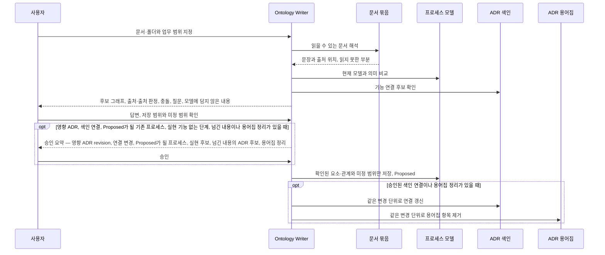

# ADR 0004: 문서 묶음에서 업무 프로세스 모델 후보를 만들고 확인된 사실만 저장

Date: 2026-10-29

## Status

Proposed

## Purpose

업무 지식은 규정, 업무 매뉴얼, 기획서, 회의록, 운영 가이드처럼 여러 문서에 흩어져 있다. 사용자는 이 문서 묶음을
넘기고 에이전트가 해석해 업무 프로세스 모델을 만들기를 원한다. 모델을 처음부터 손으로 쓰는 비용은 도입을 늦출 수 있다.

프로세스 모델은 ADR과 코드를 바꾸는 상위 기준이다. 문서는 오래되었거나 서로 충돌할 수 있고, 현재 업무와 앞으로의 계획을
섞어 쓰거나 예외 경로를 빠뜨릴 수 있다. 에이전트가 추론한 내용이나 확인되지 않은 문장이 그대로 모델에 들어가면 잘못된
업무 기준이 ADR과 코드로 전파된다. 문서에는 상태 전이 조건이나 정확한 기한처럼 모델이 담지 않는 세부도 섞여 있다.

이 결정은 문서에서 모델 후보를 빠르게 만들면서, 근거와 불확실성을 드러낸 채 사용자가 확인한 사실만 모델에 저장하게
한다. 방향: Ontology Writer는 문서를 읽어 모델의 어휘와 해상도로 후보를 만들고 후보마다 출처와 출처 판정을 붙인다. 빈 곳과
충돌은 질문으로 모아 리포트 하나로 제시하고, 확인된 내용만 프로세스 모델의 승인 경로로 저장한다. 모델에 담지 않는
세부는 따로 보고한다.

- 가정: 사용자는 같은 문서를 다시 제공할 수 있어 조사 기록을 다시 만들 수 있다 — 거짓이면 출처를 모델 밖에 보존할지
  R25의 영속 금지를 재검토한다.

## Decision Drivers

- 사용자는 문서를 지정하는 것만으로 검토 가능한 모델 후보를 얻어야 한다.
- 모델은 하위 레벨을 바꾸는 기준이므로 추론, 오래된 문서, 계획 문장이 확인 없이 현재 사실이 되면 안 된다.
- 사용자가 후보를 빠르게 판정하려면 후보마다 출처 위치와 출처 판정을 바로 확인할 수 있어야 한다.
- 모델은 에이전트가 자주 조회하는 업무 기준이므로 업무 흐름과 관계에 대한 사실만 담고, 조사 기록과 정확한 값·판정 세부는
  담지 않아야 한다.
- 문서는 신뢰할 수 없는 입력이며, 문서 안의 문장이나 다른 도구의 확인 표시가 사용자 승인을 대신하면 안 된다.
- 같은 문서를 다시 넣거나 문서를 추가해도 확인된 모델이 흔들리지 않아야 한다.

## Decision

Ontology Writer는 사용자가 지정한 문서 묶음에서 업무 프로세스 모델 후보를 만드는 경로를 제공한다. 입력은 문서·폴더와
선택적인 업무 범위(목적, 시작, 끝)다. 다른 도구가 내보낸 업무 맵(예: AgentStorm 발행본)도 입력 문서로 다룬다. 후보는
프로세스 모델이 소유하는 사실, 즉 흐름, 사건 인계와 정책, 행위자 책임, 단계를 가로지르는 업무 규칙, 업무 개념과 용어,
바운디드 컨텍스트, 관찰 기준의 관계와 의미다. 정책의 반응 조건과 업무 규칙은 의미만 후보로 두고, 상태 기계, 전이 조건,
정확한 값과 판정 세부는 '모델에 담지 않은 내용'으로 출처와 함께 따로 보고한다. 그중 ADR 수준의 내용을 ADR 작성 후보로
넘길지는 그때 사용자에게 묻는다. 모델이 없는 저장소에서 이 경로는 사용자가 요청할 때만 실행되고, 다른 ADR 사이클 동작을
바꾸지 않는다.

후보마다 출처 위치와 출처 판정을 붙인다. 출처 판정의 문서 명시는 입력 문서가 그 사실을 직접 서술한 경우이고, 추론은
여러 서술이나 맥락에서 이끌어 낸 경우이며, 문서 간 충돌은 입력 문서들이 서로 다르게 서술한 경우이고, 미확인은 근거
서술을 찾지 못한 경우다. 다른 도구가 주장마다 확인 여부를 표시한 입력에서 추론·미확인 표시는 그 판정을 그대로 쓰되, 확인 표시가
사용자 확인을 대신하지는 않는다. 후보 업무 개념이나 컨텍스트 용어가 ADR 용어집에 이미 정의돼 있으면 그 정의를 함께 보이고, 뜻이 다르면
질문으로 만든다. 문서가 현재 업무와 계획을 섞어 서술하면 후보에 그 구분을 표시한다.

Ontology Writer는 프로세스 모델이 정한 세 축(시작·종료와 정상 흐름, 수행자와 규칙, 예외·반려·인계)에 근거 충돌을 더한 네
축으로 충분성을 검토한다. 후보 그래프는 모델의 필수 속성, 소속 개수와 최소 연결(정책의 촉발 사건과 시작 단계, 규칙의
제약 대상과 규칙이 닿는 둘 이상의 단계)과, 다른 기능의 상태를 전제로 하는 규칙이 그 상태를 바꾸는 단계에 닿는지에
대조한다. 문서로 채울 수 없는 빈 곳, 충돌과 필수 항목은 질문이 된다. 모델이
이미 있으면 현재 모델과의 의미 diff를, ADR이 있으면 기능과 단계의 연결 후보를 함께 준비한다. 독립적으로 준비할 수 있는
내용을 마친 뒤 후보 그래프, 출처, 충돌과 질문을 바운디드 컨텍스트별로 묶은 리포트 하나로 제시한다.

Ontology Writer는 사용자가 확인한 요소와 관계만 저장한다. 저장은 프로세스 모델의 구조 검증과 생명주기 결정이 정한 승인 경로를
따르고, 새 프로세스는 `Proposed`로 시작한다. 리포트가 비교한 현재 모델이 저장할 때까지 그대로이면, 승인 요약은 리포트에서
확인한 요소와 관계를 다시 묻지 않는다. 승인 요약은 영향 ADR revision, 색인 연결 변경, `Proposed`가 될 기존 프로세스,
실현 기능이 없는 시스템 단계의 실현 후보, 넘긴 내용의 ADR 후보와 같은 용어의 용어집 항목 정리만
묻는다. 확인되지
않은 경로는 저장하지 않고, 저장하는 프로세스나 단계의 미정 범위에 적을 내용을 저장 범위 확인에 함께 보인다. 문서 원문,
출처 목록, 후보 그래프와 질문은 일회성 리포트에만 남는다. 에이전트는 문서 안의 지시문을 업무 자료로만 읽고, 실행하거나
승인으로 쓰지 않는다.

### Requirement contract

#### Required guarantees

**입력과 후보**

| 의무                                                                                                                                                                                                                                                                                                                                             | 관찰 가능한 검증 기준                                                                                                                                                                |
| ------------------------------------------------------------------------------------------------------------------------------------------------------------------------------------------------------------------------------------------------------------------------------------------------------------------------------------------------ | ------------------------------------------------------------------------------------------------------------------------------------------------------------------------------------ |
| R1. 사용자가 지정한 문서·폴더로 모델 후보를 만든다.                                                                                                                                                                                                                                                                                              | 모델이 없는 저장소에서도 문서만으로 검토 가능한 후보 그래프가 나온다.                                                                                                                |
| R2. 업무 범위를 주면 후보의 시작 조건과 업무 결과를 그 범위로 잡고, 문서와 다르면 질문으로 만든다. 범위가 없으면 문서가 다루는 업무 전체를 범위로 보고 그 범위를 리포트에 밝힌다.                                                                                                                                                                | 범위를 준 실행의 후보는 그 범위 안에서 시작하고 끝나고, 범위와 다른 문서 서술은 질문으로 보이며, 범위가 없는 실행의 리포트에 적용한 범위가 보인다.                                   |
| R3. 범위 밖 문서 내용은 저장하지 않고 리포트에 범위 밖 내용으로 보고한다.                                                                                                                                                                                                                                                                        | 범위 밖 내용이 후보 그래프에 없고 리포트의 범위 밖 항목에 있다.                                                                                                                      |
| R4. 후보는 프로세스 모델의 어휘와 해상도만 쓴다. 정책의 반응 조건과 업무 규칙은 의미만 후보로 두고, 상태 기계, 전이 조건, 정확한 값과 판정 세부, 어휘로 표현할 수 없는 내용은 후보에 넣지 않고 출처와 함께 '모델에 담지 않은 내용'으로 보고한다.                                                                                                 | 후보의 모든 요소와 관계가 모델 검증이 허용하는 유형이고, 문서의 수치 한도나 전이 조건이 후보가 아니라 '모델에 담지 않은 내용'에 있다.                                                |
| R5. '모델에 담지 않은 내용' 중 ADR 수준의 내용을 ADR 작성 후보로 넘길지는 사용자에게 묻는다. 넘긴 내용은 그 단계에 실현 기능이 있으면 그 실현 ADR의 갱신 후보로, 실현 기능이 없는 시스템 단계면 그 단계의 실현 후보(기존 ADR 갱신이나 새 ADR 후보)로, 여러 기능이 함께 정하는 상태 기계나 값이면 그 컨텍스트 수준 ADR 후보로 승인 요약에 보인다. | 사용자가 답하기 전에는 그 내용이 ADR 후보로 저장되지 않고, 넘긴 내용마다 대상 ADR 후보가 승인 요약에 보이며, 실현 기능이 없는 시스템 단계마다 실현 후보나 후보가 없는 이유가 보인다. |
| R6. 각 후보 요소와 관계는 출처 위치(찾지 못하면 그 사실의 표시)와 출처 판정을 가진다. 출처 판정은 문서 명시(입력 문서가 직접 서술), 추론(여러 서술이나 맥락에서 이끌어 냄), 문서 간 충돌(입력 문서들이 서로 다르게 서술), 미확인(근거 서술을 찾지 못함)이며, 입력 자료가 확인 여부를 표시한 주장은 R7대로 판정한다.                              | 사용자가 리포트에서 후보마다 출처 문서와 위치를 찾거나 위치를 찾지 못했다는 표시를 보고, 네 출처 판정을 구별할 수 있다.                                                              |
| R7. 입력 자료의 확인 표시는 사용자 확인을 대신하지 않으며, 입력이 추론이나 미확인으로 표시한 주장은 각각 추론과 미확인으로 판정한다. 입력이 원 출처를 밝히면 그 위치를 출처 위치로 쓴다.                                                                                                                                                         | 입력에서 추론이나 미확인으로 표시된 주장이 문서 명시로 판정되지 않고, 원 출처를 밝힌 주장은 그 위치를 출처로 보이며, '확인됨' 표시가 있는 주장도 사용자 확인 전에는 저장되지 않는다. |
| R8. 문서가 현재 업무와 계획을 섞어 서술하면 후보에 그 구분을 표시하고 채택 대상은 사용자가 정한다.                                                                                                                                                                                                                                               | 계획 문장에서 나온 후보가 현재 업무로 표시되지 않는다.                                                                                                                               |

**충분성과 질문**

| 의무                                                                                                                                                                                                                                                                                                                                                                        | 관찰 가능한 검증 기준                                                                                                                                      |
| --------------------------------------------------------------------------------------------------------------------------------------------------------------------------------------------------------------------------------------------------------------------------------------------------------------------------------------------------------------------------- | ---------------------------------------------------------------------------------------------------------------------------------------------------------- |
| R9. 충분성은 시작·종료와 정상 흐름, 수행자와 규칙, 예외·반려·인계, 근거 충돌의 네 축으로 검토한다.                                                                                                                                                                                                                                                                          | 리포트에 네 축마다 충분·부족·미확인 판정과 근거가 있고, 부족하거나 미확인인 축은 질문이나 미정 범위 후보가 된다.                                           |
| R10. 리포트 전에 후보 그래프를 모델의 필수 속성, 소속 개수와 최소 연결에 대조하고, 문서로 채울 수 없는 필수 항목(관찰 기준, 단계 수행자, 정책의 반응 조건, 정책의 촉발 사건과 시작 단계, 규칙의 제약 대상과 규칙이 닿는 둘 이상의 단계, 규칙·정책의 근거, 다른 기능의 상태를 전제로 하는 규칙이 닿아야 할 그 상태를 바꾸는 단계 등)은 같은 리포트의 후보나 질문으로 만든다. | 확인을 보류하지 않은 범위가 필수 항목 누락이나 저장 전 작성 검토 때문에 저장에 실패하지 않는다.                                                            |
| R11. 업무 규칙과 정책 후보에는 모델 속성인 근거 종류(규정, 계약, 운영 정책, 사용자 결정)와 그 근거를 밝히는 짧은 문장 후보를 함께 제시한다.                                                                                                                                                                                                                                 | 근거를 찾지 못한 규칙·정책 후보는 그 사실이 표시되고 근거 질문이 생긴다.                                                                                   |
| R12. 독립적으로 준비할 수 있는 후보와 질문을 마친 뒤 바운디드 컨텍스트별로 묶은 리포트 하나로 제시한다.                                                                                                                                                                                                                                                                     | 요소마다 대화를 멈추지 않고, 질문마다 보이는 식별자로 답할 수 있다.                                                                                        |
| R13. 모델이 이미 있으면 현재 모델과의 의미 diff를 같은 리포트에 제시한다.                                                                                                                                                                                                                                                                                                   | 추가·변경·삭제 후보가 비교 대상인 현재 요소와 함께 보인다.                                                                                                 |
| R14. 현재 모델에 있지만 입력 문서가 다루지 않는 요소는 삭제 후보가 되지 않고, 삭제 후보는 문서가 폐지나 변경을 명시할 때만 생긴다.                                                                                                                                                                                                                                          | 한 프로세스만 다룬 문서로 실행해도 다른 프로세스의 요소가 삭제 후보로 나오지 않고, 같은 프로세스 안에서 문서가 다루지 않는 단계도 삭제 후보가 되지 않는다. |
| R15. ADR이 있으면 기능과 단계의 연결 후보를 근거와 함께 같은 리포트에 제시하고, 빈 실현 기록이 있는 기능도 후보에 넣는다.                                                                                                                                                                                                                                                   | 연결 후보마다 판단 근거가 보이고, 빈 실현 기록이 있는 기능도 연결 후보 판단에 보이며, 확인 전에는 ADR 색인이 바뀌지 않는다.                                |

**저장**

| 의무                                                                                                                                                                                                                                                                                                                                                     | 관찰 가능한 검증 기준                                                                                                                                                                                        |
| -------------------------------------------------------------------------------------------------------------------------------------------------------------------------------------------------------------------------------------------------------------------------------------------------------------------------------------------------------- | ------------------------------------------------------------------------------------------------------------------------------------------------------------------------------------------------------------ |
| R16. 사용자가 확인한 요소와 관계만 프로세스 모델의 구조 검증과 승인 경로로 저장하고 새 프로세스는 `Proposed`로 시작한다.                                                                                                                                                                                                                                 | 확인하지 않은 후보는 모델 문서에 없고, 새로 저장된 프로세스의 Status는 `Proposed`다.                                                                                                                         |
| R17. 리포트가 비교한 현재 모델이 저장할 때까지 바뀌지 않았으면 리포트에서 확인한 요소와 관계를 다시 묻지 않는다. 승인 요약은 영향 ADR revision, 색인 연결 변경, `Proposed`가 될 기존 프로세스, 실현 기능이 없는 시스템 단계의 실현 후보, 넘긴 내용의 ADR 후보와 같은 용어의 용어집 항목 정리만 묻는다. 현재 모델이 바뀌었으면 바뀐 범위만 다시 제시한다. | 같은 기준에서 같은 요소나 관계를 두 번 확인하라는 질문이 없고, `Proposed`가 될 기존 프로세스와 실현 기능이 없는 시스템 단계의 실현 후보가 승인 요약에 보이며, 기준이 바뀐 범위는 다시 제시된다.              |
| R18. 저장되는 업무 규칙과 정책의 근거에는 근거 종류와 그 근거를 밝히는 짧은 문장만 담고 원문 인용과 문서 위치는 담지 않는다. 문서 근거 없이 사용자가 확인한 규칙과 정책의 근거 종류는 사용자 결정이다. 근거 문장에는 규정·계약·정책의 이름과 조항을 쓸 수 있지만, 입력 문서의 파일명·경로·쪽은 쓰지 않는다.                                              | 저장된 근거 속성에 입력 문서의 인용문이나 위치가 없고, 문서 근거가 없는 확인 규칙·정책의 근거 종류가 사용자 결정이다.                                                                                        |
| R19. 확인되지 않은 후보는 저장하지 않고, 그 후보가 세 축의 경로에 속하면 저장하는 프로세스나 단계의 미정 범위에 그 경로를 미정 경로로 적는다. 사용자가 그 축의 경로가 업무에 없다고 답하면 그 축을 해당 없음으로 적는다. 적을 미정 범위는 저장 범위 확인에 함께 보인다.                                                                                  | 확인되지 않은 경로가 남은 프로세스는 '미정 범위 없음'으로 저장되지 않고, 저장 범위 확인에 적을 미정 경로와 해당 없음 항목이 보이며, 미정 경로가 업무 맥락 조회 결과의 미정 범위에 보인다.                    |
| R20. 읽지 못한 문서나 부분은 이유와 함께 보고한다.                                                                                                                                                                                                                                                                                                       | 읽지 못한 범위가 조사한 범위로 보고되지 않는다.                                                                                                                                                              |
| R21. 후보 업무 개념이나 컨텍스트 용어가 ADR 루트 용어집에 이미 정의돼 있으면 리포트에 그 정의를 함께 보이고 뜻이 다르면 질문으로 만든다. 그 개념을 저장할 때는 프로세스 모델의 승인 경로가 정한 대로 그 용어집 항목의 정리를 함께 묻고, 사용자가 그 정리를 거절하면 그 개념과 그 개념을 쓰는 관계는 저장하지 않고 남은 범위로 보고한다.                  | 용어집에 있는 용어의 후보가 그 정의와 함께 보이고 뜻이 다르면 질문이 생기며, 저장 뒤 같은 용어의 정의가 모델과 용어집에 함께 있지 않으며, 정리를 거절한 개념과 그 관계는 저장되지 않고 남은 범위로 보고된다. |

#### Prohibitions

| 의무                                                                                                                                                                                                            | 관찰 가능한 검증 기준                                                              |
| --------------------------------------------------------------------------------------------------------------------------------------------------------------------------------------------------------------- | ---------------------------------------------------------------------------------- |
| R22. 출처 판정이 추론, 미확인이나 문서 간 충돌인 후보를 사용자 확인 없이 모델에 저장하지 않는다.                                                                                                                | 저장된 모델의 의미 변경마다 대응하는 사용자 확인이 있다.                           |
| R23. 문서 안의 지시문을 실행하거나 승인으로 쓰지 않는다.                                                                                                                                                        | 문서가 저장, 삭제나 외부 전송을 요구해도 그런 동작이 일어나지 않는다.              |
| R24. 문서에 없다는 사실을 그 업무가 없다는 결론으로 바꾸지 않는다.                                                                                                                                              | 근거가 없는 경로는 질문이나 미정 범위로 남는다.                                    |
| R25. 문서 원문, 출처 목록과 위치(입력 문서의 파일명·경로·쪽 포함), 후보 그래프와 질문을 일회성 리포트 밖, 즉 모델 문서의 모든 속성, 모델 디렉터리의 변경 기록, ADR, ADR 색인과 ADR 루트 용어집에 남기지 않는다. | 작업 뒤 이 위치들에 입력 문서의 인용문, 출처 목록·위치, 후보 그래프와 질문이 없다. |
| R26. 새 문서가 현재 모델과 충돌하면 사용자가 정하기 전까지 현재 모델을 바꾸지 않는다.                                                                                                                           | 충돌 후보는 질문으로 남고 모델 diff가 없다.                                        |

#### Failure guarantees

| 의무                                                                                   | 관찰 가능한 검증 기준                      |
| -------------------------------------------------------------------------------------- | ------------------------------------------ |
| R27. 같은 문서와 같은 모델로 다시 실행하면 모델, ADR 색인과 변경 기록이 바뀌지 않는다. | 두 번째 실행의 저장 diff가 없다.           |
| R28. 일부 문서 해석이나 저장이 실패하면 완료된 범위와 남은 범위를 구분해 보고한다.     | 부분 결과가 전체 성공으로 보고되지 않는다. |

### Alternatives

1. **사용자가 모델을 직접 작성하고 에이전트는 형식만 검사**
   - 장점: 모든 사실을 사용자가 쓰므로 확인 절차가 단순하다.
   - 단점: 초기 작성 비용이 커서 도입이 늦어지고, 흩어진 문서의 예외와 충돌을 사용자가 직접 찾아야 한다.

2. **문서에서 추출한 내용을 바로 모델에 저장하고 나중에 고침**
   - 장점: 가장 빠르게 전체 모델을 얻는다.
   - 단점: 추론, 오래된 문서와 계획 문장이 확인 없이 ADR과 코드를 바꾸는 기준이 된다.

3. **근거 그래프와 확인 상태를 모델에 함께 영속**
   - 장점: 사실마다 출처를 모델에서 바로 추적한다.
   - 단점: 조사 기록과 확인 이력이 자주 조회하는 업무 기준의 일부가 되어 모델이 커지고, 업무 사실과 조사 기록이 섞인다.
     모델의 닫힌 속성 집합에도 맞지 않는다.

4. **후보와 근거를 리포트로 제시하고 확인된 사실만 저장 (채택)**
   - 장점: 후보를 빠르게 얻으면서 상위 기준에는 확인된 업무 사실만 남는다.
   - 단점: 질문 답변과 확인에 사용자 시간이 들고 문서가 많으면 리포트가 길어진다.

## Consequences

### Positive

- 사용자는 문서를 지정하는 것만으로 초기 모델 후보를 얻고 근거와 충돌을 한 번에 검토한다.
- 모델에는 확인된 업무 사실만 있어 하위 전파의 기준이 흔들리지 않는다.
- 문서에서 찾은 정확한 값과 판정 세부는 '모델에 담지 않은 내용'으로 드러나 ADR 작성의 재료가 된다.
- 다른 도구가 내보낸 업무 맵도 같은 확인 경로로 들여온다.

### Negative

- 문서가 많으면 리포트와 질문이 길어진다.
- 출처 기록은 리포트에만 있으므로, 리포트를 지운 뒤에는 각 사실의 원래 문장을 모델에서 바로 찾을 수 없다.
- 거절한 후보는 기록되지 않으므로 같은 문서로 다시 실행하면 다시 제시된다.

### Risks

- 에이전트가 출처 판정을 잘못하면 추론이 문서 명시로 보일 수 있다. 출처 위치를 함께 보여 사용자가 원문과 대조하게 한다.
- 문서 묶음이 업무 일부만 다루면 모델이 국소적일 수 있다. 충분성 검토가 빠진 축을 질문과 미정 범위로 드러낸다.

## Related

- [업무 프로세스 모델을 ADR 위의 RDFS-lite 레벨로 도입](./0001-introduce-business-process-model-level.md)
- [에이전트의 업무 맥락 조회와 세션 지침](./0002-retrieve-business-context-for-agents.md)
- [프로세스 모델 변경의 승인과 하위 전파](./0003-govern-process-model-lifecycle-and-cascade.md)
- [기존 프로젝트의 기능과 계약을 ADR에 정리](../adr-authoring/project-import/0001-import-existing-project-decisions.md)
- [결정 요약과 의미 diff 제시](../adr-authoring/decision-presentation/0001-present-decision-digest-and-semantic-diff.md)
