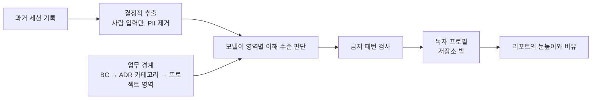

# ADR 0001: 과거 세션의 사용자 입력으로 독자 프로필을 만들어 리포트 눈높이를 정함

Date: 2026-11-12

## Status

Accepted (2026-11-12)

## Purpose

사용자는 리포트가 자신의 프로젝트 이해 수준에 맞춰 설명되기를 원한다. 프로젝트나 업무를 잘 모르는 영역에서는 용어를 풀어 쓰고 설명을 늘려야 한다. 이미 아는 내용이 있으면 그것을 출발점으로 비유해 설명해야 한다.

이를 위해 사용자가 과거 세션에서 직접 입력한 질문과 요청에서 영역별 이해 수준을 파악한다. 결과는 무엇을 알고 무엇을 잘 모르는지만 간결하게 적은 문서 하나로 관리하고, 리포트를 작성할 때 주제 영역의 눈높이를 정하는 데 쓴다. 이 문서에는 개인정보(PII)나 업무상 민감한 내용이 전혀 없어야 한다.

## Decision Drivers

- 리포트마다 같은 배경을 다시 묻지 않고, 주제 영역별로 설명 수준과 비유의 출발점을 정할 수 있어야 한다.
- 프로필에 PII나 업무 민감 정보가 남지 않아야 하며, 저장소를 통해 다른 사람에게 공유되지 않아야 한다.
- 세션 원문 전체가 아니라 사람이 직접 입력한 텍스트만 최소 범위로 읽어야 한다.
- 영역 구분은 프로젝트가 이미 기록한 업무 경계를 따라야 한다.

## Decision

리포트 작성 기능은 프로젝트마다 독자 프로필 문서를 하나 관리한다. 프로필은 현재 프로젝트에서 실행된 Claude Code·Codex 세션 중 사람이 직접 입력한 메시지만 결정적 추출 단계로 걸러 읽고, 개인정보로 보이는 문자열을 지운 최소 입력에서 만든다. 문서에는 영역별 설명 수준, 비유의 출발점이 될 아는 것, 풀어 써야 할 잘 모르는 것만 기록한다.

영역은 프로젝트가 기록한 업무 경계를 따른다. 비즈니스 온톨로지가 있고 그 조회 기능을 쓸 수 있으면 바운디드 컨텍스트(BC) 이름을 쓰고, 없으면 ADR 카테고리를, 그것도 없으면 저장소에서 드러나는 프로젝트 영역을 쓴다. 온톨로지 모델은 직접 읽지 않고 조회 결과의 BC 이름만 사용한다.

프로필은 저장소 밖의 사용자 영역에 저장해 커밋되거나 공유되지 않게 한다. 리포트를 쓸 때는 주제 영역의 항목을 읽어 눈높이와 비유를 정하되, 프로필 내용을 리포트에 드러내지 않는다.

### Requirement contract

#### 1. 입력 범위

- 현재 프로젝트의 저장소 루트와 그 워크트리에서 실행된 세션만 읽는다. Claude Code와 Codex 세션을 모두 대상으로 한다.
- 사람이 직접 입력한 메시지만 읽는다. 에이전트 응답, 도구 결과, 시스템·훅·플러그인이 주입한 지침, 작업 알림, 서브에이전트 세션과 자동 실행 세션의 입력은 제외한다.
- 모델에 전달하기 전에 추출 단계에서 이메일, URL, 파일 경로, IP 주소, 토큰·키로 보이는 문자열, 전화번호, 코드 블록을 지운다. 메시지마다 길이를, 전체적으로 메시지 수와 분량을 제한한다.
- 갱신할 때는 이전 갱신 이후의 메시지만 추가로 읽는다. 추출한 입력은 파일로 저장하지 않는다.
- 관찰 기준은 추출 결과에 에이전트 응답·도구 결과·주입 지침·서브에이전트 입력이 없고, 위 패턴의 문자열이 남지 않는 것이다.

#### 2. 프로필 내용

- 프로필은 전반 항목과 영역별 항목으로 구성한다. 각 항목은 설명 수준(`입문`·`중간`·`숙련` 중 하나), 아는 것(비유의 출발점으로 쓸 개념·경험), 잘 모르는 것(풀어 써야 할 용어·개념)만 담으며 영역마다 몇 줄 이내로 간결하게 쓴다.
- 사람·조직·고객의 이름, 연락처, 계정과 식별자, 비밀값, 내부 주소와 호스트, 금액·성과 같은 업무 수치, 장애·사건의 상세, 사용자 입력의 원문 인용, 성격·능력에 대한 평가를 기록하지 않는다. 판단의 근거가 된 메시지도 기록하지 않는다.
- 영역은 BC, ADR 카테고리, 프로젝트 영역 순서로 고른 업무 경계로 나누고, 어느 기준을 썼는지 기록한다. 비즈니스 온톨로지가 없지만 그 작성 기능을 쓸 수 있으면, 프로필을 만들기 전에 온톨로지를 먼저 구축해 BC 기준으로 만들지, 지금 기능 영역 기준으로 만들지 한 번 묻는다. 먼저 구축을 고르면 온톨로지 작성 기능의 절차와 승인을 거친 뒤 그 BC로 프로필을 만들며, 온톨로지 없이 BC를 추측하지 않는다. BC와 ADR 카테고리는 그 식별자를 영역의 키로 쓰고 표시 이름을 함께 적어, 이름이 바뀌어도 같은 영역으로 연결되게 한다. 근거가 부족한 영역은 만들지 않는다.
- 저장 전에 결정적 검사로 형식과 금지 패턴을 확인하고, 실패하면 고친 뒤에만 저장한다.

#### 3. 저장과 갱신

- 프로필은 저장소 밖의 사용자 영역에 프로젝트마다 한 파일로 저장하며, Claude Code와 Codex가 같은 파일을 쓴다. 저장소에 쓰거나 커밋하지 않는다. 마지막 갱신일을 기록한다.
- 사용자가 프로필 생성·갱신을 명시적으로 요청하면 만든다. 리포트를 작성할 때 현재 프로젝트의 프로필이 없거나, 마지막 갱신 후 3개월이 지났거나, 프로젝트에 비즈니스 온톨로지가 생겼는데 프로필 영역이 아직 BC 기준이 아니면 생성·갱신할지 한 번 묻는다. 사용자가 거절하면 같은 세션에서 다시 묻지 않고, 응답이 없으면 세션을 읽지 않는다. 답을 기다리는 동안 리포트와 무관한 작업은 계속한다.
- 사용자가 프로필의 삭제나 특정 항목의 수정을 요청하면 그대로 따른다.

#### 4. 리포트에서의 사용

- 리포트 주제가 속한 영역의 설명 수준, 아는 것, 잘 모르는 것을 읽어 설명의 출발점, 비유, 용어 풀이의 정도를 정한다. `입문` 영역은 용어를 처음 나올 때마다 풀어 쓰고 설명을 늘리며, `숙련` 영역은 아는 내용을 반복하지 않는다.
- 현재 요청에서 지정한 독자와 선호가 프로필보다 우선한다. 사용자가 아닌 다른 독자를 위한 리포트에는 사용자 프로필을 적용하지 않는다.
- 프로필 내용이나 독자의 수준 판단을 리포트 본문에 인용하거나 드러내지 않는다. 프로필에 없는 영역은 쉬운 직접 설명으로 작성한다.

### Alternatives

1. **리포트마다 독자에게 묻기**
   - 장점: 저장하는 정보가 없다.
   - 단점: 같은 질문이 반복되고, 사용자가 스스로 모르는 부분을 정확히 말하기 어렵다.
2. **세션 원문을 요약해 저장**
   - 장점: 더 많은 맥락을 쓸 수 있다.
   - 단점: 원문에 섞인 개인정보와 업무 정보가 요약에 남을 위험이 크고, 문서가 길어진다.
3. **사람 입력만 최소 추출한 영역별 프로필**
   - 장점: 필요한 판단만 짧게 남기고 금지 정보를 결정적으로 거를 수 있다.
   - 단점: 추출 규칙과 금지 패턴 검사를 세션 형식 변화에 맞춰 유지해야 한다.

세 번째를 채택한다. 저장 위치는 저장소 밖의 사용자 영역을 선택한다. 저장소 안에 두고 무시 목록에 올리면 프로젝트와 함께 보기 쉽지만, 실수로 커밋되면 개인의 이해 수준이 동료에게 공유된다.

## Consequences

- 리포트는 영역별로 설명 수준을 다르게 정할 수 있고, 같은 배경 질문을 반복하지 않는다.
- 프로필이 없거나 오래되면 리포트 작성 중에 한 번의 확인 질문이 생긴다.
- 세션 형식이 바뀌면 추출 규칙을 고쳐야 하며, 금지 패턴 검사는 모든 민감 정보를 보장하지 못하므로 모델의 작성 규칙과 함께 동작한다.
- 다른 컴퓨터나 다른 사용자에게는 프로필이 전달되지 않는다.

## Related

- [도메인별 확대 구조로 보고서를 제공](../domain-navigation/0001-domain-first-report-navigation.md) — 리포트의 출발 수준과 비유 선택에 이 프로필을 사용한다.
