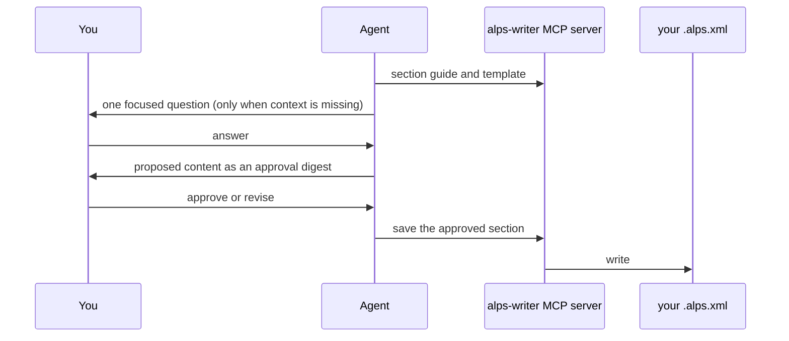

# alps-writer

Write a product requirements document (PRD) through conversation, in Codex or
Claude Code. The agent asks focused questions, proposes content for each section,
and saves only what you approve. Documents are XML files you own, with a
Markdown export.

ALPS (Agentic Lean Product Spec) comes in two formats:

| Format    | Sections                                                                                                                                               | Use it for                                   |
| --------- | ------------------------------------------------------------------------------------------------------------------------------------------------------ | -------------------------------------------- |
| Full ALPS | 1 Overview · 2 MVP goals and metrics · 3 Demo scenario · 4 Architecture · 5 Design · 6 Requirements · 7 Feature specs · 8 MVP metrics · 9 Out of scope | A product you will plan, then implement      |
| Lite ALPS | 1 Target user, problem and desired business impact · 2 Solution and essential user experiences · 3 Out of scope (optional) · 4 Demo scenario           | A minimum proof of concept (PoC) or a mockup |

In Full ALPS each feature is a vertical slice from UI to API to data, written for
a developer seeing it for the first time and ending with its demo checkpoint. In
Lite ALPS you give the problem and the business impact you want; the agent
proposes the solution, the experiences the PoC must not omit, and a demo that
shows all of them.

## Commands

| Command                          | What it does                                                                                    |
| -------------------------------- | ----------------------------------------------------------------------------------------------- |
| `/alps-init`                     | Start or resume a Full ALPS document                                                            |
| `/lite-alps-init`                | Start or resume a Lite ALPS document                                                            |
| `/alps-research <document-path>` | Find evidence for document items and flag factual errors, unsupported claims and contradictions |
| `/feature-to-adr`                | Hand each Full ALPS feature to one or more ADRs (needs [adr-writer](../adr-writer/README.md))   |

In Codex, use `$alps-init`, `$lite-alps-init` and so on, or ask in plain language.

## How a section gets written



Each section is explained, drafted and approved on its own. Nothing is saved
before you confirm it. A glossary is added only when terms need confirmed
definitions. When a document is complete, the agent offers an optional
deep-research review; skipping it leaves the document complete.

After handoff with `/feature-to-adr`, ADRs govern implementation and the PRD
remains a planning record. Re-import a changed PRD explicitly to propose ADR
updates.

## Install

Requires Bun 1.4.2 or later; the plugin ships its MCP server as a bundle.

```text
/plugin marketplace add haandol/alps-writer-plugins
/plugin install alps-writer@alps-writer
```

```bash
codex plugin marketplace add haandol/alps-writer-plugins
codex plugin add alps-writer@alps-writer
```

Documents go to `ALPS_OUTPUT_DIR` (default `<working directory>/prd/`). A
relative path given to a tool is resolved inside that directory. To use the same
server in another MCP client, see [MCP server](../../docs/mcp-server.md).
When calling the document tools directly, pass `doc_path` on every request; no
call selects a document for later ones.

## More

- [ALPS format guide](./templates/alps/about-alps.md)
- [Lite ALPS walkthrough](../../docs/usage.md#a-lite-alps--independent-poc-authoring)
- [Evidence research skill](./skills/alps-research/SKILL.md)

[MIT](../../LICENSE)
