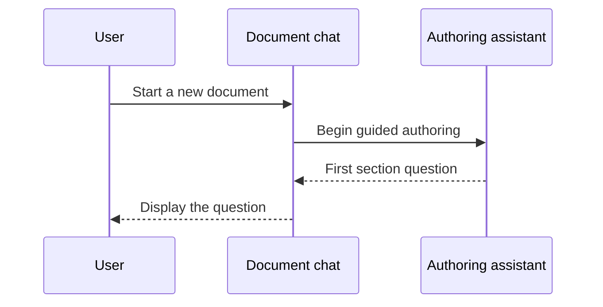

<section_guide number="6" title="Design Specification" references="5">
<purpose>Detail the UX, page flow, key pages, and user journey</purpose>

<required_review>
Section 5 (Requirements Summary) is authored right before this section, in the numeric authoring order.
Call alps_section(action: 'read', doc_path, section: 5), summarize its Feature IDs (F1, F2...), and reuse them in Key Pages.
If Section 5 is somehow still empty, author it first — its Feature IDs are prerequisites here. Do NOT invent ad-hoc Feature IDs.
</required_review>

<structure>
This section has ONE subsection, 6.1 "User Flow and Page Structure", with two nested parts:
- 6.1.1 "Key Pages (Features)" — save with subsection_id "1.1", title "Key Pages (Features)"
- 6.1.2 "Page Navigation" — save with subsection_id "1.2", title "Page Navigation"
</structure>

<questions>
1. What are the key pages (screens) the MVP must implement? (Use Feature IDs from Section 5.1 → 6.1.1)
2. What is the core functionality of each page? (→ 6.1.1)
3. How do users navigate between pages, and what are the key scenarios? (→ 6.1.2)
</questions>

<example>
### 6.1 User Flow and Page Structure

#### 6.1.1 Key Pages (Features)

- **F1: Chat Interface** — main screen where users converse with AI to write documents
- **F3: Document Download** — screen/action to export the completed document

#### 6.1.2 Page Navigation

1. The user opens the chat interface.
2. The user starts a new document → AI asks the first section's questions.
3. After all sections are complete → the download action becomes available.

</example>

<lite_source>
Apply this block only when the document records a Lite source (`alps_document(action: 'status', doc_path)` shows `Lite source:`). Read the source with `alps_section(action: 'read', doc_path: <the absolute path status reports as `Lite source path:`>, section: N)` and propose a converted draft instead of asking questions Lite already answered. Keep every Lite value, rule, permission, required flag and acceptance criterion; never add a business rule, value, permission or user-visible acceptance criterion without a Lite ID. A missing, conflicting or ambiguous business meaning becomes a Lite change proposal approved and saved in the Lite document; if the user declines, continue with the current Lite meaning. Mark converted content with `Source requirements:` and the Lite IDs it covers.

Read Lite Section 3.1. Derive pages and navigation from the FRs and name the FR IDs each page serves.
</lite_source>

<completion>Define key pages (6.1.1) and navigation flow (6.1.2), reusing Section 5.1 Feature IDs</completion>
</section_guide>
