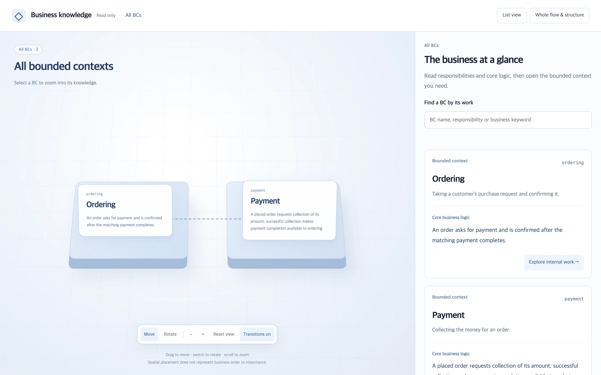
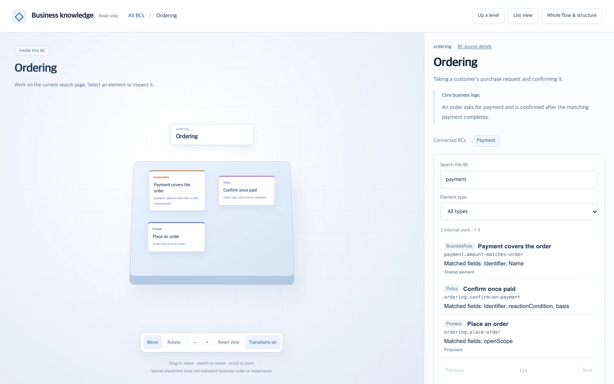
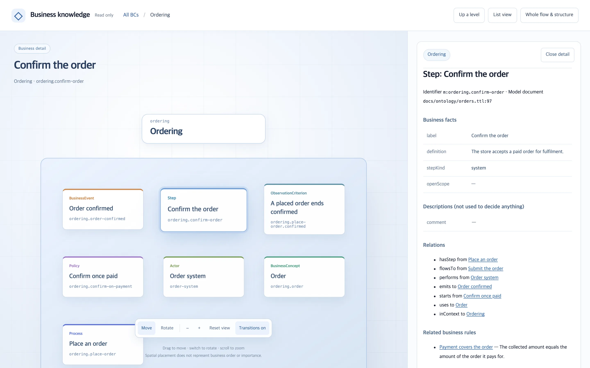
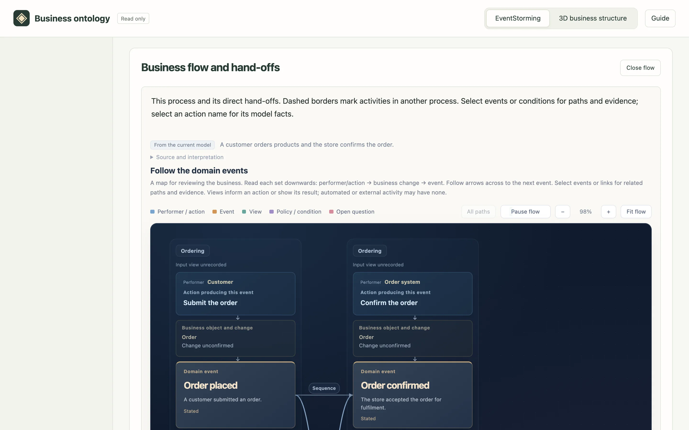
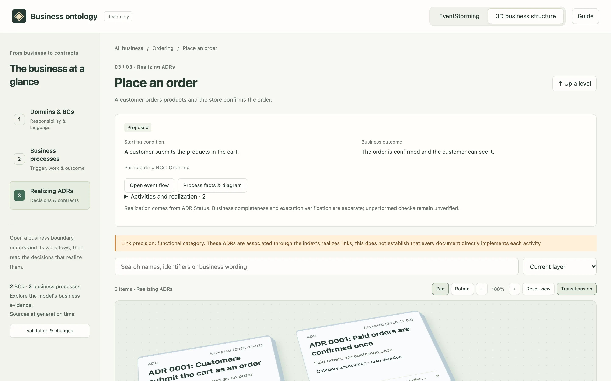

# ontology-writer

Keep a model of how your business flows — processes, steps, the events they emit,
the policies that react, and the rules that span features — so an agent changing
one feature does not break another. The model lives in Turtle files under
`docs/ontology/`, is checked mechanically, and links each step to the ADRs that
realize it. ADRs stay the only implementation authority.



## What you can do

| Goal                                                    | Command                                                                |
| ------------------------------------------------------- | ---------------------------------------------------------------------- |
| Build a model from documents, through EventStorming     | `/ontology-build [documents]`                                          |
| Change the business flow and cascade it to ADRs         | `/ontology-edit [change]`                                              |
| Check completeness, or reconcile direct Turtle edits    | `/ontology-sync [process]`                                             |
| Mark a process current once its features run end to end | `/ontology-align [process]`                                            |
| Browse the model                                        | `/ontology-view`                                                       |
| Ask before changing a feature                           | `bun scripts/ontology.mjs query --step <id>` (the agent does this too) |

Before an ADR decision or the code of a linked feature changes, the session
directive asks the agent to query the business context first.

## The saved view

`/ontology-view` writes one read-only HTML file and opens it. Explore the same
three layers in **EventStorming** or **3D business structure**:

1. Domain and bounded context (BC): responsibilities, language and collaborations.
2. Business process: its starting condition, activities and outcome.
3. Realizing functional ADR: the decision, Status and original contract.

The processes come from the business model. A functional ADR may support multiple
processes; category-level realization links are labeled with that precision.
The two representations keep the same scope, search, page and selection.





Open a selected process's event flow for its conditions, rules, branching and
external hand-offs. ADR inspection is the final abstraction layer.





Screenshots come from the [template model](./templates/ontology/example.ttl);
`bun run docs:screenshots` regenerates them.

## How it fits

Business ontology level above ADRs for Codex and Claude Code. A repository keeps one or more Turtle documents in `docs/ontology/` that describe how the business flows across features: processes and their steps, the events steps emit and the policies that react to them, actors, business rules that span steps, business concepts and terms, and observation criteria. The vocabulary is a closed RDFS-lite ontology, so a model built by an agent is checked mechanically and the same question gets the same answer. The model owns flows and relations; ADRs stay the only implementation authority and keep values, state machines and detailed conditions. Model-dependent checks stay inactive without model documents; an explicit build request can create the first model.

The aim is to capture real business workflows accurately and richly, so domain
logic reaches ADR contracts, code and tests. Ontology formalism and inference
are means, not completion goals. Build starts with evidence-based EventStorming:
a whole-scope event map, bounded contexts and subdomains grounded in that map,
then confirmed model facts. Additional sources use the same comparison and
approval path. These agent workflows are distinct from the deterministic CLI.

## Knowledge layers and retrieval

Construct ontology knowledge in layers. The upper layer contains BCs only:
their responsibilities, authored core business logic and declared collaborations.
The heavier layer holds each BC's internal workflows, connected by context
membership. Exact implementation contracts remain in ADRs.

```bash
bun scripts/ontology.mjs query --overview
bun scripts/ontology.mjs query --context ordering --search payment
bun scripts/ontology.mjs query --context ordering --limit 20 --offset 20
bun scripts/ontology.mjs query --step ordering.confirm-order
```

`--overview` reads the whole small BC layer by default. It never expands internal
events, steps, rules or ADRs; an optional `--limit` pages this layer too. Whole-model
Text search runs over the graph each query has just read from the current Turtle
files; it keeps no index or cache. Words match in any
order, quoted phrases require adjacency, and short Korean/substrings remain
searchable. Matches are ranked by identifiers, names and text relevance; inside
a BC they carry the matched fields and original source locations. The saved
HTML uses the same query and ranking rules in memory, without a database or
network request in the browser.

The source Turtle files and ADR index remain authoritative, and an edit shows in
the next query because nothing derived is stored. Validation, change flags and
mandatory detail relationships are still checked independently of ranking.
Use Bun 1.4.2 or later.

`--overview --search` returns BC candidates, then `--context --search` shows the
internal matches. Context responses page elements, relationships and diagnostics
together, with the exact continuation in `next`. Keep the model unchanged across
pages, and retain a custom `--adr-dir` in follow-up commands.

Record `coreLogic` and `collaboratesWith` in the model rather than generating an
upper summary on each query. Use `validate --require-layers` for construction,
or add `--layer-context <id>` for each BC in a scoped extension. The same flags
work with `impact` and `apply`; new BCs require the upper knowledge on save.
Legacy gaps stay readable and explicitly incomplete. Structural layer checks
do not prove business completeness. See [knowledge layers](./references/knowledge-layers.md).

This follows C4's knowledge resolutions and HNSW's idea of narrowing a search.
Queries remain local and deterministic; no HNSW index or embedding service is
required. Local graph parsing still reads the model, while the LLM receives
only the selected knowledge.

## Guides and examples

| Guide                                                            | What it explains                                                                                                        |
| ---------------------------------------------------------------- | ----------------------------------------------------------------------------------------------------------------------- |
| [How the ontology is created and used](./docs/workflow.md)       | Evidence, EventStorming, model approval, ADR/code use and readiness checks (Korean)                                     |
| [Order and payment walkthrough](./docs/order-payment-example.md) | A fictional source document, a runnable candidate board and Turtle model, and the contracts/tests still needed (Korean) |

The [example files](./examples/order-payment/) ship with this plugin. They are
learning material, separate from a project's actual ontology and ADR index.

## Install

**Codex**

```bash
codex plugin marketplace add haandol/alps-writer-plugins
codex plugin add ontology-writer@alps-writer
```

**Claude Code**

```text
/plugin marketplace add haandol/alps-writer-plugins
/plugin install ontology-writer@alps-writer
```

Install [`adr-writer`](../adr-writer) as well when the repository has ADRs. A model change that affects ADRs, an alignment review and the business-context checks of ADR work need both plugins.

## Slash commands

| Command                       | Role                                                                                                                                                                                                                                                                                              |
| ----------------------------- | ------------------------------------------------------------------------------------------------------------------------------------------------------------------------------------------------------------------------------------------------------------------------------------------------- |
| `/ontology-edit [change]`     | Change the business ontology (`docs/ontology/*.ttl`) from a request: one approval summary with the semantic diff, affected features, link changes, processes that become `Proposed` and each affected ADR's semantic diff, then cascade to ADRs, adr-writer's `/adr-impl` and an alignment review |
| `/ontology-sync [process]`    | Review completeness/readiness without mutation when requested, or reconcile direct Turtle edits and propose downstream changes                                                                                                                                                                    |
| `/ontology-align [process]`   | Make a process current only when its realizing features are implemented, compliance contracts are in place, nothing contradicts the model and every observation criterion passed by executing the features' real entry points                                                                     |
| `/ontology-build [documents]` | Capture workflows through an evidence-based event map, identify contexts/subdomains, then propose model facts with sources; save only confirmed scope                                                                                                                                             |
| `/ontology-view`              | Explore domain/BC → business process → realizing ADR in EventStorming or 3D, with shared navigation and scoped business evidence                                                                                                                                                                  |

## Completeness and the next workflow

The build's local question screen keeps option answers and free-text answers
exclusive: typing clears the selected option, and later updates preserve the
current draft. A separate discussion area lets the user ask the authoring agent
about the model or a specific review question and read the reply beside it.
Discussion does not submit candidate answers or approve model changes. It uses
the current agent's session, displays whether an agent is listening, and retains
questions and replies across reopening. Hosts that cannot wake the agent
automatically require notification in the main conversation; the screen explains
that handoff instead of starting another inference service.

Ask `/ontology-sync` to review completeness/readiness when you want a read-only
assessment of the actual business workflow. It reports business-model
sufficiency, ADR contract readiness and actual execution evidence separately,
including unknown scope. Use `/ontology-build` for additional information,
`/ontology-edit` for a requested change, the reconciliation path of
`/ontology-sync` for direct edits, and `/ontology-align` for execution evidence.
The read-only review is an agent workflow using existing commands, not a new
CLI flag. The viewer starts at the domain/BC layer. Selecting a BC reveals its
actual business processes; selecting a process reveals the functional ADRs that
realize its activities. This guides business responsibility boundaries through
ADR contracts into code organization, without deriving the business structure
from existing functional ADR categories or technical services.

EventStorming and 3D business structure share all three layers and preserve search,
paging, selection and return positions. Shared processes and ADRs retain identity;
external participation and unrecorded memberships are explicit. Move and zoom in
both views, rotate in 3D, and read details on a flat surface. Transitions can be
disabled and honor reduced motion. Internal scenes and diagrams are built on demand.
The existing `#all` address enters this common hierarchy. Reopening resets local
navigation state; the browser writes no persistent state.

The selected process's event board retains exact reactions, action order, rules
and open paths, with direct external hand-offs. A linked activity opens the same
model detail. Only indexed Markdown inside the real ADR root is included; missing
or unsafe document paths and Status inconsistencies stay visible.

Preview a current draft and its supplied business evidence without adoption:

```bash
bun scripts/ontology.mjs view --draft <draft-directory> \
  --mapping <draft-index.json> --board <business-board.json> --lang ko
```

Domain/subdomain memberships and classifications come only from that explicit
business evidence, preserving identities and source verdicts. The model vocabulary
is unchanged. Saved-model facts, unadopted candidates and unperformed reviews remain
distinct; a view never saves the model, index or ADRs.

The event flow places emitted events on a continuous trace with solid arrows;
action-only stages remain labeled intermediate actions. Connection labels open
the original policy, action, condition and evidence, while event selection
highlights upstream/downstream paths. Reaction paths and recorded action order
remain distinct, and no link is inferred from visual adjacency.

The event flow uses a readable front-facing canvas with restrained depth and
subtle directional strokes with a visible trail and playback/pause reasons.
Each set reads from performer/action through an evidenced object change to its
event, with sourced input/result views. Automated or external activity need not
have a human or UI. Motion can be paused, respects reduced motion and
stops while hidden or out of view. It illustrates recorded event reactions, not
live traffic or sequence-only relations. Candidate boards can show source-backed
changes, business areas and views before a model exists, alongside complete source
cards; see `references/eventstorming-board.md`. The saved vocabulary has no Domain,
Subdomain or View types, so a model-only reconstruction leaves them unconfirmed.
Unknown changes and unperformed
reviews remain explicit.

## Business ontology

Skill entrypoints keep task routing and approval boundaries close to the request.
Candidate review, confirmed saves, direct-edit history and extra viewing evidence
live in the relevant skill's `references/` and are read at that stage. Edit,
build and sync share [change meaning](./references/change-meaning.md) and the
[approved change unit](./references/change-unit.md), so changes to save and
cascade rules have one owner. The shared report-writer skill remains generated
from the workspace's canonical report guidance.

Model documents use the closed vocabulary in `templates/ontology/vocabulary.ttl`; `templates/ontology/example.ttl` shows a small model. The model owns business flows, event hand-offs, policies, cross-step rules and business terms. The rules are in `references/ontology.md`; the deterministic commands are `bun scripts/ontology.mjs <command>` with `validate`, `format`, `diff`, `query`, `impact`, `apply`, `transition`, `align`, `lifecycle`, `changes` and `view`, documented at the top of the script. `validate` also checks the ADR index's `realizes` links against the model.

## Working with adr-writer

- The ADR index, `docs/adr/.mapping.json`, belongs to adr-writer. A category's `realizes` list is the only link between a feature and the steps it realizes: this plugin writes those links in the same change unit as the model and validates them, and adr-writer checks only their shape and moves them when categories split or merge.
- A model change that affects ADRs needs adr-writer: the ADR revisions in its approval summary follow `/adr-new`'s draft rules, and `/adr-impl` implements them. Without adr-writer such a change stops before the approval summary; a change that affects no ADR is saved by this plugin alone.
- With a model present, adr-writer's session directive adds one line saying that business context is checked through this plugin. Without this plugin, ADR work states that the business context was not checked.
- This plugin carries copies of the adr-writer scripts it runs — reading the ADR index and ADR Status, recording a Status transition, opening a report — and of the shared report-writer skill. Edit the originals; `bun run shared-scripts:sync` and `bun run report-skill:sync` refresh the copies, and CI fails on a stale one.

## Hook

| Hook           | When it fires                          | Role                                                                                                                                                                 |
| -------------- | -------------------------------------- | -------------------------------------------------------------------------------------------------------------------------------------------------------------------- |
| `SessionStart` | Startup, resume, clear, and compaction | With an ADR index and a business ontology, ask for the business-context query before an ADR decision or contract changes and before code of a linked feature changes |

The directive names the query command and renders neither the model nor the index. Claude Code discovers `hooks/hooks.json` automatically; Codex registers the same file through its manifest.

## Report writing

The skills' human-facing reports follow the bundled `report-writer` skill, the same one adr-writer ships.

## License

[MIT](../../LICENSE)
