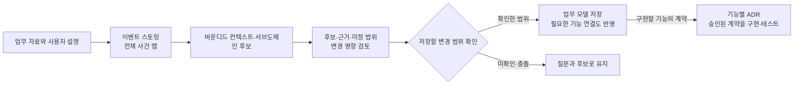
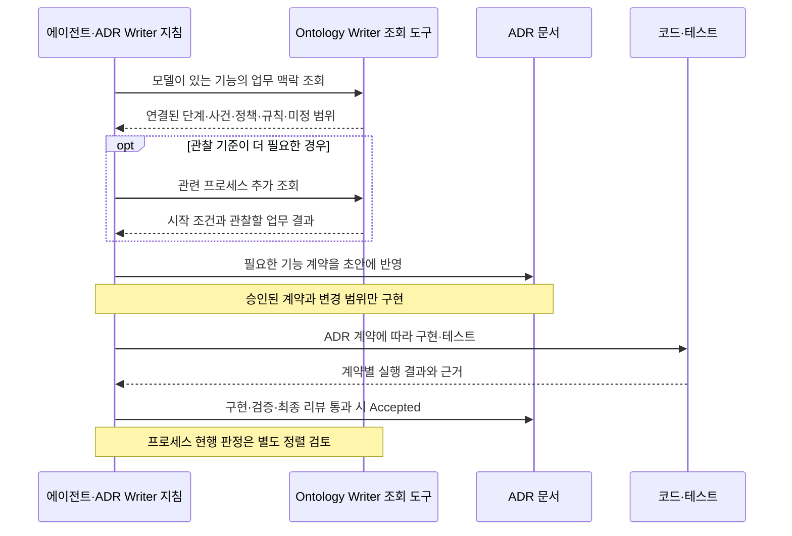

# 온톨로지는 어떻게 만들어지고 사용되는가

## 목표

ALPS Writer Plugins에서 업무 온톨로지를 만드는 순서와 개발에 사용하는 방법을 설명한다. 어떤 내용을 모델에 남기고, 언제 ADR(아키텍처 결정 기록)의 계약으로 확정하며, 무엇을 확인해야 업무가 구현되었다고 판단할 수 있는지 구별할 수 있게 한다.

## 배경

코드와 개별 ADR만으로는 여러 기능에 걸친 실제 업무를 파악하기 어렵다. 누가 일을 시작하고, 어떤 사건이 다음 업무를 촉발하며, 어느 조직이나 시스템에 일을 넘기는지, 실패하면 어떤 경로가 필요한지 별도의 업무 맥락이 필요하다.

여기서 온톨로지는 그 **업무 개념·사건·규칙과 관계를 저장한 모델**이다. 목표는 실제 업무 흐름을 정확하고 풍부하게 포착해 DDD, 즉 업무의 용어와 규칙을 중심으로 설계하는 접근이 ADR과 코드·테스트까지 이어지게 하는 것이다. 온톨로지의 형식적 완성도나 추론 능력 자체가 완료 목표는 아니다.

> 현재 흐름은 **자료와 설명 → 이벤트 스토밍 → 책임 경계 식별 → 확인한 모델 저장 → ADR 계약 → 구현·테스트 → 정렬 검토**다. 자료 해석과 업무 판단은 에이전트가 스킬 지침에 따라 수행하고, 명령줄 도구(CLI)는 구조 검증·조회·의미 차이·변경 영향 등을 계산한다. CLI 통과만으로 실제 업무의 완전성이 증명되지는 않는다.

이 문서의 `docs/ontology/`와 `docs/adr/`는 플러그인을 사용하는 프로젝트의 기본 경로다. 플러그인에 포함된 예제가 사용자의 업무 모델로 자동 저장되지는 않는다.

파일과 실행 명령을 함께 따라가려면 [주문·결제 예제](./order-payment-example.md)를 읽는다. 입력 자료, 후보 보드, 저장 모델과 ADR·테스트로 넘길 항목을 같은 업무로 비교한다.

<a id="ownership"></a>

## 1. 업무 맥락과 구현 계약의 역할

온톨로지는 기능 사이의 업무를 설명하고, ADR은 각 기능이 지켜야 할 구현 계약을 소유한다. 개발자는 온톨로지의 관계를 바로 코드의 새 의무로 삼지 않고, 필요한 내용을 ADR의 승인된 계약으로 구체화한다.

### 각 레벨이 답하는 질문

| 레벨                         | 답하는 질문                                          | 보존하는 내용                                                                           |
| ---------------------------- | ---------------------------------------------------- | --------------------------------------------------------------------------------------- |
| ALPS PRD(제품 요구사항 문서) | 무엇을, 왜 만들려는가?                               | 사용자 문제, 제품 목표와 기획상의 요구                                                  |
| 업무 온톨로지                | 실제 업무가 기능 사이에서 어떻게 이어지는가?         | 시작과 결과, 행위자, 사건·반응 정책, 기능 사이의 규칙, 업무 개념과 책임 경계, 관찰 기준 |
| ADR                          | 각 기능은 어떤 결정과 계약으로 그 업무를 실현하는가? | 아키텍처 결정과 이유, 정확한 값·상태·권한·조건, 거절·실패 보장과 검증 기준              |
| 코드·테스트                  | 그 계약을 어떻게 구현하고 확인하는가?                | 구현 구조, 식별자, 의존성, 실행 가능한 검증과 실제 결과                                 |

예를 들어 “환불 기간은 배송 완료일부터 계산한다”는 기능 사이의 의미를 모델에 남길 수 있다. 그 기간을 30일로 정했다면 정확한 값은 해당 ADR의 요구사항 계약에 보존한다. 모델이 상세 값을 담지 않는다고 요구사항을 버리는 것은 아니다.

업무 사건을 모델에 기록했다고 해서 모두 메시지로 전송해야 하는 것은 아니다. 전달 방식과 일관성 보장 등 구현을 좌우하는 결정은 ADR에서 정한다.

### 어디에 무엇을 저장하는가

프로젝트의 `docs/ontology/` 아래에 있는 모든 `.ttl` 문서를 합친 그래프가 하나의 모델이다. Turtle(`.ttl`)은 대상과 관계로 사실을 표현하는 RDF의 텍스트 형식이다. Ontology Writer는 정해진 업무 요소·관계만 허용하는 어휘로 이를 검증한다. 프로세스 목록과 Status도 모델 속성이며 별도 온톨로지 색인을 만들지 않는다.

기능과 업무 단계의 연결은 ADR 색인인 `docs/adr/.mapping.json`의 `realizes`에만 둔다. 예를 들어 `ordering/checkout` 기능의 `realizes`에 `ordering.submit-order`가 있으면, 그 기능이 모델의 주문 접수 단계를 실현한다는 뜻이다. **이 연결이 있다는 사실만으로 구현이나 검증이 완료된 것은 아니다.**

모델에는 ADR 경로·번호·카테고리 키를 넣지 않고, 업무 단계를 실현하는 ADR 본문에도 모델 파일 경로나 요소 ID를 넣지 않는다. ADR은 구현에 필요한 업무 의미와 계약을 자체적으로 읽을 수 있게 작성한다. 검색한 코드 위치와 조회 결과를 별도의 영구 매핑으로 보관하지 않는다.

규칙과 정책의 근거 종류·짧은 근거 문장은 모델에 남긴다. 원문 인용, 입력 파일·페이지 위치, 후보별 출처 판정, 미채택 후보와 검토 결과는 `.adr-review/`의 일회성 자료에 둔다. 따라서 저장 모델을 다시 시각화해도 원래 워크숍의 모든 출처와 후보 이력이 복원되지는 않는다.

### 언제 이 레벨을 사용하는가

온톨로지는 선택 사항이다. 모델을 만들거나 읽는 데는 Ontology Writer를 사용하고, 모델을 ADR·코드로 연결하는 작업에는 ADR Writer도 필요하다. ALPS Writer는 PRD를 작성할 때 사용하는 별도 플러그인이며 온톨로지의 필수 선행 단계는 아니다.

모델이 없는 프로젝트에서는 ADR 작업에 온톨로지 절차를 추가하지 않는다. 기존 ADR과 코드가 있는 프로젝트에도 나중에 모델을 도입할 수 있지만, 코드에서 관찰한 동작을 곧바로 의도된 업무 정책으로 확정하지는 않는다.

근거: [모델의 소유 범위와 저장 규칙](../references/ontology.md), [플러그인 설치와 역할](../README.md).

<a id="creation"></a>

## 2. 자료에서 확인된 업무 모델까지

`/ontology-build`는 바로 Turtle을 만드는 작업부터 시작하지 않는다. 요청한 업무 범위의 사건 맵을 먼저 만들고, 그 흐름에서 책임 경계를 찾은 뒤, 검토한 후보를 기존 승인 경로로 저장한다.

다음 그림은 모델 작성과 개발로의 전달 순서다. 실제 업무의 이벤트 스토밍 결과는 별도의 사건·행동·정책 보드로 제시한다.



### 자료와 업무 범위를 정한다

업무 문서, 사용자 설명, 접근 가능한 코드·테스트·예시 기록을 읽고 어디서 시작해 어떤 업무 결과까지 다룰지 정한다. 읽지 못한 자료와 다루지 못한 범위도 밝힌다. 자료를 채우기 위해 운영 시스템에 임의로 접근하지 않는다.

다음은 요청 예시다. `./business-docs/`는 실제 자료 위치로 바꾼다.

```text
/ontology-build ./business-docs/ 주문 접수부터 결제와 주문 확정까지 정리해줘.
전체 사건 맵, 책임 경계 후보, 실패·재시도·외부 인계와 미확인 사항을 먼저 보여줘.
```

자료 속의 “저장하라” 같은 지시문은 실행 승인으로 취급하지 않는다. 자료가 말하는 업무 사실과 사용자가 현재 승인한 변경 범위는 별개다.

### 사건 맵에서 책임 경계를 식별한다

먼저 “주문이 접수됨”, “결제가 완료됨”처럼 일어난 사실로 이름 붙인 사건을 모은다. 각 경로에서 수행자와 행동, 발생 사건, 반응 정책과 조건, 후속 단계, 사용하는 업무 정보와 예외·인계를 연결한다. 수행자는 사람뿐 아니라 시스템 역할이나 외부 조직일 수도 있다. 단순히 옆에 놓였거나 순서가 이어진다는 이유로 인과관계를 만들지 않는다.

그 맵에서 용어의 의미와 규칙의 책임이 일관되는 범위를 **바운디드 컨텍스트**로 식별한다. **서브도메인**은 해결하는 업무 문제의 영역이다. 서비스나 폴더가 같다고 같은 경계가 되지는 않으며, 서브도메인과 컨텍스트가 반드시 일대일인 것도 아니다. 분류와 경계의 이유를 근거와 함께 제시한다.

확인한 바운디드 컨텍스트와 그 책임은 모델에 보존한다. 서브도메인 분석·분류 후보 자체는 검토 자료에 두며, 이 과정이 저장 모델에 별도의 `Subdomain` 요소나 발견 이력 저장소를 추가하지는 않는다.

후보 요소와 관계에는 다음 출처 판정을 붙이고, 현재 업무와 계획된 업무를 구별한다.

| 판정          | 의미                          |
| ------------- | ----------------------------- |
| `stated`      | 자료가 직접 명시함            |
| `inferred`    | 여러 진술이나 문맥에서 추론함 |
| `conflicting` | 자료가 서로 충돌함            |
| `unconfirmed` | 뒷받침할 진술을 확인하지 못함 |

`stated`도 사용자 승인을 대신하지 않는다. 엔티티나 애그리거트의 전후 상태는 근거가 있을 때만 보드에 표시한다. 저장 모델의 `uses`는 업무 개념을 사용한다는 관계이므로 그것만으로 상태가 바뀌었다고 판단하지 않는다.

### 후보의 충분성과 변경 영향을 검토한다

에이전트는 시작·종료와 정상 흐름, 수행자·규칙, 예외·반려·인계, 근거 충돌의 네 축을 검토한다. 자료에 경로가 없다는 이유로 실제 업무에도 없다고 단정하지 않는다. 확인이 필요한 경로는 질문으로 남기고, 저장할 범위에서 합의한 누락은 프로세스나 단계의 `openScope`에 반영한다. 근거 충돌 자체는 검토 질문으로 다룬다.

기존 모델이 있으면 전체 모델을 기준으로 초안을 만들고 의미 차이와 영향받는 기능·ADR을 계산한다. 표현 차이가 업무 의미의 변경인지 에이전트가 판단하며 CLI의 문자열 차이만으로 확정하지 않는다. 저장된 사실의 문구를 바꾸면서 같은 의미로 처리하려는 경우에는 사용자 확인을 받는다. 새 자료에 나오지 않은 기존 요소를 삭제 후보로 만들지 않는다. 의미가 같은 자료를 다시 읽었다면 불필요한 모델 변경을 만들지 않는다.

상태 기계, 정확한 수치, 한 단계 내부의 권한·실패 처리처럼 모델 해상도를 넘는 내용은 출처와 함께 별도로 식별하고 필요한 ADR 후보로 넘긴다. 발견용 보드에 표시할 수 있는 정보와 저장 모델에 영구 보관하는 정보의 범위는 다르다.

### 확인한 변경을 저장하고 하위 작업으로 넘긴다

모델 변경, 기능 연결, 영향받는 ADR의 개정 내용과 새로 `Proposed`가 되는 프로세스 등을 하나의 승인 요약에서 확인한다. 이미 확인한 사실을 반복해서 묻지 않고, 이 요약에 포함해 승인한 ADR 개정도 같은 내용으로 재승인하지 않는다. 확인되지 않은 후보나 해결되지 않은 충돌은 승인된 사실처럼 저장하지 않는다.

저장 도구는 검토 이후 모델·색인·초안·관련 ADR 등이 바뀌었는지 검사한다. 바뀌었다면 이전 비교를 그대로 적용하지 않고 달라진 범위를 다시 제시한다. 모델·색인·용어집 등 도구가 함께 쓰는 변경 단위는 쓰기 실패 시 복원하고, 승인한 ADR 개정과 구현은 이후 순서로 진행한다. 모델부터 코드까지 전부를 한 번의 트랜잭션으로 저장하는 구조는 아니다.

새 프로세스는 `Proposed`로 저장한다. 이는 확인한 목표 업무이며, 실제 기능과 정렬되어 현행 업무로 판정된 `Accepted`와 다르다. 영향을 받는 ADR은 선행 의존성 순서로 구현하고, 마지막 ADR이 완료되면 정렬 검토로 이어진다. 도중에 실패하면 완료한 범위와 남은 범위를 나누어 보고한다.

근거: [이벤트 스토밍 절차](../references/eventstorming.md), [모델 구축](../skills/ontology-build/SKILL.md), [변경 승인·저장·전파](../skills/ontology-edit/SKILL.md).

<a id="development"></a>

## 3. ADR·코드·테스트에서 사용하는 방법

온톨로지는 개발할 기능이 업무 전체에서 맡은 역할을 알려준다. 그 맥락을 승인된 ADR 계약으로 구체화한 뒤 코드와 테스트를 만든다. **구현 완료 판정은 ADR 계약을 기준으로 하고, 업무 모델과의 정렬 판정은 별도로 보고한다.**

### 필요한 업무 맥락만 조회한다

ADR 색인과 모델이 있는 프로젝트에서는 세션 시작 시 업무 맥락 조회 지침을 제공한다. 훅이 모델 전체를 대화에 넣거나 업무를 자동 실행하는 것은 아니다. 에이전트가 대상 기능의 작업에 필요한 시점에 조회 도구를 사용한다.

ADR Writer는 Turtle 모델을 직접 읽지 않는다. Ontology Writer의 `query --category`로 실현 단계와 주변 단계, 입력·출력 사건, 반응 정책, 관련 규칙·근거와 미정 범위를 얻는다. 관찰 기준이 더 필요하면 관련 프로세스를 추가 조회한다. 조회 결과는 영구 기록으로 남기지 않는다.

연결되지 않은 기능은 기존 단계의 실현 후보인지, 새 업무 단계가 필요한지, 업무 흐름과 무관한지를 판단해 확인한다. 사용자가 연결하지 않기로 확인한 기능만 `realizes: []`로 기록한다. Ontology Writer를 사용할 수 없어 조회하지 못했다면 그 사실을 밝히고 진행하며, 조회 불가만으로 모든 ADR 작업을 막지는 않는다.

다음은 조회 가능한 모델이 있는 프로젝트에서 새 ADR을 작성해 구현할 때, 에이전트가 ADR Writer 지침과 Ontology Writer 조회 도구를 사용하는 순서다. 이미 승인된 ADR의 구현이나 읽기 전용 리뷰는 필요한 단계를 사용하며 계약 승인을 반복하지 않는다.



### 업무 관계를 기능의 준수 계약으로 구체화한다

`/adr-new`에서는 업무의 시작 조건, 수행자, 사건 인계, 결과와 예외를 해당 기능의 계약으로 옮긴다. 여기서 **준수 계약**은 그 관계를 실현하려면 기능이 어떤 입력을 받아 어떤 사건을 내보내고, 무엇을 거절하며 실패를 어떻게 처리해야 하는지 적은 ADR 요구사항이다. 모델 문장을 복사하는 것으로 끝내지 않는다.

`/adr-impl`은 그 승인된 계약을 정상·예외 시나리오와 테스트에 연결한다. 모델에서 새 의무를 발견했더라도 승인되지 않은 요구사항을 코드나 테스트의 새 통과 조건으로 조용히 추가하지 않는다.

`/adr-impl-review`는 ADR 계약에 대한 구현·테스트의 충족 여부를 검토한다. 모델에만 있는 의무가 ADR에 빠졌다면 모델과 ADR의 정렬 문제로 보고하고, 승인된 ADR 계약을 구현하지 못했다면 구현 문제로 판정한다. 모델을 바꿔야 해결되는 계약은 상위 변경 제안으로 넘기고, 그 변경에 의존하는 미확정 행은 보류한다.

### 주문·결제 예제에서 연결을 읽는다

[저장소의 예제 모델](../templates/ontology/example.ttl)에는 “결제 완료 사건이 해당 주문의 결제일 때 주문 확정을 시작한다”는 정책이 있다. 이 정책을 실현하는 ADR에는 어떤 결제 결과를 받아 어떤 주문을 확정할 수 있는지, 맞지 않는 입력을 어떻게 다룰지 기능 수준의 계약이 필요하다. 인계 양쪽의 기능이 필요한 계약을 각각 갖추었는지도 확인한다.

그 계약을 승인해 구현한다면, 테스트는 대상 주문의 결제와 다른 주문의 결제를 구별해 계약대로 처리되는지 관찰해야 한다. 예제에서 미정으로 남긴 결제 실패·재시도 경로를 임의의 취소 정책으로 채워서는 안 된다. 추가 업무 정보를 확인하고 해당 계약을 먼저 확정한다.

### 화면에서 흐름과 근거를 찾는다

`/ontology-view`는 현재 모델과 ADR 색인으로 읽기 전용 HTML을 만든다. **사건 흐름**에서는 사건을 중심으로 수행자·행동·정책·조건·관련 규칙과 미정 질문을 읽고, **업무 구조**에서는 컨텍스트 구역·프로세스·단계와 인계를 3D로 탐색한다. 사건을 선택하면 원문에 연결된 상류·하류 경로가 강조되고, 선의 표시를 선택하면 정책·행동·조건과 근거를 확인한다. 사건이 없는 단계는 중간 행동으로 표시하며, 순서 연결을 사건의 인과로 바꾸지는 않는다. 사건 상세에서 같은 모델 단계로 이동할 수 있다.

위치·카메라·선택은 열린 화면 안에서만 유지한다. 움직이는 신호는 기록된 사건 관계의 방향이며 실제 통신이나 처리 성공을 뜻하지 않는다. 모델에 없는 전후 상태는 미확인으로 남는다. 구축 중 후보 보드는 저장 모델 없이도 열 수 있지만, 모델이 없는 프로젝트에 `/ontology-view`를 실행하면 모델이 없음을 알린다.

사건 흐름 안의 **전체 업무 영역**에서는 도메인·서브도메인·컨텍스트의 소속을 읽고, 컨텍스트의 활동을 선택해 개별 사건으로
돌아간다. 각 활동은 주체·행동에서 확인된 업무 변화와 발생 사건으로 이어진다. 자료에 있는 뷰는 행동에 참고하는 입력과
결과 확인 역할로 구별하며, 시스템·시간·외부 활동에 사람이나 화면을 강제하지 않는다. 흐름 효과의 상태 문구는 재생 여부와
사용자 정지·모션 감소·화면 숨김·재생할 연결 없음 등을 알려준다.

서브도메인 소속·분류와 뷰는 저장 모델의 어휘에 없는 정보다. 이 정보를 보려면 추가 자료를 반영한 후보 보드를 사용하며,
저장 모델만으로 만든 화면에서는 미확인으로 남긴다. 소속은 명시한 식별자를 사용하고, 복수 소속 컨텍스트는 한 번만 표시한다.
외부 수행자가 있다는 이유로 외부 컨텍스트를 만들거나, 같은 이름이라는 이유로 컨텍스트와 서브도메인을 합치지 않는다.

근거: [ADR 작업의 업무 맥락 사용 규칙](https://github.com/haandol/alps-writer-plugins/blob/main/plugins/adr-writer/references/business-context.md), [세션 지침 훅](../hooks/surface-business-context.mjs), [모델 보기](../skills/ontology-view/SKILL.md).

<a id="maintenance"></a>

## 4. 갱신과 준비 상태 점검

추가 자료 반영, 업무 변경, 읽기 전용 검토와 실제 실행 검증은 서로 다른 요청이다. 부족한 부분을 발견했다고 해서 모델을 저장하거나 실행 검증까지 자동으로 진행하지 않는다.

### 요청에 맞는 경로를 선택한다

| 하고 싶은 일                                     | 시작할 작업                                                         | 결과와 변경 범위                                                           |
| ------------------------------------------------ | ------------------------------------------------------------------- | -------------------------------------------------------------------------- |
| 새 모델을 만들거나 추가 자료로 보완              | `/ontology-build`                                                   | 사건 맵·경계·모델 후보를 기존 자료와 비교하고 확인한 변경만 저장           |
| 업무를 변경하거나 직접 수정한 모델을 반영        | 자연어 변경은 `/ontology-edit`, Turtle 직접 수정은 `/ontology-sync` | 변경 의미와 영향을 검토하고 승인한 ADR·코드 전파로 연결                    |
| 완전성과 개발·테스트 준비 상태를 확인            | `/ontology-sync`에 **읽기 전용 완전성·준비 상태 검토**를 명시       | 모델·ADR·실행 근거를 따로 판단하며 파일과 Status를 바꾸지 않음             |
| 실제 기능들이 업무 결과까지 함께 동작하는지 확인 | `/ontology-align`                                                   | 선행 조건과 계약을 확인하고 실제 진입점을 실행해 프로세스 현행 여부를 판정 |

읽기 전용 준비 상태 검토는 에이전트의 작업 경로다. 별도의 `--readiness` 같은 CLI 플래그가 생긴 것은 아니다. 요청 예시는 다음과 같다. 프로세스 ID는 실제 모델의 대상으로 바꾼다.

```text
/ontology-sync ordering.place-order 완전성과 준비 상태를 읽기 전용으로 검토해줘.
업무 모델, ADR 계약, 실제 실행 근거를 구별하고 파일과 Status는 바꾸지 마.
```

### 세 가지 판정을 구별한다

| 판정                      | 확인할 내용                                                     | 그것만으로 충분하지 않은 근거                          |
| ------------------------- | --------------------------------------------------------------- | ------------------------------------------------------ |
| 업무 모델이 충분한가?     | 시작·결과와 정상 흐름, 수행자·규칙, 예외·인계, 근거 충돌        | 구조 검증 통과, `openScope: none` 선언                 |
| ADR 계약이 준비되었는가?  | 실현 기능 연결, 인계 양쪽의 준수 계약, 미정 의무·모순·선행 조건 | `realizes` 링크가 존재한다는 사실                      |
| 실제 실행으로 확인했는가? | 관찰 기준과 실제 기능 진입점의 실행 결과                        | ADR의 `Accepted`, 구현 리뷰 `PASS`, 기계적인 정렬 계획 |

읽기 전용 검토는 바뀌지 않은 프로세스도 요청 범위에 포함해 살펴본다. 자료나 이력이 부족하면 미확인으로 남긴다. 구조가 유효하거나 모델이 미정 범위가 없다고 선언했다는 이유로 전체 업무의 완전성을 확정하지 않는다.

`Proposed` ADR도 승인된 계약이 충분히 명확하면 구현을 시작할 준비가 될 수 있다. 다만 아직 구현 완료 상태는 아니므로, 별도의 실행·정렬 선행 조건을 충족한 것으로 간주하지 않는다.

### 구현됨과 프로세스 Accepted의 차이

화면의 “구현됨”은 실현 기능마다 `Accepted` ADR이 하나 이상 있고 `Proposed` ADR이 없을 때 계산하는 표시다. 은퇴한 ADR(`Deprecated`, `Superseded`)은 그 판정에서 제외하며, 색인·ADR 상태를 신뢰할 수 없으면 미확인으로 표시한다. 이 표시는 전체 업무 실행을 직접 관찰한 결과가 아니다.

`/ontology-align`은 모델·기능 연결과 실현 ADR의 상태, 인계 양쪽·정책·규칙의 준수 계약, 모델과의 모순을 확인한다. 이어 각 관찰 기준에 대해 실행할 시스템 단계와 실제 진입점을 정하고, 시작 조건을 만들어 업무 결과까지 실행한다. 외부 조직·시스템의 대체는 명시할 수 있지만, 실현 기능 자체를 대체하거나 필요한 단계를 건너뛴 결과는 검증 완료로 인정하지 않는다.

이 조건과 관찰 기준을 모두 충족한 `Proposed` 프로세스만 `Accepted`로 전환한다. CLI의 `align`은 기계적인 계획을 만드는 명령이고, 스킬 `/ontology-align`이 수행하는 실제 실행·의미 검토 전체를 대신하지 않는다. `Proposed` 프로세스의 검토가 실패하거나 일부만 실행됐다면 남은 범위를 밝히고 `Proposed`를 유지한다.

`Accepted`도 업무 전체의 미정 범위가 모두 사라졌다는 뜻은 아니다. 모델의 충분성, ADR 준비 상태와 실제 실행 판정을 계속 구별해서 읽는다.

### 모델 변경은 다시 검토 경로로 돌아온다

업무 구성의 의미가 바뀐 프로세스는 다시 `Proposed`가 되어 필요한 ADR 개정·구현·정렬 검토를 거친다. 의미가 같은 문구나 미정 범위만 바뀐 경우에는 확인과 갱신 조건을 따로 판단하므로, 파일을 수정했다는 이유만으로 무조건 Status를 내리지 않는다.

모델이 그대로인데 ADR이나 코드 쪽에서 어긋난 문제가 생겼다면 하위 레벨의 정렬 문제로 다룬다. 모델을 코드에 맞춰 자동 수정하지 않는다. 직접 편집과 과거 승인 여부를 이력에서 확인할 수 없으면 그 한계도 미확인으로 보고한다. 검토 결과나 승인 상태를 별도 영구 레지스트리로 만들지 않는다.

근거: [준비 상태 검토](../references/workflow-readiness.md), [직접 수정의 동기화](../skills/ontology-sync/SKILL.md), [실행 정렬 검토](../skills/ontology-align/SKILL.md).
